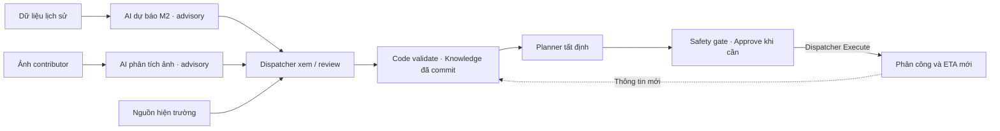
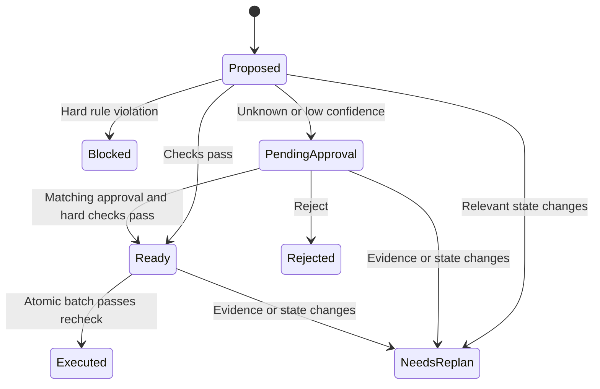
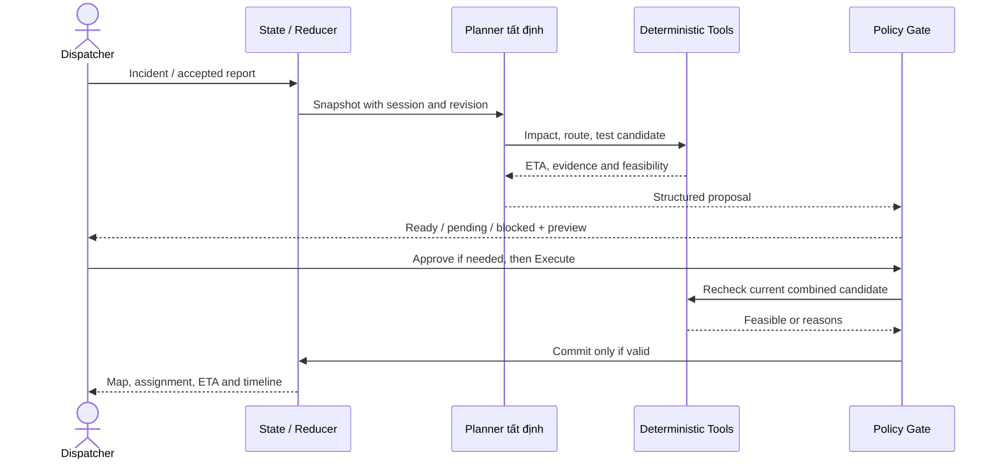
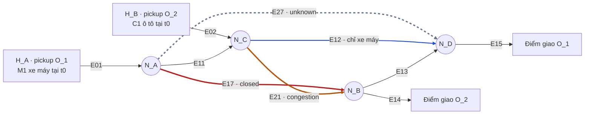
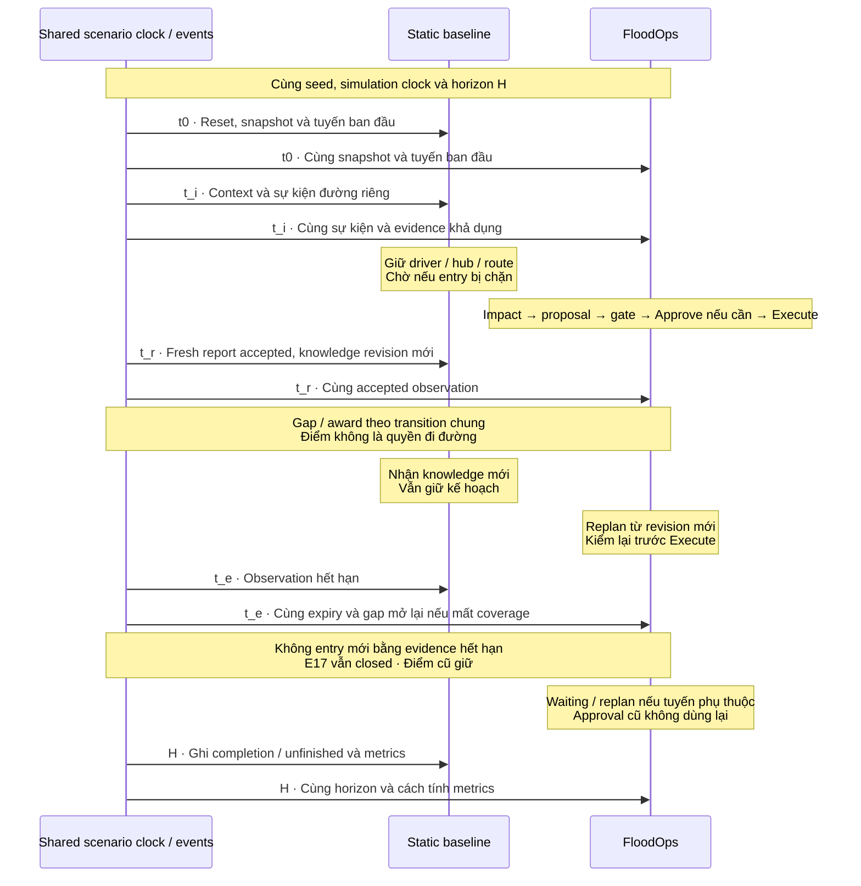
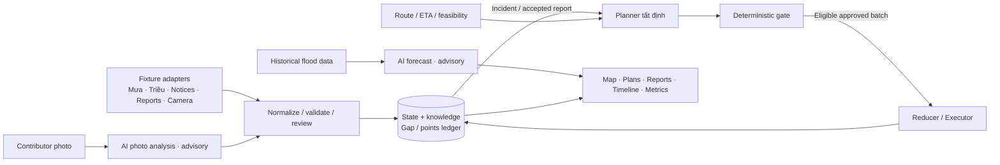

# FloodOps — Product Requirements Document (PRD)

| Thuộc tính | Giá trị |
|---|---|
| Phiên bản | v0.5 — AM-M01 + AM-C02, cập nhật 2026-10-31 |
| Owner | Team Gay Hackers (Hung, Kai, Long, Thiên Ân) |
| Mục tiêu | M1: web demo trong một vùng nhỏ TP.HCM; 7 giờ là timebox hackathon, không cam kết hoàn tất toàn bộ roadmap. |
| Tài liệu triển khai | File này chứa phạm vi, dữ liệu, quy tắc, luồng và nghiệm thu. Mục 3.3/3.4 xác định milestones; nền tảng roadmap tham chiếu [implementation plan](../plans/20261030-2249-floodops-web-mobile-implementation/plan.md); link ngoài chỉ là bằng chứng / tài liệu nguồn. |
| Nguồn hợp nhất | floodops-prd@b30b808 + long-prd@7a9f3b3 + docs/hung-floodops-prd-revision@6b46e40; [đối chiếu ba bản](../plans/reports/review-261021-2211-three-prd-branches.md). |
| Quy ước | **Đã thống nhất** = hướng được xác nhận; **Đề xuất** = cần review; **TBD** = chưa quyết định. Mọi kết quả demo là **Simulation result**. |
| Bổ sung người đóng góp | AM-C01, ngày 31/10/2026: chiến dịch, nhiệm vụ S-A-B-C-D-E-F, bảng hạng khu vực và quyền lợi/phần thưởng. [Đặc tả và cutover](../plans/20261030-2249-floodops-web-mobile-implementation/specs/contributor-campaigns.md). |
| Bổ sung sinh viên demo | AM-C02, ngày 31/10/2026: mode chiến dịch sinh viên, hoạt động tình nguyện và điểm rèn luyện mô phỏng; chính sách hư cấu, không có giá trị công nhận của trường. [Đặc tả và cutover](../plans/20261030-2249-floodops-web-mobile-implementation/specs/student-volunteer-demo.md). |

**Mức độ hoàn thiện:** PRD mô tả M1 khả thi để kiểm luồng và roadmap M2/M3 có evidence gates. Chưa xác nhận data access, calibration, model quality hoặc KPI; M1 hoàn tất không đồng nghĩa sản phẩm production hoặc toàn bộ roadmap hoàn tất.

**AM-C01:** giữ chiến dịch, nhiệm vụ S-F, ranking và quyền lợi theo US-35..US-38/T16..T20. **AM-AI02 (user chốt ngày 31/10/2026)** thay AI điều phối và AI phân cấp nhiệm vụ bằng code tất định; runtime AI chỉ còn **(1) dự đoán mức ngập từ dữ liệu quá khứ, (2) phân tích ảnh contributor**. US-36 được sửa thành phân cấp bằng policy; US-39/T21/D11 dành cho dự báo và được giữ nguyên khi tích hợp AM-C02. Codex hỗ trợ phát triển không tính là runtime AI.

**Trạng thái cutover:** AM-M01 do user yêu cầu ngày 31/10/2026 thay yêu cầu hoàn tất toàn bộ web/native/campaign/forecast trong lần build đầu bằng milestones ở 3.3. AM-C02 được tích hợp vào PRD và tài liệu planning liên quan; việc này chưa hoàn tất amendment/refreeze của toàn bộ implementation plan/specs/API baseline 66 operations/8 LLM tools/client/receipts theo AM-AI02, AM-M01 và AM-C02. Không dùng plan cũ để bắt M1 làm toàn roadmap, hoặc tự coi contract mới đã có. Không thay historical gates/policy/ownership; Lead phải đồng bộ producers/consumers/tests trước implementation có delta.

US-30/6.3.1 và IR-01..IR-12 về AI hỗ trợ review ảnh vẫn áp dụng. Quality score 0-100 chỉ là advice, không là điểm thưởng, confidence, quyền duyệt hoặc độ an toàn; AI job/result metadata tách khỏi human review/completion/award commit.

**AM-C02:** thêm US-40/US-41 P0 trong M2, T22..T24 và D13; tổng hiện hành **41 US (38 P0, 2 P1, 1 P2)**. Mã student trên nhánh gốc được đổi để không trùng forecast; M1 vẫn 31 US. `student_volunteer_demo` là mode contributor bên cạnh mode bounty thông thường, dùng policy `student-recognition-demo-v1`; không tạo app/role mới, không quy đổi bounty thành ĐRL. Contract delta vẫn pending, không coi baseline 66 operations/8 tools đã cutover.

**Cách dùng cho AI triển khai:** đọc phạm vi mục 3, yêu cầu mục 5, hợp đồng dữ liệu / thực thi mục 6–7 và nghiệm thu mục 8. Đối chiếu quyết định mở ở mục 10 trước phần việc phụ thuộc. Không tự coi đề xuất là quyết định đã chốt. Theo D04, thông số vật lý / vận hành phải có căn cứ, đơn vị và kiểm chứng; thiếu thì ghi TBD, không tự đặt số để đạt chỉ số đánh giá (KPI). Cố định bộ thông số trước so sánh kế hoạch gốc (baseline) với FloodOps. Hiện tại chuẩn bị tài liệu; quy định build tại chỗ ở mục 9 vẫn áp dụng.

**Cách đọc cho chủ sản phẩm:** đọc mục 1–4 để hiểu sản phẩm và mục 10 để chốt quyết định; mục 5–9 dành cho yêu cầu triển khai / kiểm chứng chi tiết. Mã, thuật ngữ và ký hiệu có giải thích tiếng Việt tại [chú giải 10.4](#104-chú-giải-mã-ký-hiệu-và-thuật-ngữ).

**Mục lục:** 1. Tổng quan · 2. Khách hàng và bài toán · 3. Phạm vi · 4. UX và luồng · 5. Chức năng · 6. Dữ liệu và nguồn/API · 7. AI và thực thi · 8. Mô phỏng và nghiệm thu · 9. Kỹ thuật, delivery, rủi ro · 10. Quyết định và bằng chứng.

---

## 1. Executive Summary

**Khách hàng và bài toán.** FloodOps phục vụ đơn vị giao hàng nội thành TP.HCM có người điều phối (dispatcher) và đội tài xế riêng. Ngập cục bộ do **mưa lớn, triều cường hoặc cả hai** có thể làm kế hoạch giao hàng mất khả thi. Người điều phối cần biết đơn bị ảnh hưởng, cách phân công lại và giờ đến dự kiến (ETA) mới trong khi dữ liệu từng đoạn đường có thể thiếu hoặc đã cũ.

**Giải pháp.** FloodOps kết hợp dữ liệu mưa, triều, quan trắc ngập quá khứ và báo cáo hiện trường. AI dự đoán mức ngập tại vị trí/thời điểm xác định và hỗ trợ phân tích ảnh contributor. **Code tất định tính impact, route, phân công, ETA và mission grade; dispatcher review, duyệt rủi ro khi cần rồi bấm Execute.** Forecast và photo advice không tự đóng/mở đường, phát thưởng hoặc thực thi kế hoạch.



**Giá trị kỳ vọng.** Đơn vị giao hàng bảo vệ đơn ưu tiên và hạn chế trễ dây chuyền; dispatcher có kế hoạch phối hợp kèm lý do; tài xế nhận phân công có kiểm tra ràng buộc; người nhận có ETA cập nhật. Người dân được xét điểm giả lập cho quan sát đã kiểm tra lấp khoảng trống dữ liệu.

**Đầu ra sản phẩm.** M1 là web app cho dispatcher, driver và contributor theo capability, dùng cùng backend/session mô phỏng cho một vùng nhỏ TP.HCM. Có local history/tide context, AI photo advice, manual review, simple points ledger và planner tất định. Native iOS/Android, validated street-depth forecast, calibrated impact study và advanced campaigns/rewards là milestones sau. M1 không tích hợp live, chi trả thật hoặc claim hiệu quả thực tế.

---

## 2. Customer, Context & Problem

### 2.1 Khách hàng, người dùng và bên hưởng lợi

| Vai trò | Đối tượng | Nhu cầu / đầu ra |
|---|---|---|
| Khách hàng chính — giả thuyết B2B | Đơn vị giao hàng nội thành TP.HCM có đội xe, dispatcher và điểm lấy hàng; người mua dự kiến là quản lý vận hành. | Duy trì giao hàng khi gián đoạn, bảo vệ đơn ưu tiên, theo dõi kết quả. |
| Bên liên quan kinh doanh — sàn / nền tảng bán hàng | Sàn thương mại điện tử, ví dụ minh họa Shopee; phân biệt vai trò nền tảng bán hàng với đơn vị trực tiếp vận hành giao hàng. | Hạn chế ảnh hưởng của giao trễ lên cam kết dịch vụ, trải nghiệm người mua / người bán và uy tín nền tảng. |
| Bên liên quan kinh doanh — shop / người bán | Doanh nghiệp hoặc cá nhân bán, chuẩn bị hàng cho đơn; có thể khác đơn vị giao hàng. | Hạn chế chậm giao ảnh hưởng chất lượng hàng nhạy thời gian, kết quả bán hàng và uy tín shop. |
| Người dùng chính | Dispatcher / trưởng ca; quản lý vận hành khi trực tiếp được giao quyền điều phối. | Web là nơi làm việc chính: theo dõi đội xe / đơn, lập kế hoạch, review, duyệt và Execute. Có cùng luồng trên mobile khi rời bàn; xem 3.4. |
| Người dùng phụ | Tài xế được ghép với một tài xế trong phiên. | Mobile là nơi làm việc chính: xem phân công, tuyến và ETA đã commit của mình; gửi báo cáo đường. Web có workspace tương đương; không có nhận / từ chối cuốc hoặc dẫn đường GPS. |
| Bên liên quan vận hành — kho / điểm lấy hàng | Bộ phận phụ trách hàng tại hub / điểm lấy hàng của đơn vị giao hàng. | Hạn chế dồn đọng và xáo trộn kế hoạch lấy hàng khi tuyến hoặc thời điểm giao bị gián đoạn. |
| Người đóng góp | Người dân có thể quan sát từ vị trí an toàn. | Mobile ưu tiên gửi ảnh / mô tả và xem báo cáo của mình, kết quả review, điểm giả lập. Web hỗ trợ cùng nghiệp vụ; không cấp quyền điều phối. |
| Bên hưởng lợi — người đặt / mua hàng | Người đặt mua hàng cho bản thân hoặc cho người khác; có thể khác người nhận. | Hạn chế bất định về thời điểm giao và ảnh hưởng tới nhu cầu mua hàng, kế hoạch của người nhận hoặc việc sử dụng hàng đúng thời điểm. |
| Bên hưởng lợi — người nhận hàng | Người thực tế nhận / sử dụng hàng, có thể khác người đặt mua. | Cần biết ETA thay đổi để chủ động sắp xếp; prototype chỉ có bản xem trước thông báo ETA, không có app khách hoặc gửi thật. |
| Người quan sát demo | Giám khảo. | Kiểm chứng thích nghi, an toàn, nhãn mô phỏng và kết quả. |

**Phân biệt customer:** khách hàng mua FloodOps là đơn vị giao hàng theo giả thuyết B2B; khách mua hàng là người đặt đơn; người nhận là người nhận / sử dụng hàng. Các vai trò có thể trùng nhau nhưng không mặc định là một đối tượng. Sàn, shop và đơn vị giao hàng được phân biệt theo trách nhiệm; chưa chốt tổ chức cụ thể hoặc quan hệ hợp tác thực tế. Shopee ở bảng trên chỉ minh họa loại hình sàn, không xác nhận là khách hàng, đối tác hay bên đã tích hợp dữ liệu với FloodOps.

**Ranh giới bổ sung stakeholder, 31/10/2026:** đây là mô tả vai trò và ảnh hưởng, không bổ sung luồng, giao diện, quyền, entity / trường dữ liệu, tích hợp sàn / quản lý đơn hoặc KPI. Nhu cầu của các bên không đồng nghĩa prototype đã phục vụ trực tiếp từng bên. Tài xế, người đóng góp, người đặt và người nhận không được mặc định là phân khúc trả phí riêng. Chọn vai trò trong demo không phải tài khoản production.

### 2.2 Ngữ cảnh Sài Gòn / TP.HCM

Ngập đô thị có thể làm gián đoạn đường chính và đường tiếp cận điểm giao. [HĐND TP.HCM](https://hdnd.hochiminhcity.gov.vn/tin-tuc/tin-tong-hop/tphcm-mua-lon-ket-hop-trieu-cuong-gay-ngap-nhieu-noi) ghi nhận mưa lớn kết hợp triều cường tối 8/10/2025 gây ngập tại Quốc Hương, Xuân Thủy và nhiều tuyến khác; có phương tiện chết máy hoặc quay đầu.

PRD phân biệt ba nguyên nhân kịch bản: **rain**, **high_tide**, **combined**. Có thể có triều cao khi không mưa. Bản tin mưa, dự báo đỉnh triều và đo mực nước là tín hiệu khác nhau; không lấy một giá trị để suy ra độ sâu ngập trên mọi đường.

Bằng chứng xác lập bối cảnh gián đoạn và sự tồn tại của dữ liệu. Quy trình dispatcher, mức thiếu quan sát, ý định mua, hiệu quả FloodOps và lợi thế so với sản phẩm hiện có vẫn là giả thuyết cần phỏng vấn / dữ liệu vận hành; tin về ngập không tự chứng minh nhu cầu mua.

### 2.3 Bài toán và lợi ích

Tình huống mô phỏng: một nhóm tài xế và đơn bị ảnh hưởng khi đường đóng, ùn tắc hoặc chưa rõ khả năng đi; số lượng phải tính từ vị trí, tuyến và thời điểm sự cố. Dispatcher phải quyết định đổi tuyến / tài xế, có đổi hub / hoãn đơn được không, và ETA ai thay đổi. Thông tin xe máy đi được không tự áp dụng cho ô tô.

**Job to be done:** chuyển nhiều thông tin hiện trường thành kế hoạch khả thi cho nhóm đơn bị ảnh hưởng, kèm bằng chứng, ưu tiên, phân công và ETA. Điểm nghẽn cần kiểm chứng là thiếu quan sát đủ mới ở đúng vị trí và thời điểm cần quyết định.

**Bản đồ ảnh hưởng:** các tác động dưới đây là giả thuyết của bài toán cần kiểm chứng, không phải kết quả phỏng vấn, thống kê thiệt hại hoặc hiệu quả đã đo. Cột cuối nêu cách đối chiếu dự kiến và giới hạn kiểm chứng trong phạm vi mô phỏng, không xác nhận đã có kết quả chạy.

| Nhóm | Ảnh hưởng khi giao hàng bị gián đoạn do ngập | Lợi ích kỳ vọng | Cách đối chiếu trong phạm vi prototype |
|---|---|---|---|
| Đơn vị giao hàng | Đơn trễ, tăng khối lượng điều phối và nguy cơ thiệt hại phương tiện; khó giữ cam kết giao hàng. | Bảo vệ critical và giảm đơn trễ. | K1–K2 cùng kịch bản; chưa đo chi phí, doanh thu hoặc hiệu quả kinh doanh thực tế. |
| Sàn / nền tảng bán hàng, ví dụ Shopee | Chậm giao có thể ảnh hưởng trải nghiệm người mua / người bán, cam kết dịch vụ và uy tín nền tảng. | Hạn chế gián đoạn trong phần giao hàng liên quan đến nền tảng. | Chỉ liên hệ gián tiếp qua kết quả giao hàng mô phỏng; chưa có tích hợp sàn hay đo tác động kinh doanh của sàn. |
| Shop / người bán | Chậm giao có thể ảnh hưởng chất lượng hàng nhạy thời gian, kết quả đơn bán và uy tín shop. | Hạn chế ảnh hưởng của giao trễ tới hàng hóa và người mua. | Chỉ liên hệ gián tiếp qua trạng thái đơn / ETA và kết quả mô phỏng; chưa đo doanh thu hay thiệt hại hàng hóa của shop. |
| Dispatcher | Phải chọn tuyến, phân công và ưu tiên trong khi thông tin hiện trường còn thiếu / cũ hoặc mâu thuẫn. | Có kế hoạch kèm lý do; thấy phần còn thiếu thông tin. | Impact, plan diff, nguồn / độ mới, K4. |
| Tài xế | Có thể mất thời gian, chờ / quay lại hoặc chịu rủi ro phương tiện khi tuyến không còn phù hợp. | Phân công có kiểm tra xe, sức chứa, đường đóng. | K3 và kết quả gate; chưa đo thu nhập, tai nạn hay chi phí sửa xe thực tế. |
| Kho / điểm lấy hàng | Thời điểm lấy hàng bị xáo trộn, hàng có thể dồn tại hub khi phương án giao thay đổi. | Kế hoạch phù hợp ràng buộc điểm lấy hàng hiện có. | Ràng buộc hub / capacity trong feasibility; không có luồng hay giao diện quản lý kho mới. |
| Người đặt / mua hàng | Không chắc thời điểm đơn đến, khó sắp xếp cho bản thân / người nhận và đáp ứng nhu cầu đúng lúc. | Biết tác động tới đơn và thời điểm giao dự kiến thay đổi. | Preview ETA của đơn từ state đã thực thi; không có luồng đặt hàng, tài khoản người mua hoặc thông báo gửi thật. |
| Người nhận hàng | Nhận hàng muộn có thể làm lỡ thời điểm sử dụng, đặc biệt với đơn đã được xác định là khẩn / nhạy thời gian. | Biết ETA thay đổi để chủ động sắp xếp. | Preview từ state đã thực thi; chưa đo hậu quả sức khỏe hoặc thiệt hại thực tế của người nhận. |
| Người đóng góp | Ngập cũng có thể ảnh hưởng việc đi lại; quan sát địa phương phân tán có thể chưa bổ sung được đúng chỗ thiếu thông tin. | Được ghi nhận cho dữ liệu hữu ích. | Report, gap được bổ sung, ledger điểm; chưa chứng minh mức tham gia hay hiệu quả cộng đồng thực tế. |

---

## 3. Product Scope & Deliverables

### 3.1 Phạm vi đã thống nhất

- Một đội giao hàng, một khu vực có ranh giới xác định tại TP.HCM và một ca gián đoạn do ngập đô thị. Mạng đường dùng tọa độ / hình học tham chiếu thực, giữ kết nối và hạn chế theo loại xe; phạm vi cụ thể TBD theo geometry/data có quyền cho M1; independent calibration D04 là gate M3.
- Nhiều nguồn qua cùng pipeline. Camera là một nguồn bên cạnh báo cáo ngập / giao thông, mưa, triều / mực nước, tài xế và cộng đồng.
- Luồng cộng đồng M1: contributor gửi báo cáo tự do -> optional AI photo advice -> dispatcher manual review -> commit knowledge và eligibility/points theo policy demo -> replan. Không cần campaign/mission hoặc có người phản hồi đúng deadline để hệ thống vận hành. Luồng DataRequest/S-F/campaign/ranking giữ cho M2.
- Dữ liệu bên ngoài được đóng gói thành snapshot / fixture có nguồn và nhãn; không cần connector live. Snapshot bản đồ / vận hành thực dùng để hiệu chuẩn, còn sự kiện dựng để kiểm luồng phải ghi giả lập. Tiền thật và xây cộng đồng ngoài đời thuộc giai đoạn sau. Danh mục API ở mục 6.6 phục vụ khảo sát.

### 3.2 Đầu ra nhìn thấy

| Khu vực | Nội dung |
|---|---|
| Map | Hub, tài xế, đơn, tuyến; closed / congestion / unknown; phạm vi loại xe; thước tỉ lệ và khoảng cách thực, không kéo giãn từng đoạn để đổi độ dài / ETA. |
| Flood history / tide context | M1: historical flood hotspots và tide predictions nhập có nguồn, timestamp/as-of/unit/datum; forecast AI riêng chỉ bật ở M2 sau data/model gates. |
| Incident & Plan | Tác động, ưu tiên, kế hoạch, bằng chứng, rủi ro, trước / sau, Approve / Reject / Execute. |
| Data & Reports | Nguồn, mưa / triều / hiện trường, độ mới, review, gap, form tài xế / cộng đồng. |
| Campaigns & Missions — M2 | Region/kỳ, nhiệm vụ S-F, capacity/review windows và progress sau contract/config cutover; không là M1 gate. |
| Points | M1: own simulated points ledger và eligibility reasons; M2 mới có ranking/catalog/entitlements. Không payout hoặc fulfillment thật. |
| Timeline & Results | Trace sự kiện tới hành động, baseline / FloodOps, clock và Reset. |

Có thể dùng tab / drawer cho khu vực phụ. Banner **Simulation** luôn hiện; trạng thái hiệu chuẩn D04 xem được. Phân biệt **Reference data**, **Replayed** và **Simulated** ở từng nguồn / input; điểm luôn **Simulated**. Dùng bản đồ thật không tự chứng minh toàn bộ mô phỏng đã được hiệu chuẩn.

### 3.3 Milestones, ưu tiên và non-goals — AM-M01

**User chốt thu hẹp lần build đầu:** M1 tập trung một vùng nhỏ có ranh giới/road mapping tại TP.HCM. Vùng và period cụ thể phải chọn theo dữ liệu có quyền sử dụng; chưa tuyên bố phủ toàn thành phố hoặc toàn cầu. Mỗi milestone có evidence riêng, không tự rút luật an toàn khi giảm feature scope.

| Milestone | Deliverable và gate |
|---|---|
| M1 — web proof of workflow | Một web app: incident -> impact -> deterministic proposal -> gate/Approve/Execute; driver/contributor report -> optional AI photo advice -> manual review -> knowledge/simple points -> replan; expiry/Reset/results. Map giữ geometry/units; lịch sử ngập và tide context có provenance hoặc hiển thị unavailable. |
| M2 — extensions có prerequisite | Native Expo iOS/Android và cross-device parity; hub/defer/P2 comparison; DataRequest/campaign/S-F/verification slots/ranking/simulated benefits; student volunteer demo với ledger/caps/campus rank riêng; AI forecast khi có matched labels và temporal holdout. Đây là các deliverables độc lập, chỉ claim phần có evidence, không hứa cùng một lần phát hành hoặc deadline. |
| M3 — validation và pilot | Đối chiếu travel/service/capacity/demand bằng nguồn độc lập theo D04; evaluate forecast theo T21; phỏng vấn/pilot để đo participation, review delay, fraud limitations và operational value. Production scope/real rewards vẫn cần authorization riêng. |

**Traceability:** giữ 39 US trên main và thêm US-40/US-41, tổng 41 US, không xóa ID. Cột P0/P1/P2 là ưu tiên trong milestone. M1 gồm US-01..US-11, US-13..US-26 và US-28..US-32, US-34 (31 US). US-12/27/33/35..US-41 thuộc M2 (10 US). US-29/31/32 có M1 subset được sửa tại mục 5; mission bindings/completion/slots/budget/rank và student recognition chỉ áp khi M2 bật. Native parity áp ở M2. M3 là evidence gate cho claims calibration/accuracy/pilot, không waiver safety M1.

M1 dùng **documented assumptions** cho thông số chưa có mẫu vận hành; freeze chúng trước so baseline và ghi Calibration incomplete. Không chỉnh assumptions để ép K1/K2. Hoàn thành M1 có thể báo là functional demo; chưa được gọi là calibrated simulation, validated forecast, full product hoặc production-ready.

Ngoài M1: native builds, street-depth forecasting chưa đủ nhãn, numerical depth từ ảnh, campaign economy, redeem/prize fulfillment, cộng đồng production và calibrated ROI. Ngoài toàn roadmap hiện có: cứu hộ, live fleets/OMS/account SaaS, background GPS, customer messaging thật, payment/crypto và mô hình thủy văn cơ chế riêng. Các luật closure/vehicle/expiry/conflict/approval giữ nguyên cho mọi feature bật.

### 3.4 Nền tảng và trải nghiệm theo milestone

M1 chỉ yêu cầu `apps/web` React/React Router và shared backend. Responsive web có thể dùng trên điện thoại nhưng không gọi là native evidence. M2 bổ sung một `apps/mobile` Expo app cho iOS/Android, cùng contracts/session/capability; không có app riêng cho từng role. Chọn role UI không cấp quyền.

#### 3.4.1 Web app — bàn điều phối và workspace hỗ trợ

Người dùng chính là **dispatcher / trưởng ca** ở bàn vận hành; màn hình rộng phục vụ đọc nhiều đơn, tuyến và bằng chứng cùng lúc:

1. **Tổng quan và bản đồ:** đội xe, hub, đơn hàng, tuyến, đường closed / congestion / unknown; xem chi tiết thực thể.
2. **Sự cố và tác động:** chọn kịch bản mưa / triều / kết hợp, xem đơn và tài xế bị ảnh hưởng.
3. **Kế hoạch điều phối:** code tạo proposal/reason từ rules/evidence; xem assignment/ETA delta, Approve khi cần và Execute riêng. M1 hiện historical flood/tide context; AI forecast panel là M2 gated, không biến forecast thành street truth.
4. **Nguồn và dữ liệu:** độ mới, phạm vi phương tiện, khoảng trống thông tin và conflict.
5. **Review báo cáo:** kiểm ảnh / mô tả / vị trí / thời gian; khối **AI nhận xét** tùy chọn hiển thị chất lượng0–100, mô tả khớp Có/Không/Chưa đủ thông tin và lý do theo 6.3.1. Dispatcher vẫn Accept / Reject thủ công; điểm AI không cấp quyền đi đường.
6. **Timeline, clock và Reset:** theo dõi sự kiện → quyết định → thực thi, điều khiển phiên đúng quyền.
7. **Kết quả:** so baseline / FloodOps từ runner, phân biệt projected và committed / measured, xem giới hạn D04.
8. **Workspace tài xế:** xem phân công / tuyến / ETA của chính tài xế được gắn capability, gửi report nhanh / văn bản và xem report của mình.
9. **Workspace người đóng góp:** M1 gửi ảnh/fixture hoặc thông tin bằng form, xem own reports/review/reasons/simple simulated points; campaign/mission/leaderboard/benefit UI thuộc M2. M2 có mode thường và student demo; student xem activity/participation, ĐRL mô phỏng, cap và bảng hạng cùng profile/kỳ theo 6.4.5.

Hai workspace cuối là giao diện web cho cùng nghiệp vụ hiện trường, không biến tài xế / contributor thành dispatcher và không yêu cầu họ dùng web hằng ngày.

#### 3.4.2 Mobile app — M2, không là M1 gate

App có navigation theo capability, tối ưu thao tác chạm và đọc trên màn hình nhỏ; không phải bản thu nhỏ nguyên bố cục desktop:

- **Tài xế:** màn công việc của tôi (đơn / điểm dừng / tuyến / ETA đã commit); bản đồ / chi tiết tuyến được phân; form report nhanh hoặc văn bản và trạng thái report của mình. “Nhận phân công” là thấy cập nhật sau Execute, **không** có luồng nhận / từ chối cuốc, bằng chứng giao hàng, tự đổi đơn hoặc turn-by-turn navigation. Không live GPS / tracking nền.
- **Người đóng góp:** campaign list/detail, nhiệm vụ S-F và bảng treo thưởng với lý do/điều kiện; chọn khu vực thủ công, gửi ảnh / fixture gắn đoạn đường, thời gian, vehicle scope và mô tả. Có own reports/completions/points, leaderboard region/campaign bằng bí danh và prize/eligibility detail. Không xem đơn / đội xe, ảnh/report riêng của người khác, tự review hoặc rút tiền. Cấp nhiệm vụ là độ ưu tiên dữ liệu, không phải độ nguy hiểm.
- **Mode sinh viên trong contributor:** cùng app, thêm activity/participation status, ĐRL mô phỏng, cap campaign/kỳ và bảng hạng cùng profile/kỳ; giữ nhãn không được trường công nhận ở 6.4.5. Không tạo app/role mới hoặc nhận bounty/quà thường cho cùng hoạt động.
- **Dispatcher:** đủ overview / map / impact, plan / diff / Approve / Reject / Execute, sources / coverage / conflict / review, timeline / clock / results / Reset như web, gồm forecast panel; Review có cùng khối AI nhận xét ảnh và score theo 6.3.1. Đây là luồng điều phối đầy đủ khi rời bàn, không chỉ read-only; mọi lệnh cần online và đúng capability.

Driver / contributor có thể lưu nháp report và ảnh chưa gửi khi offline; kết nối lại phải kiểm phiên và người dùng chủ động gửi. Không queue Approve, Execute, Reset, clock hoặc tự gửi ảnh nền. UI giữ nhãn `Simulation`; app native không biến mô phỏng thành dịch vụ logistics production.

#### 3.4.3 Luồng phối hợp và nghiệm thu hai nền tảng — M2

1. Dispatcher mở web và tạo / tham gia phiên; tài xế / contributor ghép mobile vào **cùng phiên** bằng quyền được cấp, không tự chọn role để nâng quyền.
2. Dispatcher gửi DataRequest từ data thiếu hoặc forecast advisory; policy server phân cấp S-F và kiểm request/config trước publish. Contributor chọn nhiệm vụ, gửi ảnh/thông tin E27; web thấy pending và dispatcher có thể yêu cầu AI phân tích ảnh. Pending/advice chưa đổi knowledge, điểm hoặc rank.
3. Dispatcher review thủ công và trả decision/remarks; server tạo ReviewResult đúng report/request/mission/version. ContributorRewardEngine xét completion/eligibility/điểm từ kết quả đó; student mode rẽ sang DemoRecognitionEngine kết hợp participation theo 6.4.5. Transition hợp lệ mới commit review/knowledge và reward outcome. Contributor thấy kết quả review, trạng thái/lý do thưởng và ledger/rank đúng mode cùng phiên trên web/native; không nhận thưởng kép.
4. Bộ lập kế hoạch tất định đề xuất lại từ knowledge đã commit; dispatcher xem diff trên web hoặc mobile, Approve nếu cần rồi Execute. Driver chỉ thấy assignment/route/ETA mới sau commit.

**Nghiệm thu M2 native:** phải có web + actual native builds trên iOS/Android và cross-device report/review/Execute/Reset evidence; không dùng responsive/Expo web thay native. M1 kiểm cùng workflow qua browser contexts với capability riêng, không đòi native build. Campaign/forecast portions chỉ nghiệm thu sau prerequisite gates, không claim M2 complete bằng M1. Người nhận không có app và không gửi ETA thật.

---

## 4. UX & End-to-End Flows

### 4.1 Mục tiêu theo actor — sơ đồ khái niệm


Đây là sơ đồ mục tiêu bằng Mermaid, không phải đặc tả ký pháp UML đầy đủ. Tool nội bộ và giám khảo không phải actor vận hành.

### 4.2 Luồng nghiệp vụ


Approve chỉ lưu quyết định cho proposal hiện hành; dispatcher bấm Execute để kiểm lại rồi commit. Replan không tự Execute. Một bản tin mưa / triều chỉ cập nhật context; incident → impact dùng sự kiện đường khai báo riêng trong seed, không suy ra ngập từ thời tiết.

### 4.3 Kịch bản demo mục tiêu ≤ 150 giây

Luồng dưới là **fixture kiểm chức năng**, chưa phải kết quả hiệu chuẩn. **Ba khái niệm thời gian:** ETA là giờ dự kiến giao; SLA là hạn giao theo cam kết dùng để tính trễ; TTL là thời gian quan sát còn được dùng. Ví dụ: hạn giao 15:00, ETA 15:10 thì dự kiến trễ 10 phút, chưa phải kết quả giao thực tế.

1. Reset: xem vùng, kỳ dữ liệu, thông số đã freeze và projected on-time do engine tính, không đặt trước tỉ lệ đúng hạn.
2. Chọn rain/high_tide/combined, xem packaged historical hotspots và tide context (nếu có quyền/metadata), rồi trigger road events riêng của functional fixture. Forecast AI tương lai không bắt buộc ở M1; tide prediction không thành street-depth observation.
3. Engine chỉ ra đơn / tài xế có tuyến bị ảnh hưởng, đề xuất đổi tuyến / đổi tài xế cho đơn còn unpicked, kèm lý do và preview. Approve khi cần; Execute nhóm đủ điều kiện.
4. Replay camera và nguồn ngoài; chỉ ra context mưa / triều khác observation đoạn đường.
5. Gửi ảnh xe máy tại E27 cho gap đang mở; yêu cầu AI phân tích ảnh, dispatcher review, reward engine xét điểm, replan và thấy ETA thay đổi theo K6. Ô tô vẫn unknown nếu thiếu evidence riêng. Duyệt / Execute kế hoạch mới; tài xế vẫn có form văn bản / nút nhanh.
6. Gửi ảnh trùng / cũ; hiển thị lý do từ chối / 0 điểm. Tua giờ qua expiry.
7. Chạy tới horizon, so baseline / FloodOps, timeline; Reset lặp lại.

Rehearsal không sửa dữ liệu ngoài UI hoặc lược bỏ policy để đạt thời lượng. Tua nhanh chỉ đổi tốc độ phát; khoảng cách, travel / service time, SLA và TTL vẫn giữ cùng tỉ lệ thời gian mô phỏng.

### 4.4 Hành vi UI chung

- Phân biệt proposed, pending approval, blocked, executed, needs replan. Preview chưa commit luôn ghi projected.
- Mỗi action / report có đối tượng, bằng chứng / nguồn và lý do; lỗi có đường thử lại.
- Accepted report, eligible reward và approved route là ba kết quả riêng.
- Với AM-C01 ở M2, cấp S-F, reward policy version, pending/committed points, rank tạm thời/chốt và quyền lợi Simulated được phân biệt. Nhiệm vụ thiếu cấu hình thưởng hợp lệ phải disabled/draft kèm lý do.
- Chọn vai trò / contributor ID là giả lập. Ảnh synthetic hoặc được phép sử dụng; không yêu cầu ảnh cá nhân thực.

### 4.5 Tra cứu từ luồng tới yêu cầu

| Luồng / thao tác | Yêu cầu mục 5 |
|---|---|
| Tạo sự cố, xem ảnh hưởng và thứ tự ưu tiên | US-01, US-02, US-03, US-10 |
| Xem kế hoạch, bằng chứng, trước / sau và tính khả thi | US-04, US-05, US-06, US-20 |
| Duyệt / từ chối, Execute và chặn đường đóng | US-07, US-08, US-09 |
| Tài xế báo đường, chuẩn hóa theo loại xe, replan; xử lý lỗi AI | US-13, US-14, US-15, US-18, US-24 |
| Người dân gửi ảnh, kiểm tra và review | US-29, US-30 |
| Xác định gap, xét điểm và ghi thưởng một lần | US-31, US-32 |
| Nhiều nguồn, mưa / triều, xung đột và hết hạn | US-16, US-17, US-28, US-34 |
| ETA, so sánh kết quả, timeline / nhãn và bằng chứng demo | US-11, US-21, US-22, US-25, US-26; US-27 nếu bật P2 |
| Tua đồng hồ, Reset toàn phiên | US-19, US-23 |
| Hoãn standard / đổi hub khi bật P1 | US-12, US-33 |
| Chiến dịch và nhiệm vụ phân cấp bằng policy tất định | US-35, US-36; US-29, US-32 |
| Dự báo mức ngập từ lịch sử | US-39; T21, D11 |
| Điểm, bảng hạng khu vực và quyền lợi theo chiến dịch | US-31, US-37, US-38 |
| Chiến dịch sinh viên và ĐRL mô phỏng theo hoạt động — M2 | US-40, US-41; T22..T24 |

---

## 5. Functional Requirements & Acceptance Criteria

US là mã yêu cầu; mỗi dòng mô tả việc cần làm và cách xác nhận đã làm đúng. AI dự báo có thể dùng mô hình chuỗi thời gian/ML; vision dùng mô hình phân tích ảnh; API là giao diện phần mềm để gọi dịch vụ / mô hình / nguồn dữ liệu. Giữ US-01–US-27 để truy vết; US-28 trở đi bổ sung dữ liệu và cộng đồng. Tham chiếu mục trong bảng thuộc file này.

### 5.1 Sự cố và điều phối

| ID | Yêu cầu | Điều kiện nghiệm thu | Ưu tiên |
|---|---|---|---|
| US-01 | Trigger incident. | Có rain / high_tide / combined; fixture kiểm luồng có E17 closed, E21 congestion, E27 unknown, ánh xạ đúng geometry. Map cập nhật ≤ 1 giây, timeline có simulation time và nhãn sự kiện. Tín hiệu mưa / triều riêng không tự đóng đường. | P0 / M1 |
| US-02 | Xem impact. | Tính đơn / tài xế, edge gây ảnh hưởng và predicted lateness từ snapshot / tuyến / thời điểm trong scenario; không ấn định 7 đơn / 2 tài xế hoặc hardcode dashboard. | P0 / M1 |
| US-03 | Xếp hạng đơn. | Đơn rất khẩn (critical) > đồ ăn (food) > thông thường (standard); cùng mức theo predicted lateness giảm dần, tie-break order ID. | P0 / M1 |
| US-04 | Kế hoạch phối hợp. | Reroute, đổi tài xế, ETA; action có targets, reason, evidence, dependency group, risk. Hub / defer chỉ hiện khi P1 bật. | P0 / M1 |
| US-05 | Giải thích truy vết. | Mọi entity / evidence ID tồn tại trong snapshot; sai ID / schema → loại proposal, không execute. Không test nguyên văn lời giải thích. | P0 / M1 |
| US-06 | Before / after. | Assignment và ETA delta từng đơn; preview chưa execute được ghi projected. | P0 / M1 |
| US-07 | Execute nhất quán. | Commit nguyên tử batch gồm dependency groups hoàn chỉnh, đủ điều kiện; kiểm combined candidate state. Nhóm pending và dependent không bị áp dụng. | P0 / M1 |
| US-08 | Approve / Reject. | Approval gắn action / plan / revision; cả group chỉ chạy khi đủ điều kiện. Unknown / low-confidence cần duyệt; Reject không execute action / dependent. | P0 / M1 |
| US-09 | Chặn đường đóng. | Confirmed closed / impassable theo vehicle → BLOCKED + rule ID; không override. | P0 / M1 |
| US-10 | Giữ ưu tiên. | Không đổi tier / defer critical; không hy sinh critical để cải thiện standard, theo POL-05. Không hứa critical luôn đúng hạn trong mọi tình huống. | P0 / M1 |
| US-11 | ETA preview. | Tạo từ committed ETA cho đơn thay đổi; nói rõ dự đoán, không gửi thật. Proposal preview có nhãn riêng. | P0 / M1 |
| US-12 | Defer standard. | Chỉ standard, cumulative defer ≤ config limit; original SLA không dời. Thiếu limit → disabled / blocked. | P1 / M2 |
| US-20 | Feasibility. | Dry-run trả feasible / reasons theo vehicle, capacity, road, pickup progress, hub; kiểm toàn candidate batch. Chỉ unpicked order được đổi driver; picked_up giữ carrying driver và chỉ reroute. | P0 / M1 |
| US-24 | Lỗi mô hình AI. | Forecast/photo timeout, refusal, API/schema lỗi hoặc thiếu dữ liệu -> unavailable/pending/result null với reason; không fake kết quả, không đổi committed operations/accepted observations. Planner tất định và manual review vẫn dùng được; output cũ sau Reset/input đổi bị bỏ. | P0 / M1 |
| US-33 | Đổi hub. | Chỉ unpicked order, hub đích có order trong availability fixture và còn cap; không dịch chuyển hàng đã ở trên xe. | P1 / M2 |

### 5.2 Dữ liệu, báo cáo và điểm

| ID | Yêu cầu | Điều kiện nghiệm thu | Ưu tiên |
|---|---|---|---|
| US-13 | Driver report. | Văn bản và nút nhanh: xe máy qua được / ngập sâu / đã khô; nút nhanh dùng được khi AI dự báo/ảnh lỗi; chuẩn hóa bằng form/rules và làm rõ thủ công nếu text mơ hồ, không thêm AI parser. | P0 / M1 |
| US-14 | Observation schema. | Segment, vehicle scope, condition, source, validation, confidence, observed_at, expires_at, evidence; thiếu mapping chắc chắn → review / làm rõ. | P0 / M1 |
| US-15 | Vehicle scope. | Observation xe máy không áp cho ô tô / xe tải. Xe khác thiếu evidence → unknown. | P0 / M1 |
| US-16 | Expiry. | Now ≥ expires_at → không còn current evidence; plan phụ thuộc cần replan; Execute kiểm lại. Điểm đã cấp hợp lệ không bị thu hồi do expiry về sau. | P0 / M1 |
| US-17 | Conflict. | Camera / driver / community không gỡ authoritative closure. Source, freshness, trust là trường riêng; conflict chưa giải quyết → unknown / review. | P0 / M1 |
| US-18 | Thấy thay đổi sau replan. | Diff action thêm / bỏ / đổi, lý do gắn report / evidence; fixture đạt K6 / T15. Scenario đánh giá báo đúng kể cả không đổi hoặc xấu hơn; proposal cũ không overwrite proposal mới. | P0 / M1 |
| US-28 | Nhiều nguồn. | Source registry, camera fixture và context / report ngoài khác, gồm mưa và triều / mực nước. Hiển thị provider, type, simulated flag, time; không API live. | P0 / M1 |
| US-29 | Citizen photo. | M1: report tự do với photo/fixture, segment/location/capture time/vehicle/description; own status và pending manual review. Mission/request/completion links nullable và không bắt buộc; server pin demo reward policy khi nhận report. M2 thêm mission/request/region/generation/bounty binding sau cutover. | P0 / M1 |
| US-30 | Validate / review + AI nhận xét ảnh. | Schema, ảnh, vị trí, timestamp, duplicate do code kiểm; dispatcher Accept/Reject. AI theo 6.3.1 hỗ trợ chất lượng/mô tả/mismatch, có score0–100 và yes/no/unclear kèm lý do; không tự duyệt, mở đường, cộng điểm hoặc Execute. AI lỗi/chậm vẫn review thủ công; không claim xác thực GPS/ảnh hoặc xác suất an toàn. | P0 / M1 |
| US-31 | Simple simulated points. | M1: authenticated ReviewResult và deterministic freshness/hash/scope/open-gap checks; tối đa một award/report và first-fill/gap, atomic knowledge/award/audit. Dùng session demo policy version/points pin tại receipt cho cả free reports; thiếu policy trả pending_config, không đoán điểm. Không cần mission/slot/rank. M2 thêm verify/completion/budget/leaderboard; technical error không fake zero. | P0 / M1 |
| US-32 | Data gaps. | M1: gap/coverage theo segment+vehicle+epoch, low accepted fresh nonunknown/no-conflict đủ coverage; không cần DataRequest/mission để nhận report. M2: gap/expiry chỉ gợi ý draft request, dispatcher publish theo policy S-F, verify không fake gap. | P0 / M1 |
| US-34 | Mưa và triều. | Chạy được rain-only, tide-only và combined; source context không tự sửa edge condition. Mực nước có unit / datum / location; không so khác datum như cùng chuẩn. | P0 / M1 |
| US-35 | Chiến dịch và yêu cầu dữ liệu. | Dispatcher nhận biết data thiếu và gửi DataRequest có identity/version/session generation/region/segment/vehicle/epoch, reason/deadline/ảnh và operational context được kiểm. Campaign quản lý đúng quyền/window/config theo mode; budget bounty chỉ áp mode thường. Chỉ publish mission sau request hiện hành và policy classification hợp lệ, không auto-open từ gap/expiry. | P0 / M2 |
| US-36 | Phân cấp nhiệm vụ S-F bằng policy. | Server derive grade/rationale từ DataRequest hiện hành và rule version cho urgency/impact/deadline/freshness. Không dùng model hoặc nhập grade client để bypass rules. Thiếu threshold/config theo mode giữ draft; budget bounty là gate của mode thường, student theo 6.4.5. Đổi request/policy phải tính lại trước publish, report đã nhận giữ reward policy đúng mode đã pin. | P0 / M2 |
| US-39 | AI dự đoán mức ngập. | Dùng dữ liệu quá khứ hợp lệ trước forecast origin, đúng target/location/unit và horizon; trả mức dự báo, uncertainty interval/coverage level, cutoff/as-of, model/data versions và status. Holdout theo thời gian, so persistence baseline và sai số theo horizon; thiếu dữ liệu/model/validation -> unavailable, không bịa số. Forecast không tự cấp passability, mission publish hoặc Execute. Theo 6.3.2/T21. | P0 / M2 |
| US-37 | Bảng hạng khu vực. | Rank theo campaign/region và committed awards; pending không cộng. Bằng điểm đồng hạng, thứ tự hiển thị ổn định; mỗi report chỉ tính một vùng. Contributor chỉ thấy alias/điểm/rank projection và own position, không mở dữ liệu riêng của người khác. | P0 / M2 |
| US-38 | Quyền lợi và phần thưởng. | Catalog theo hạng/mốc, điều kiện, inventory/budget và entitlement ledger có version; trạng thái dự kiến/chốt rõ, retry không nhân quà. Demo Simulated; sponsor/giá trị/fulfillment thật TBD, không payout hoặc tự đổi điểm ra tiền. | P0 / M2 |
| US-40 | Chiến dịch sinh viên demo. | Mode student_volunteer_demo trong contributor, một campus profile/kỳ và StudentDemoEnrollment synthetic do server fixture bind. Chỉ xem/gửi campaign được phép; không trường thật duyệt, MSSV/SSO hoặc role/app mới. Luồng DataRequest -> policy S-F -> board -> report -> ReviewResult giữ nguyên, publish dùng config mode demo. | P0 / M2 |
| US-41 | Điểm rèn luyện mô phỏng. | Một canonical activity đủ 120 volunteer minutes từ trusted fixture và ít nhất một accepted quality report/validated completion được +2/+3/+5 theo profile hư cấu; cap 2 activity/campaign, 3/kỳ xuyên campaign. DemoRecognitionEngine dùng ReviewResult và attendance, unique activity/report, atomic ledger/counters; không bounty kép, đổi điểm, S-F multiplier hoặc công nhận thật. | P0 / M2 |

### 5.3 Điều khiển và evidence demo

| ID | Yêu cầu | Điều kiện nghiệm thu | Ưu tiên |
|---|---|---|---|
| US-19 | Advance time. | +N phút, N > 0; xử lý expiry, timeline ghi thay đổi. Wall clock không tự làm fixture hết hạn. | P0 / M1 |
| US-21 | Baseline. | Cùng seed / events / physics / horizon; 6 chỉ số mục 8.2, nhãn Simulation result. | P0 / M1 |
| US-22 | Timeline. | Simulation time + event sequence; actor system / model / dispatcher / driver / community / external; trace report → plan → execution. | P0 / M1 |
| US-23 | Reset. | Reset seed, clock, metrics, reports, points; session ID mới; response phiên cũ bị bỏ. | P0 / M1 |
| US-25 | Policy / labels. | Banner luôn hiện, rule IDs xem được; nguồn / points fixture có nhãn. | P0 / M1 |
| US-26 | Codex prompt log. | K5; repo nộp có prompt, thay đổi, quyết định con người và kết quả kiểm tra. | P0 / M1 |
| US-27 | Reroute-only baseline. | Nếu làm cột 3: cùng dữ liệu / policy, tự đổi tuyến từng xe, không đổi driver / hub / ưu tiên. Không gọi là benchmark Google Maps. | P2 / M2 |

---

## 6. Data Model, Source Strategy & Rewards

### 6.1 Data contract

Bảng giữ entity roadmap; M1 không yêu cầu tạo Campaign/Mission/MissionClassification/Completion/Regional ranking/Benefit/FloodForecast. Free report/ReviewResult/Award phải hỗ trợ nullable mission binding và simple pinned demo policy sau contract cutover; không tự gửi field mới vào frozen DTO.

| Entity | Trường / quy ước |
|---|---|
| Source | source_id, provider, source_type, role (context / observation / restriction), is_simulated, access_status, policy_profile. |
| Input event | event_id, source_id, issued_at / captured_at, received_at, valid time, location / area, raw text / media ref, external ID. |
| Measurement | measurement_type (rain / tide_height / river_level / discharge / street_depth), value, unit, station / grid, vertical datum nếu là height, observed vs forecast, issued / valid time. |
| Observation | observation_id, source_id, segment_id, knowledge_epoch, vehicle_types, condition (normal / caution / impassable / unknown), validation (pending / accepted / rejected / superseded), confidence_band, observed_at, expires_at, evidence IDs, conflict flag. |
| Restriction | ID, segment, vehicle scope, closure / reopening, authority profile, effective time. Authoritative restriction tách khỏi report thường. |
| Road | ID / source mapping, endpoints, polyline WGS84, length_m, direction / turn restrictions, vehicle compatibility, travel time theo vehicle / time window, nguồn / phương pháp hiệu chuẩn, knowledge_epoch, effective condition theo vehicle và evidence. Congestion factor nếu dùng phải có căn cứ và không tính trùng traffic delay. |
| Driver | ID, vehicle_type, capacity theo từng đại lượng / đơn vị có giới hạn thực, position trên graph, ordered stops, current load cùng đơn vị, status. |
| Hub | ID, tọa độ / điểm nối graph, open / limited, pending pickup capacity với đơn vị / cửa sổ thời gian xác định, available_order_ids. Kiểm tổng demand unpicked orders gán hub theo cùng định nghĩa capacity. Vị trí hub giả định phải có nhãn. |
| Order | ID, tier, demand cùng đơn vị capacity, pickup hub, destination / điểm nối graph, driver, original SLA, ETA, service time, lifecycle (unpicked / picked_up / delivered), cumulative defer; nguồn thực ẩn danh hoặc giả lập có nhãn. |
| Scenario / Parameter provenance | Scenario ID / version, vùng / kỳ dữ liệu, T0 / timezone, replay mapping, calibration_status; mỗi parameter có value, unit, source / reference date, phạm vi vehicle / geography / valid time, measured / derived / assumed, phương pháp và sai số / mức bất định. |
| Plan / Action / Approval | Plan ID, session / input revision; action ID / type / targets, route ID, evidence, reason, dependencies / group, status, projected changes. Approval lưu action ID / plan ID / revision / decision. |
| Report / Gap / Reward | Report ID, contributor, photo_hash, capture metadata / review, optional mission link; gap ID theo segment / vehicle và lần mở. Award tối đa một/report, thêm completion/mission/campaign/region, work type, policy version đã pin, points/reason/time; filled_gap_ids có thể rỗng với verify. |
| Campaign / Mission | Campaign ID, region, data goal, activity/review windows, lifecycle, policy/budget. Mission ID/occurrence, campaign/region, segment/vehicle/epoch/data need, collect/verify/update, cấp S-F, reason/actor/version, yêu cầu ảnh, capacity và thời hạn. |
| DataRequest / MissionClassification | Request ID/version/generation/region/segment/vehicle/epoch, reason/deadline/ảnh và context server kiểm. Classification tất định bind request/version và policy/input hash, grade S-F/rationale/rule IDs; stale/invalid không publish. |
| FloodForecast | Target type/location, surface/datum nếu có, unit, origin/cutoff/as-of, horizons/valid times, predicted levels, uncertainty bounds/coverage level, source/data/model versions, status/reason; advisory, không Observation hoặc Restriction. |
| ReviewResult | Server tạo từ authenticated manual Accept/Reject và deterministic checks; bind report/request/mission/session generation/review ID/version, decision/reasons/validated facts. Bắt buộc làm input ContributorRewardEngine; không lấy quality score vision thay kết quả người review. |
| Completion / Regional ranking / Benefit | Completion liên kết report/mission/participant và eligibility; leaderboard projection alias/committed points/rank theo campaign/region; benefit policy, inventory/budget và entitlement Simulated. Exact wire schemas chờ AM-C01 cutover. |
| StudentDemoEnrollment / Demo recognition policy | Participant synthetic, campus profile/kỳ/generation và allowed campaign do server fixture bind; policy student-recognition-demo-v1 có flat grant/campaign cap/period cap. Không MSSV hoặc xác thực trường; không đổi profile/kỳ trong client để né cap. |
| Volunteer activity / Participation confirmation | Canonical occurrence/enrollment/campaign, interval, confirmed volunteer minutes và trusted fixture provenance/version; không overlap/duplicate attendance, không sửa clock vận hành để đủ 120 phút. |
| Demo recognition ledger / Campus ranking | Unique(enrollment, activity occurrence, generation), policy version pin riêng, backing report không tái dùng; atomic campaign/kỳ counters và events. Alias rank cùng profile/kỳ/generation từ committed ĐRL mô phỏng, tách bounty/rank/quà thường; chờ AM-C02 cutover. |
| Image review job / advice | Session/generation/report + digest ảnh/nội dung/model/rubric; status/deadline; bốn quality ratings0–2, score0–100 do server tính, report_match yes/no/unclear, mô tả/mismatch/lý do và gợi ý. Advice tách khỏi Observation.confidence, report decision và reward; pending/failed/superseded có result null. |

Simulation time là phút kể từ T0 của ca, cho phép phần lẻ; đổi từ giây / giờ phải tường minh. Một phút mô phỏng biểu diễn một phút vận hành. Playback có thể tăng tốc đồng đều, ví dụ hành trình 15 phút phát ở 30× mất 30 giây wall clock nhưng ETA vẫn là 15 phút. Travel, service, SLA, defer, TTL và incident time cùng đồng hồ đó. Wall clock đo API latency / rehearsal. Replay giữ timestamp gốc và mapping sang T0; không ghép dữ liệu khác ngày thành một sự kiện thực. State có session ID và revision; không dùng thời gian nhận thay thời gian quan sát. Không cộng / so sánh mưa mm, mực nước m theo datum và discharge m³/s như cùng một đại lượng.

#### 6.1.1 Domain model — quan hệ và cardinality


**Cách đọc:** số ở hai đầu dây chỉ số lượng đối tượng được liên kết: `1` = đúng một; `0..1` = không có hoặc một; `0..*` = từ 0 trở lên; `1..*` = từ 1 trở lên. Ví dụ Report–Reward: một báo cáo có thể không nhận thưởng hoặc nhận tối đa một phần thưởng; mỗi phần thưởng thuộc đúng một báo cáo. Hình thoi đen là quan hệ chứa: Plan chứa các nhóm hành động.

Đây là quan hệ khái niệm, không yêu cầu DB hoặc class code tương ứng; bảng 6.1 vẫn là hợp đồng trường dữ liệu. Report là dữ liệu gửi vào / kết quả review, Observation là bằng chứng chuẩn hóa; không phải mọi report đều tạo observation dùng được. Observation chỉ tham gia knowledge khi đúng segment / vehicle / epoch và còn hạn theo 6.3; các reference không tự cấp quyền đi đường.

Hub-Order và Driver-Order biểu diễn phân công hiện tại; hub availability có thể liệt kê order ở nhiều hub, còn picked_up giữ carrying driver. Plan chưa có action có thể có 0 group; mỗi action thuộc một group và dependency phải không có vòng lặp. Approval giữ lịch sử; chỉ quyết định khớp action / plan / revision hiện hành mới có hiệu lực. Mỗi report tối đa một award; collect/update có thể ghi nhiều gap nhưng mỗi gap occurrence tối đa một first-fill award. Verify award liên kết completion của nhiệm vụ xác minh, không cần gap fill mới. Camera / report redundant ngoài nhiệm vụ đủ điều kiện không tạo award; mất coverage mở gap ID mới, không thu hồi điểm cũ hợp lệ. Campaign/Mission/Completion/Benefit là phần AM-C01 mô tả ở bảng 6.1 và mục 6.4, không phải entity đã có trong wire baseline.

### 6.2 Nhiều nguồn và vai trò

| Luồng | Dùng cho | Giới hạn |
|---|---|---|
| Mưa / weather forecast | Context, yêu cầu cập nhật hiện trường. | Không xác lập độ sâu hoặc passability. |
| Triều / river-level station / forecast | Context theo vị trí / kỳ triều; observation tại trạm nếu là đo thực. | Dự báo khác quan trắc; cần unit, datum, valid time, vị trí. Không chuyển trực tiếp thành street depth. |
| Báo cáo ngập địa phương | Observation / incident nếu có vị trí, thời gian, phạm vi. | Xác minh quyền, độ phân giải và mapping edge. |
| Traffic / closure notices | Context hoặc restriction từ source được cấu hình có thẩm quyền. | Tên provider không tự tạo quyền đóng / mở đường. |
| Sensor | Observation tại điểm đo. | Mapping từ trạm tới đường cần bằng chứng / model riêng. |
| Camera | Observation trong góc quay. | Mờ, cũ, mất kết nối → không current evidence. |
| Driver | Observation trên tuyến đang phục vụ. | Vehicle scope / thời gian; không tự gỡ closure. |
| Community | Lấp gap về độ phủ / độ mới. | Có người đúng nơi / lúc, kiểm tra và chi phí khuyến khích. |

MVP adapter đọc fixture vào cùng envelope; không xây connector mọi provider. Không có dữ liệu thì hiển thị Unavailable / Unknown. Tín hiệu mưa / triều có thể khởi động đánh giá và yêu cầu report, nhưng không tự đóng đường.

### 6.3 Validation, trust, freshness

1. Raw input không ghi trực tiếp effective road state. Kiểm source ID, schema, geography, timestamp; ảnh phải load được và có fingerprint.
2. Context diện rộng giữ ở context nếu không map segment. Mực nước thiếu datum không được so với nguồn khác để tính chênh / độ sâu; giữ unknown cho phép suy luận đó.
3. Citizen report mới pending_review; dispatcher Accept / Reject sau check. Ảnh thiếu, lỗi, cũ, sai vị trí hoặc duplicate có reason.
4. Chỉ accepted observation với observed_at ≤ now < expires_at tham gia current knowledge. Policy code gán confidence / TTL; LLM không tự sửa.
5. MVP: report driver / community mới mặc định low-confidence dù accepted; fixture high-profile phải khai báo. Accept không tự nâng thành high.
6. Authoritative closure giữ hiệu lực đến authorized reopening. Ngoài closure, các accepted observation còn hạn, đúng vehicle và knowledge_epoch nhưng khác condition tạo **unresolved conflict**, bất kể nguồn. Review phải chọn evidence tiếp tục dùng và đánh dấu evidence bị thay thế là superseded, có lý do. Timestamp mới hơn không tự xóa mâu thuẫn. Khi không conflict, chọn confidence high trước low rồi observed_at mới nhất; tie-break observation ID. Không lấy số đông làm chứng nhận an toàn.
7. Expiry / conflict ảnh hưởng route → plan needs replan; không lấy report đã hết hạn để lấp gap.

Reason codes: INVALID_SCHEMA, INVALID_IMAGE, UNKNOWN_SEGMENT, LOCATION_MISMATCH, FUTURE_CAPTURE, EXPIRED, DUPLICATE_IMAGE, CONFLICT, ACCEPTED, VALID_BUT_REDUNDANT, UNKNOWN_DATUM.

**Effective knowledge và coverage:** seed khai báo initial condition / vehicle scope và evidence cho mọi edge relevant. Source profile high / low có trong config; thiếu profile mặc định low, không tự thành high vì là camera. Bản đồ / thời gian đi tham chiếu không phải evidence đường đang khô hoặc đi được. Kịch bản đánh giá dùng validity có căn cứ; thiếu thì unknown. Fixture kiểm luồng được khai báo initial normal giả lập, nhưng không dùng để tuyên bố trạng thái thực. Khi incident thay đổi edge, tăng knowledge_epoch và loại evidence epoch cũ khỏi current knowledge. E27 unknown sau incident không quay về normal từ seed khi report mới hết hạn.

Không evidence đủ điều kiện → **ordinary unknown**, có thể xét duyệt theo POL-02. **Unresolved conflict** là trạng thái riêng, chặn route mới qua edge tới khi review giải quyết; replan đơn thuần không xóa conflict. Authoritative closure không được supersede bằng review report.

Đối với useful coverage / gap, evidence đủ chất lượng là accepted, còn hạn, đúng segment / vehicle / epoch, condition khác unknown và không conflict. **Low-confidence được tính coverage**, nhưng route dùng nó vẫn cần approval. Nhận điểm không tự cấp quyền đi đường.

#### 6.3.1 AI hỗ trợ review ảnh và đầu ra định lượng — US-30

**M1:** dispatcher chủ động yêu cầu AI nhận xét ảnh contributor trên web Review detail: visible flooding/obstructions, quality và description match; không là người duyệt hoặc traffic safety checker. Native cùng card ở M2. M1 không yêu cầu numerical depth estimation; khi không có reference đủ phải nêu không thể xác định độ sâu.

| Đầu ra hiển thị | Ý nghĩa và ranh giới |
|---|---|
| Chất lượng ảnh:0–100 | Điểm ordinal theo rubric `image-quality-v1`, không phải phần trăm ảnh thật / đường an toàn hoặc confidence của Observation. |
| Mô tả khớp ảnh: Có / Không / Chưa đủ thông tin | `report_match=yes/no/unclear` chỉ đối chiếu mô tả với điều nhìn thấy; không xác nhận đúng địa điểm/thời gian. Không ép yes/no khi thiếu dữ liệu. |
| Nhận xét và lý do | Độ mờ/tối/bị che/thiếu chi tiết; mô tả mặt đường/nước đọng/vật cản/phương tiện nhìn thấy; điểm không khớp và giới hạn quan sát. |
| Gợi ý review | Phù hợp / Cần kiểm tra thêm / Không đủ bằng chứng; không phải Accept/Reject hoặc quyền chạy tuyến. |

- Model chấm bốn integer0–2: độ rõ (`sharpness`), ánh sáng (`lighting`), cảnh đường nhìn thấy (`scene_visibility`), chi tiết (`detail`). **Server** tính `quality_score = floor(100 * sum(ratings) / 8 + 0.5)`; không tin score/recommendation do model hoặc client gửi.
- Gợi ý do code derive: score<50 hoặc match=unclear → không đủ bằng chứng; còn lại match=no → cần kiểm tra thêm; còn lại score>=75 → phù hợp; còn lại → cần kiểm tra thêm. Mốc50/75 là rubric UX đề xuất, không safety threshold/D04. Ví dụ(1,2,1,2)→75/100;100/100 nhưng match=no vẫn cần kiểm tra.
- M1 AI mô tả dấu hiệu ngập/vật cản, image quality và description match. M2 mới xem xét khoảng depth khi có validated scale/reference, units và uncertainty; không có thì depth=null. Không claim xác thực vị trí/thời điểm/ảnh thật hoặc passability từ pixels. Capture-time analysis khác future forecast; code/người review kiểm mapping/freshness/vehicle/reward.
- Accept/Reject vẫn riêng và dùng deterministic checks hiện có. Advice không đổi report pending, closure, knowledge, confidence, TTL, gap, points, tuyến hoặc ETA; không tự gọi Execute. Chấp nhận report cũng không tự đồng nghĩa tuyến an toàn.
- Model thiếu quyền/credits, chậm, refusal hoặc output sai → status/reason và `result=null`, không fake điểm0 hoặc kết quả thành công. Dispatcher có thể review thủ công ngay cả khi model đang chạy. Không tự retry/gọi AI nền từ upload; chỉ ảnh normalized được phép, có budget.
- Kết quả phải bind đúng session/generation/report/ảnh/mô tả/model/rubric. Human review, Reset/expiry hoặc input đổi khiến output muộn bị superseded, không áp vào dữ liệu mới hoặc rollback quyết định người dùng.
- Bản JSON field/rubric/API/ownership và các ca IR-01–IR-12 được chốt tại [AI-assisted image review spec](../plans/20261030-2249-floodops-web-mobile-implementation/specs/ai-assisted-image-review.md). Phần ước lượng depth/visual reference là target AM-AI02, cần DTO/schema và acceptance delta cùng cutover, không gửi field mới vào schema IR cũ. Model thật phải được kiểm riêng trên ảnh được phép; schema pass hoặc score75/100 không chứng minh tính đúng hay xác suất hiệu chuẩn.

#### 6.3.2 AI dự đoán mức ngập từ dữ liệu quá khứ — US-39

**M2, data-gated theo AM-M01:** giữ hướng AI forecast từ AM-AI02; chưa hứa street-depth prediction ở M1. M1 có lịch sử ngập và imported tide forecasts, không gọi đó là mô hình AI do FloodOps huấn luyện. Chỉ bật street-depth model sau matched street labels/location/time và validation; nếu chỉ có dữ liệu trạm thì target phải là station water level. Các yêu cầu còn lại dưới đây là gate của M2/M3, không phải output đã đạt.

- Chốt target trước training/evaluation: street_depth tính từ mặt đường địa phương khác station river/tide water level theo datum. Chỉ dự báo street depth khi có nhãn mức ngập đường và mapping/provenance đủ; dữ liệu trạm chỉ đủ cho target trạm thì hiển thị target đó, không đổi tên thành ngập đường. Mưa/triều có thể là covariates có nguồn và timestamp.
- Ghi licence/consent, location, target/unit/datum, observation time, availability time, missingness và quality của dữ liệu. Chọn vùng, cadence, lookback, horizons, model family, sample size và accuracy/interval thresholds còn TBD; thiếu dữ liệu phù hợp -> Forecast unavailable. Không tự mở connector live hoặc gọi paid model ngoài grant.
- Output: forecast origin, training/input cutoff, data as-of, target location/type/unit, từng valid time/horizon với predicted level và interval/coverage level, source/data/model/config versions, status/reason. Intervals phải có phương pháp và kiểm coverage, không gắn nhãn confidence phần trăm tùy ý. Ngoài miền training, input quá cũ, thiếu hoặc lỗi -> unavailable/insufficient_data/out_of_domain, result null thay vì fake 0.
- Không dùng dữ liệu tương lai hoặc ảnh/report nhận sau origin trong input của lượt đó. Train/validation/test chia theo thời gian; fit preprocessing chỉ trên train; dùng holdout chưa fit/tune và so persistence baseline cùng origin/horizon/data. Báo MAE/RMSE theo horizon, sample count, interval coverage và failures; ngưỡng chốt trước đánh giá. Không chọn riêng lượt thuận lợi, không gọi schema pass là forecast accuracy pass.
- Accepted reports chỉ thành dữ liệu bổ sung khi có target/location/time/quality phù hợp; photo advice chưa review không là ground truth. Forecast, observed measurement và simulated road event là ba lớp riêng. Forecast chỉ hỗ trợ dispatcher nhận biết nhu cầu/tạo draft DataRequest; không tự commit road condition, publish mission, reward hoặc route authorization.
- M2 web/native cùng forecast panel/loading/stale/error states; model job ngoài transaction, bind generation/cutoff/data/model/latest pointer. Khi advance simulation time qua valid time/horizon hoặc data-age limit đã cấu hình, forecast thành historical/stale, không hiện current và không gợi ý nhu cầu như prediction mới; refresh là job mới đúng origin. Reset/input đổi/job thay thế chặn output muộn. Manual review/planner vẫn chạy khi forecast unavailable.
- Demo/replay dùng frozen history và origin đúng simulation time; nhãn Forecast/Simulation/Calibration incomplete đúng trạng thái. Mô hình thật và chất lượng dự báo cần evidence T21 riêng, không lấy forecast làm ground truth cho physics hoặc dùng nó để ép K1/K2.

### 6.4 Community Reporting & Rewards

**M1 — free reports và simple ledger:** contributor có thể gửi khi không có mission. Dispatcher review; code ghi knowledge/eligible first-fill points theo session demo policy đã pin tại receipt (points/config TBD, không default số). Missing policy -> pending_config; report review/knowledge vẫn có thể commit với typed reward pending, không bịa zero hoặc award. Award khi evaluate hợp lệ là exactly-once trong transaction; retry phải dùng cùng report/result/pinned policy. Report nhận khi chưa có policy không tự được gán policy ban hành sau hoặc retro-award; cần authorized resolution/cutover rõ, không giả đã pin một version chưa tồn tại. UI phân biệt pending/ineligible/committed. Không có campaign/rank/entitlement và không chuyển free-report points vào campaign về sau mà không có approved migration. First-fill M1 theo accepted transition order; không quảng cáo công bằng theo arrival time hoặc bonus tốc độ.

**Không phụ thuộc crowd response:** report là input bổ sung, không bảo đảm người phù hợp phản hồi kịp. Không có report hoặc review quá chậm/expired -> unknown/waiting hoặc approval theo policy, không tự sinh evidence. Ghi captured/received/reviewed times và review delay; refresh/review không kéo dài TTL. Không khuyến khích di chuyển tới điểm nguy hiểm.

**M2 — thiết kế campaign dưới đây:** chưa là M1 requirement. Mode bounty thông thường phải giải quyết receipt-order/first-fill conflict và rule correction/slot/budget trong cùng contract/tests trước publish; không dùng simple M1 ledger như evidence campaign economy hoàn chỉnh. Student mode có publish/recognition gates riêng ở 6.4.5; vẫn cần current classification, đúng quyền/config/review và contract/tests, nhưng không chờ general bounty slot/budget hoặc first-fill eligibility.

**AM-C01 đã thống nhất ngày 31/10/2026:** contributor có chiến dịch, bảng nhiệm vụ treo thưởng S-F, tiến độ, kết quả review, điểm, bảng hạng khu vực và quyền lợi. Chi tiết triển khai/cutover ở [contributor campaigns](../plans/20261030-2249-floodops-web-mobile-implementation/specs/contributor-campaigns.md).

Hai mode campaign đều thuộc M2. Mode thông thường dùng bounty/ranking/quà ở 6.4.3/6.4.4. AM-C02 student mode giữ luồng request/policy classification/review nhưng dùng DemoRecognitionEngine/ledger ĐRL mô phỏng riêng ở 6.4.5, không normal award kép. M1 vẫn dùng báo cáo tự do và simple points ở US-29/31/32.

#### 6.4.1 Chiến dịch và hành trình người dùng

- Campaign gom nhu cầu trong một region/kỳ. Dispatcher xác định thiếu dữ liệu rồi gửi DataRequest có scope/version/reason/deadline/ảnh và context đã kiểm sang hệ thống contributor. Gap/expiry chỉ gợi ý request; không tự publish mission.
- Lifecycle: draft -> active -> closing -> closed; paused ngừng nhận submission mới nhưng giữ xử lý report đã nhận theo policy đã pin. Không chốt rank/quà khi report đúng hạn còn pending hoặc tranh chấp chưa giải quyết.
- Luồng bắt buộc: **dispatcher DataRequest -> server phân S-F bằng policy -> mission board -> contributor ảnh/thông tin -> AI photo advice theo yêu cầu dispatcher -> dispatcher ReviewResult -> reward engine tất định -> feedback**. Forecast có thể gợi ý data need, không tự mở nhiệm vụ. AI ảnh lỗi không chặn manual review. Cùng backend, không thêm app/server hoặc multi-agent chat.
- Khu vực chọn thủ công; contributor chỉ thấy mission summary/reason phù hợp quyền, không private order/driver context dùng cho phân cấp. Không tự thêm GPS nền hoặc dẫn đường.
- Chỉ quan sát từ vị trí đang an toàn; unknown/gap không chứng minh có thể đi tới. Không nhiệm vụ đi vào vùng ngập/đường đóng, không thưởng theo nguy hiểm. Được bỏ qua nhiệm vụ không phạt; ảnh nước rút cũng có giá trị.

```mermaid
sequenceDiagram
    actor D as Dispatcher
    participant C as Hệ thống contributor
    participant A as AI phân tích ảnh
    actor U as Người đóng góp
    D->>C: Gửi yêu cầu dữ liệu
    C->>C: Phân cấp S-F bằng policy và kiểm config đúng mode
    Note over C,A: AI không phân cấp nhiệm vụ
    C->>C: Kiểm kết quả và chính sách
    C-->>U: Công bố nhiệm vụ
    U->>C: Ảnh và thông tin
    C->>D: Báo cáo pending
    D->>C: Yêu cầu AI phân tích ảnh (tùy chọn)
    C->>A: Ảnh normalized và mô tả đã bind
    A-->>C: Dấu hiệu ngập, chất lượng, match, uncertainty hoặc failure
    C-->>D: Advice đã kiểm; manual review vẫn dùng được
    D->>C: Kết quả review và nhận xét
    C->>C: Ghi nhận ReviewResult
    C->>C: Xét điều kiện và điểm thưởng
    C-->>U: Kết quả review và phản hồi điểm
```

#### 6.4.2 Cấp nhiệm vụ S-A-B-C-D-E-F

| Cấp | Ý nghĩa dữ liệu cần có | Thưởng trong cùng work type/policy |
|---|---|---|
| S | Thiếu dữ liệu cản quyết định cho đơn critical, cần cập nhật ngay. | Cao nhất |
| A | Cần sớm để xử lý nhiều đơn hoặc tuyến quan trọng. | Rất cao |
| B | Ảnh hưởng đáng kể, còn phương án thay thế. | Cao |
| C | Nhu cầu vận hành thường, khẩn cấp trung bình. | Trung bình |
| D | Bổ sung coverage ưu tiên thấp, ít ảnh hưởng hiện tại. | Cơ bản |
| E | Cập nhật định kỳ ít khẩn cấp. | Thấp |
| F | Thông tin hữu ích có nhu cầu xác định nhưng không gấp. | Nhỏ |

Cấp do code tất định tính urgency/impact/deadline/freshness từ DataRequest và policy đã version hóa. MissionClassification gồm grade S-F, rationale/rule IDs, request/version/generation và input/policy hash; service validate current classification trước publish. Không gọi AI hoặc cho client chọn final grade. Missing rules/threshold/config hoặc request đổi thì draft/needs clarification/recompute, không bịa grade mặc định. Cấp không đo nguy hiểm hoặc uy tín an toàn.

Ngưỡng phân loại và điểm cụ thể còn **TBD**; cùng loại nhiệm vụ dùng cấu hình S > A > B > C > D > E > F. Không mặc định 10 điểm/report hoặc một lịch thưởng theo thứ tự đến. Thiếu grade/reward policy, capacity hoặc budget hợp lệ thì chưa publish/disabled kèm reason. Server pin grade/reward version khi nhận report hoàn chỉnh; đổi cấp về sau không tự hạ thưởng của report đã nhận đúng điều kiện. Draft offline chưa giữ slot hoặc bảo đảm thưởng.

Quy tắc bounty/budget trên áp dụng mode thông thường. Student mode theo 6.4.5 cần MissionClassification tất định còn hiện hành và cấu hình `student-recognition-demo-v1`/profile/activity/review của mode đó; không cần bảng điểm bounty thường, voucher budget, sponsor hoặc trường phê duyệt để publish. S-F vẫn là ưu tiên dữ liệu, không nhân ĐRL mô phỏng.

#### 6.4.3 Công việc và ghi nhận điểm

- **Collect:** report accepted, fresh và dùng được lấp gap đang open ngay trước acceptance/resolution; mỗi gap occurrence giữ một first-fill award.
- **Verify:** chỉ có thưởng khi mission xác minh độc lập được mở rõ, còn slot và evidence accepted/fresh/đúng scope có ích. Không bắt buộc tạo gap fill mới; ảnh thứ hai hoặc cùng kết luận chưa đủ để được thưởng. Conflict phải qua quy trình review, không dùng số đông để cấp quyền đi đường.
- **Update:** expiry hoặc thay đổi điều kiện/epoch tạo gợi ý/draft DataRequest mới; dispatcher gửi, policy classification hợp lệ rồi mới publish mission occurrence. Không tự mở nhiệm vụ để farm điểm.
- **ReviewResult trước reward:** DispatcherReviewService tạo typed result từ authenticated manual review và deterministic checks, bind report/request/mission/session generation/review ID/version/decision/reasons/validated facts. ContributorRewardEngine bắt buộc đọc result hiện hành trước xét work type, completion/eligibility/pinned bounty policy/slot/budget. Raw upload, forecast, mission grade hoặc vision advice/quality score không tạo award.
- **Exactly once:** một report/mission/campaign/region và tối đa một award/report, một rewarded completion/participant/mission occurrence. Có thể tạo ReviewResult, handoff cho reward engine rồi commit review/knowledge+completion/reward outcome/award/budget/rank/audit nguyên tử trong cùng session transition. Technical failure không half-commit; pending/ineligible/no-slot là business result có reason, không fake 0 điểm do lỗi. Replay/forged/stale result không nhân thưởng; AI vision metadata vẫn tách riêng.
- **Duplicate / redundant:** cùng normalized photo qua contributor khác, retry, report lỗi hoặc ảnh dư thừa ngoài verify task đủ điều kiện đều 0 điểm, reason rõ. Verification uniqueness tách khỏi collect first-fill gap; không bịa filled_gap_ids để thưởng xác minh.
- Expiry sau đó không thu hồi điểm đã cấp hợp lệ. Reset xóa campaign runtime/completions/points/ranks/simulated benefits, tạo phiên/quyền mới và khôi phục campaign fixture ban đầu.
- Fixture metadata + review không chứng minh chống giả GPS/ảnh hoặc độc lập hoàn toàn. Accepted report, eligible reward và approved route luôn là ba kết quả riêng.

#### 6.4.4 Bảng hạng và quyền lợi

- Leaderboard theo campaign + region + kỳ trong phiên, tính từ committed awards; pending là tạm tính riêng. Một report không cộng nhiều vùng. Bằng điểm đồng hạng; thứ tự hiển thị ổn định, không lấy tốc độ gửi/duyệt để phá hòa.
- Contributor thấy alias/points/rank/own position qua projection được cấp quyền; không lộ ảnh, report riêng, vị trí/hành trình người khác hoặc mở ledger dispatcher. Coverage hiện hành, completion và điểm là các số riêng.
- Catalog có quyền lợi theo hạng/mốc, điều kiện, inventory và entitlement ledger. Voucher/phần quà là thiết kế được bổ sung; demo hiển thị **Simulated**, không tự đổi điểm thành tiền hoặc xác nhận quà thật đã có.
- Nhà tài trợ, giá trị, ngân sách, điều kiện đồng hạng/khiếu nại và fulfillment thật còn TBD, phải xác nhận trước cam kết. Không có payout/redemption/provider integration hoặc phát quà thật trong amendment tài liệu này.

#### 6.4.5 Chiến dịch sinh viên và điểm rèn luyện mô phỏng — AM-C02, M2

`student_volunteer_demo` là mode riêng của contributor campaign, không app hoặc main role mới. Mọi màn hình mode này giữ nhãn **Điểm rèn luyện mô phỏng - không có giá trị công nhận của trường**. Tên trường bên dưới chỉ là nhãn profile hư cấu; không logo/con dấu/chứng nhận, không yêu cầu trường thật phê duyệt hoặc tích hợp MSSV/email/SSO. Tổng là đóng góp hoạt động trong FloodOps demo, không ĐRL 0-100 của trường, GPA hoặc điều kiện tốt nghiệp.

| Profile hư cấu | Một activity đủ điều kiện | Trần campaign | Trần một kỳ demo, cộng mọi campaign |
|---|---|---|---|
| HCMUT/Bách Khoa HCM (Demo) | +2 ĐRL mô phỏng | 4 | 6 |
| HCMUS/KHTN TP.HCM (Demo) | +3 ĐRL mô phỏng | 6 | 9 |
| UIT (Demo) | +5 ĐRL mô phỏng | 10 | 15 |

Policy **student-recognition-demo-v1** là cấu hình demo mặc định được chọn theo yêu cầu user để review, không phải số user trích dẫn hoặc quy chế trường; bảng bounty S-F thường vẫn TBD. Tối đa 2 activity được cộng/campaign, 3 activity cùng enrollment/profile/kỳ/generation xuyên mọi campaign. Không đổi 100 điểm game thành ĐRL, không thưởng thêm theo S-F/rank và không có voucher/quà tiền tệ trong mode này.

1. Dispatcher gửi DataRequest; code phân S-F theo policy, bind MissionClassification với request/version/generation, rule IDs và input/policy hash; service validate current classification rồi publish mission student demo. Không gọi model để phân cấp hoặc làm gate publish. Enrollment/profile/kỳ và allowed campaigns lấy server fixture; contributor không có thêm quyền dispatcher/Reset.
2. Contributor gửi ảnh/thông tin. Dispatcher review, trả typed ReviewResult đúng report/request/mission/enrollment/session/generation/versions; optional US-30 vision advice vẫn riêng, không là ngưỡng ĐRL.
3. ContributorRewardEngine rẽ sang **DemoRecognitionEngine** thay bounty award: cần một canonical volunteer activity có trusted synthetic confirmation **ít nhất 120 volunteer minutes** và **ít nhất một accepted quality report/validated mission completion có backing ReviewResult** thuộc activity đó. Hai điều kiện tới theo thứ tự nào cũng chờ đủ rồi evaluate.
4. Engine kiểm report/activity uniqueness và cap trước atomic ledger/grant + campaign counter + period counter + events. Trả review remarks cùng `pending_review`, `pending_participation`, `recognized_demo`, `ineligible` hoặc `capped` có reason; API lỗi không fake +0. Student submission không đồng thời nhận normal bounty/regional rank/quà.

Attendance do trusted scenario fixture/server demo record xác nhận, không student tự khai, số ảnh, app-open time, GPS hoặc chờ wall clock. Fixture 120 phút không đổi simulation clock/physics/D04 và không cần chờ thật hai giờ. Một activity 240 phút hoặc nhiều ảnh vẫn một flat grant; 119 phút + report hợp lệ còn pending participation. Report pending/rejected/invalid/duplicate không qualify; accepted quality report redundant về first-gap/bounty slot vẫn có thể chứng minh hoạt động hợp lệ. Freshness xét tại review hợp lệ; evidence/observation expiry sau review không thu hồi ĐRL đã cấp trong run hiện hành.

Unique ledger theo **enrollment/activity occurrence/generation**, không dùng policy version trong key. Một backing report không dùng cho activity/campaign khác; canonical attendance không overlap/tính trùng. Server bind enrollment/profile/kỳ; không chọn lại trường/học kỳ để né cap. Chạm cap vẫn accepted activity nhưng `capped`, +0 với reason. Ví dụ HCMUT-Demo: campaign A nhận A1/A2 tổng 4, A3 +0 do cap; campaign B nhận B1 +2 đưa tổng kỳ 6, B2 +0 do cap kỳ. Các activity có report riêng, không overlap.

Campus leaderboard dùng alias/own position, cùng profile + kỳ + generation từ committed demo ledger; đồng hạng, không so raw +2/+3/+5 giữa trường hoặc lộ report/attendance cá nhân. Offline chỉ report draft, refresh trước explicit Send. Reset hoặc session expiry xóa runtime enrollment/participation/ledger/counters/rank, fence generation/quyền/event cũ và reload fixtures; không chuyển thành tích sang run/profile mới. Chi tiết entities, ví dụ và T22..T24 ở [student volunteer demo](../plans/20261030-2249-floodops-web-mobile-implementation/specs/student-volunteer-demo.md).

### 6.5 Tỉ lệ thực và hiệu chuẩn mô phỏng — D04, M1 assumptions / M3 validation

**AM-M01:** M1 giữ geometry thực và đơn vị/tỉ lệ nhất quán; travel/service/capacity/demand chưa có dữ liệu được dùng assumption có nhãn, lý do và config hash, freeze trước so baseline. Không claim calibrated. Bảng dưới là chuẩn D04 cho milestone validation M3: chỉ claim đúng thực tế sau đủ nguồn/independent holdout/tolerance. Thu nhỏ vùng được phép; chỉnh tham số để ép KPI không được phép. Thiếu data không chặn functional M1 nếu disclosed, nhưng chặn calibration/impact claims.

| Nhóm thông số | Căn cứ / quy tắc bắt buộc |
|---|---|
| Vùng và cỡ mẫu | Chọn ranh giới thực tại TP.HCM, ngày / khung giờ và thời lượng ca. 2 hub / 5 tài xế / 30 đơn chỉ còn là đề xuất cỡ mẫu; chốt sau khi đối chiếu mật độ đơn, phân bố điểm giao, số đơn / giờ / xe và cơ cấu phương tiện. Không coi tỉ lệ xe máy / ô tô đặt sẵn là đại diện TP.HCM. |
| Hình học / mạng đường | Dùng snapshot bản đồ có nguồn / phiên bản / quyền sử dụng; length_m theo polyline thực, không dùng khoảng cách đường chim bay thay đường đi. Giữ một chiều, kết nối, hạn chế rẽ / loại xe liên quan. Map có thước tỉ lệ; phép chiếu phải giữ tỉ lệ trong sai số chấp nhận của vùng. |
| Travel / service | Thời gian đi dựa trên quan sát hoặc snapshot routing / traffic đã đối chiếu đúng vehicle, đoạn đường và khung giờ; service time dựa trên mẫu vận hành. Có thể dùng mô hình length / speed khi nêu rõ cách hiệu chuẩn và phần trễ đã tính. Không mặc định 1 phút / stop, congestion ×3 hay caution ×1.5; không cộng trùng traffic delay. Thiếu dữ liệu thì TBD / assumed, chưa đạt hiệu chuẩn. |
| Xe / hàng / hub | Capacity và demand dùng kg, thể tích / kích thước hoặc đơn vị nghiệp vụ có định nghĩa, nguồn và giới hạn áp dụng. Nếu dùng equivalent units, phải có quy đổi từ mẫu kiện thực và kiểm mọi giới hạn liên quan; không mặc định mọi đơn = 1 unit. Giới hạn hub phải có đơn vị / thời gian và căn cứ vận hành, không mặc định 20 đơn. |
| Ngập / ùn tắc | Kịch bản replay thực cần nguồn, vị trí, thời gian và phạm vi phương tiện của sự kiện / tác động. Sự kiện dựng để kiểm gate có nhãn Simulated. Không đổi mực triều / lượng mưa thành street depth hoặc tốc độ đi qua nước khi chưa có model được kiểm chứng; thiếu passability thì unknown / restriction theo evidence. |
| TTL / vị trí ảnh | TTL là policy cần căn cứ nhịp cập nhật, độ biến động hiện trường và loại nguồn; tolerance vị trí dựa trên độ chính xác vị trí / hình học. Không mặc định 2 / 5 phút hoặc 50 m cho mọi nguồn; mapping nhiều đường còn mơ hồ thì review. Không claim chống GPS spoofing thực. |
| SLA / defer / horizon | SLA và giới hạn defer lấy từ quy trình vận hành / dữ liệu có nguồn hoặc giả định được công bố; không dời SLA để đạt KPI. P1 thiếu defer limit → disabled. H sau mọi SLA của tập đánh giá, cùng H cho mọi nhánh. |
| Điểm thưởng | AM-C01 dùng policy theo cấp S-F và collect/verify/update; điểm, ngưỡng, capacity và budget còn TBD, không có 10 points mặc định. Chỉ là cấu hình UX giả lập; không quy thành tiền / thu nhập thực hoặc bằng chứng hiệu quả khuyến khích ngoài đời. |
| Forecast | Historical target labels và time split có nguồn; output/interval/model validation theo 6.3.2. Forecast không thay ground truth của simulator hoặc chứng minh passability. |

**Hồ sơ hiệu chuẩn trong seed / kết quả:** mỗi thông số ảnh hưởng route, ETA, feasibility hoặc freshness phải có provenance theo 6.1. Ghi mẫu / cỡ mẫu, thời gian / địa bàn, cách tính, phạm vi áp dụng, sai số chấp nhận và kết quả đối chiếu. Ngưỡng sai số phải chốt **trước** khi kiểm chứng; dùng mẫu đối chiếu độc lập với mẫu đã dùng để fit. Cùng đơn vị chưa đủ chứng minh đúng thực tế. Hiện chưa có bộ dữ liệu / kết quả đối chiếu trong repo chứng minh D04 đã đạt.

Tách **fixture kiểm chức năng M1** khỏi **scenario đánh giá đã hiệu chuẩn M3**. M1 dùng disclosed assumptions và banner Calibration incomplete; kết quả chỉ chứng minh workflow và chênh lệch trong fixture. M3 cần đối chiếu độc lập theo bảng trên trước claim real-scale/real-world effect. Cả hai freeze inputs/config/versions trước so baseline, mọi thay đổi chạy lại cả hai nhánh; không chỉnh để ép K1/K2.

### 6.6 Danh mục nguồn / API ứng viên

**Cold start TP.HCM — M1:** chọn một vùng nhỏ theo dữ liệu có quyền, chuẩn hóa snapshot/replay có source ID, timestamp, location, observed/estimated/predicted flag, unit/datum, confidence/validation, licence và data version. Không có export/permission thì nguồn unavailable; snapshot synthetic chỉ thay cho functional fixture có nhãn, không giả dữ liệu thật hoặc training labels.

| Nguồn cold start ứng viên | Vai trò và prerequisite |
|---|---|
| [Bản đồ triều cường/điểm ngập TP.HCM](https://bandotrieucuong.tuoitrethanhphobac.vn/) | Hotspots/report estimates/timestamps nếu có authorized historical export. Chức năng được mô tả trong [bài ra mắt](https://tuoitre.vn/ra-mat-ban-do-so-ung-pho-trieu-cuong-diem-ngap-tai-tphcm-10026101809144679.htm); chưa inspect/export data, xác minh API/licence/photo rights hoặc đủ lịch sử train. Không report không có nghĩa dry; update time khác capture time. |
| [ICOE Bảng triều 2026](https://www.icoe.org.vn/?mod=list&action=view&gid=1002&id=1013) | Station tide predictions/context và baseline tham chiếu; cần kiểm đúng station/period/unit/datum/issued time, tải được attachment và điều kiện reuse/attribution/thông báo viện. Predictions không là observed ground truth, không trực tiếp thành street depth và không chứng minh FloodOps AI accuracy. |

M2 forecasting cần matched rainfall/tide covariates với actual street-depth/flood-category observations đúng location/time. Không train rồi evaluate như observed accuracy trên cùng nguồn prediction. Deduplicate reports/photos trước time split và không coi missing reports là negative dry labels. Giữ provenance, không nhập raw identity/contact hoặc photo không có quyền vào repo public.

Tài liệu nguồn ngập / mưa / triều đối chiếu ngày **2026-10-15**; bổ sung nguồn bản đồ / routing ngày **2026-10-19**. Chưa triển khai hoặc kiểm tra endpoint live. Các nguồn này không mặc định có passability cho mọi đường TP.HCM. API / key / licence, coverage và quyền lưu snapshot để replay cần kiểm tra trước sử dụng; MVP dùng dữ liệu đóng gói có nhãn.

| Nguồn / docs | Dữ liệu và giới hạn | Truy cập / vai trò |
|---|---|---|
| [OpenStreetMap](https://www.openstreetmap.org/copyright) | Ứng viên hình học / mạng đường tham chiếu; cần kiểm độ đầy đủ của kết nối, một chiều và hạn chế theo loại xe tại vùng chọn. Không cung cấp bằng chứng đường đang ngập / đi được hoặc travel time đã hiệu chuẩn. | Snapshot có phiên bản / attribution; tuân thủ ODbL và điều kiện dịch vụ dùng để lấy dữ liệu. Phục vụ D04; chưa chọn / kiểm tra extract cụ thể. |
| [TomTom Calculate Route](https://docs.tomtom.com/routing-api/documentation/tomtom-maps/v1/calculate-route) / [Flow Segment Data](https://docs.tomtom.com/traffic-api/documentation/tomtom-maps/v1/traffic-flow/flow-segment-data) | Ứng viên route geometry / distance / estimated time và traffic speed / travel time; Flow trả travel time theo giây. Confidence traffic không phải confidence passability ngập. | Cần key, kiểm coverage TP.HCM, vehicle profile nhất là xe máy, licence / quyền lưu replay và map matching trước hiệu chuẩn. Không dùng bicycle profile thay xe máy. Chưa có response thực cho vùng chọn; không bắt buộc chọn provider này. |
| [Open-Meteo Weather](https://open-meteo.com/en/docs) | JSON mưa, precipitation probability / weather code theo tọa độ; model resolution tùy vùng, không phải trạm đo từng đường. | /v1/forecast; evaluation non-commercial có public API không key, [commercial terms](https://open-meteo.com/en/pricing) riêng. Context mưa. |
| [Open-Meteo Flood / GloFAS](https://open-meteo.com/en/docs/flood-api) | Daily river discharge mô phỏng / dự báo, lưới khoảng 5 km, m³/s; nearest river có thể không đại diện vị trí cần. | /v1/flood; context sông / lưu vực, không urban street depth. |
| [Open-Meteo Marine](https://open-meteo.com/en/docs/marine-weather-api) | Sea level including tides, sea_level_height_msl theo global mean sea level; model khoảng 8 km, độ chính xác ven bờ hạn chế / sâu trong đất liền có thể không tin cậy. | /v1/marine; context ven biển; không thay trạm Phú An / Nhà Bè hay mặc định đại diện sông Sài Gòn. |
| [WorldTides](https://www.worldtides.info/apidocs) | Tide heights, extremes, datum / station metadata; prediction point / datum có thể khác request. Không phải đo street water. | /api/v3; cần API key và credits, [licence / usage](https://www.worldtides.info/developer) cần kiểm tra cho dashboard nhiều người. Kiểm coverage / datum tại khu vực trước dùng. |
| [GDACS](https://www.gdacs.org/Documents/2025/GDACS_API_quickstart_v1.pdf) | Flood/disaster event GeoJSON / XML, phạm vi sự kiện; không bảo đảm có mọi ngập nhỏ. | SEARCH eventlist=FL; [feeds](https://www.gdacs.org/feed_reference.aspx), attribution GDACS. Incident context, không edge condition. |
| [NASA GPM IMERG](https://gpm.nasa.gov/data/imerg) | Mưa vệ tinh: lưới 0.1°, sản phẩm half-hourly; độ trễ theo Early / Late / Final. Không phải ngập quan trắc hoặc triều. | [Product directory](https://gpm.nasa.gov/data/directory), GES DISC cần [Earthdata Login](https://urs.earthdata.nasa.gov/documentation/for_users/data_access/curl_and_wget); PPS đăng ký riêng. Context / lịch sử mưa, không thời gian thực cho hẻm. |
| [NCHMF](https://nchmf.gov.vn/kttv/) | Bản tin chính thức về mưa, thủy văn, triều; issued / valid time và phạm vi theo bản tin. | Public web / attachments; chưa xác minh documented public developer API hay quyền bulk reuse. Context; không đoán endpoint. |
| [FEDS / thông tin thoát nước TP.HCM](https://thongtinthoatnuoc.tphcm.gov.vn/) | Báo cáo vị trí / mức ngập, thời gian và lớp liên quan theo [World Bank case study](https://documents1.worldbank.org/curated/en/099052625225018333/pdf/P176260-dffa6f4e-18b1-412f-ab75-4e4dfe34167d.pdf). | Portal có đăng nhập; chưa có public API / quyền reuse được xác minh cho FloodOps. Nguồn địa phương cần trao đổi. |
| [Giao thông / camera TP.HCM](https://dieuhanhgiaothong-sxd.hochiminhcity.gov.vn/chuc-nang-nhiem-vu-98.html) | Tài liệu mô tả khai thác / chia sẻ hình ảnh và dữ liệu giao thông. | Quyền stream / API bên thứ ba chưa xác minh. Observation / notice khi có quyền và dữ liệu phù hợp. |

Ví dụ request theo docs, **chưa gọi kiểm tra**; tọa độ chỉ là điểm tham khảo TP.HCM, không xác nhận coverage:

```text
GET https://api.open-meteo.com/v1/forecast?latitude=10.7769&longitude=106.7009&hourly=precipitation,rain,precipitation_probability&timezone=Asia%2FHo_Chi_Minh
GET https://flood-api.open-meteo.com/v1/flood?latitude=10.7769&longitude=106.7009&daily=river_discharge
GET https://www.gdacs.org/gdacsapi/api/events/geteventlist/SEARCH?eventlist=FL&fromdate=2026-10-01&todate=2026-10-15
```

Sau MVP, connector lưu provider / version, measurement type / units / datum, issued / observed / valid / received time, geography / resolution, licence, access mode, stale / error status. Không scrape trang hạn chế hoặc suy đoán endpoint. Key ở server-side env; lỗi nguồn không tạo road fact.

---

## 7. AI, Policy Gate & Execution

### 7.1 Hai chức năng AI và các dịch vụ tất định

Runtime AI chỉ chạy FloodForecastService (6.3.2) và ContributorPhotoAnalysis (6.3.1). Không có AI Commander, AI mission triage, model chọn tool điều phối hoặc model parser cho driver text. Codex hỗ trợ build không là runtime feature. External text/caption/OCR chỉ là dữ liệu, không cấp quyền hoặc đổi policy.

| Thành phần | Trách nhiệm / side effects |
|---|---|
| AI forecast | Dự đoán mức ngập từ lịch sử với target/horizon/uncertainty/provenance; advisory, không tools ghi operational state. |
| AI photo analysis | Phân tích ảnh contributor và description, chất lượng/match/dấu hiệu ngập; không review decision, confidence, points hoặc road authority. |
| Code tất định | Tính impact, route/ETA/feasibility, candidate assignment, defer/hub khi bật; phân grade S-F, derive photo score, validate/policy/TTL/reward và commit qua reducer. |
| Dispatcher | Tạo request/publish trong capability; review ảnh và report, duyệt rủi ro và Execute riêng. AI unavailable vẫn có manual review và planner. |

Các hàm get_incident_state/get_affected_orders/compute_route/test_reassignment/propose_assignment_change/draft_customer_notification/record_road_observation là internal services, không model-callable tools. Defer/hub functions thuộc M2. Planner M1 dùng bounded rule/constraint search và stable tie-break IDs với frozen input/config; khai báo search limit, không claim global optimum. Không có candidate hợp lệ -> no_feasible_plan, giữ state và cho dispatcher replan. Chưa có report không được tự mở unknown roads. Wire delta cần refreeze trước implementation.

### 7.2 Policy matrix

| Rule | Điều kiện | Kết quả |
|---|---|---|
| POL-01 | Confirmed closed hoặc effective impassable cho vehicle. | Block, không override. |
| POL-02 | Ordinary unknown hoặc low-confidence, không unresolved conflict / hard violation. | Pending nếu chưa có approval đúng action / revision; matching approval đáp ứng soft gate, cho Ready sau hard checks. UI giữ uncertainty. |
| POL-03 | Evidence expired hoặc proposal stale; unresolved conflict. | Expired / stale → Needs replan. Conflict → Blocked pending evidence review; replan không tự giải quyết conflict. Approval cũ không dùng lại. |
| POL-04 | Vehicle, capacity, pickup progress, hub availability / cap sai. | Block action và dependent group. |
| POL-05 | Đổi tier / defer critical hoặc hy sinh critical cho standard. | Block. Objective projected so lexicographic: critical unreachable → critical late count → critical delay tới H → food late count → total late count → total delay tới H → total unreachable. Candidate không làm objective xấu hơn current plan projected từ cùng snapshot / H. |
| POL-06 | Defer không standard, quá cumulative limit hoặc thiếu limit. | Block / disabled. |
| POL-07 | ETA / notification. | Tính từ committed state; pending proposal không thành thông báo đã cập nhật. |
| POL-08 | Không soft risk, fresh evidence, batch feasible. | Ready; apply trong lần Execute. |

Approve không bỏ qua hard rules. **Auto** nghĩa không cần Approve riêng; action vẫn thuộc batch dispatcher Execute, không có background execution chưa yêu cầu.

Đọc POL-05 từ trái sang phải: ưu tiên tiêu chí đứng trước; chỉ xét tiêu chí sau khi mọi tiêu chí trước bằng nhau. Đây là cách so sánh theo thứ tự ưu tiên (lexicographic), không cộng tất cả chỉ số thành một điểm chung.

### 7.3 Atomicity, dependencies, stale responses

- Proposal lưu session, input revision, evidence, dependency groups không vòng lặp.
- Preview rõ eligible / excluded. Group cần reroute + reassignment không được execute riêng một nửa.
- Execute kiểm snapshot mới, evidence / approval, áp eligible groups vào candidate rồi tính lại toàn route / load / ETA / objective. Candidate fail → không commit batch, nêu lý do và cần replan.
- Combined feasibility cho phép order ngoài eligible groups tiếp tục **waiting**, ETA = null, không có executable route hoặc movement chưa được phép. Route cũ có thể lưu để so sánh nhưng không dùng để di chuyển qua edge không hợp lệ. Không từ chối mọi eligible group chỉ vì order khác chưa có route; vẫn kiểm consistency, capacity và POL-05 cho cả candidate, gồm waiting outcomes.
- Commit nguyên tử assignment, route, ETA, notification preview, success timeline. Pending / blocked groups không chạy; proposal còn lại phụ thuộc state thay đổi phải replan.
- Road / accepted observation / clock / operation changes tăng revision; **mọi revision change làm proposal chưa execute và approval của nó hết hiệu lực**. Approval / audit không đổi operational state không tăng revision; review acceptance đổi knowledge thì tăng. MVP không ngầm phân loại material / immaterial.
- Forecast/photo jobs lưu session/generation, input/data/model/config versions và current-job pointer; response stale hoặc sau Reset bị bỏ. Planner tất định cũng bind input revision và latest proposal ID, kể cả replan cùng revision; kết quả cũ không overwrite proposal mới.
- AI forecast/photo failure không rollback observation đã accepted hoặc operations đã commit. Failure audit được phép; không đổi route/assignment/ETA, manual review và planner vẫn khả dụng.



Replan tạo proposal snapshot mới; old blocked / rejected / needs-replan lưu lịch sử.

**Objective không bịa ETA:** project current / candidate bằng cùng runner và snapshot. Với no-route / waiting chưa giải quyết, giữ ETA = null và đánh dấu unreachable; score delay tạm dùng max(0, H − SLA), late khi H > SLA. Với route có predicted completion, dùng min(predicted completion, H) để score delay tới H, late khi predicted completion > SLA. Đây là projected score cho gate, không phải completion metrics quan sát ở mục 8.2.

### 7.4 Sequence bên trong hệ thống



### 7.5 Di chuyển và thay đổi sau Execute

- Simulator di chuyển theo node / edge và event time; baseline / FloodOps cùng travel / service model. Trước mỗi edge entry, kiểm closure / impassable và evidence / authorization còn dùng được. Không thể đi thì waiting, không teleport hoặc ETA bịa.
- Expiry / conflict / điều kiện mới ảnh hưởng route đã commit: dừng trước edge tiếp theo cần evidence đó, replan / duyệt lại. Revision không liên quan không tự xóa route đã commit, nhưng check entry vẫn áp dụng.
- MVP seed phát closure khi xe liên quan ở node. Nếu event đến lúc xe đã vào edge hợp lệ, hoàn tất edge theo travel time đã chốt, ghi in_progress_at_change; không vào thêm edge nay bị chặn. Đây là đơn giản hóa mô phỏng, không phải hướng dẫn xử lý xe trong nước ngập.
- Invariant đường đóng đo tại **edge entry**: không bắt đầu vào edge đang confirmed closed. Log lưu entry time / restriction revision. Baseline cũng chờ khi ordinary unknown cần approval mà chưa được duyệt.
- Reassignment chỉ unpicked; picked_up giữ carrying driver, chỉ reroute. Delivered order không sửa assignment / completion để cải thiện KPI.

---

## 8. Simulation, Metrics & Acceptance

### 8.1 Seed và baseline

- Seed khai báo vùng / khung giờ, snapshot geometry thực, fleet / workload, travel / service times, stops, SLA, compatibility, availability, policy config và hồ sơ hiệu chuẩn 6.5. Số edges theo mạng đường đủ phục vụ vùng / tuyến, không ép còn 25 nếu làm mất kết nối hoặc đường vòng hợp lệ. Cỡ mẫu hub / xe / đơn chưa chốt trước đối chiếu tải vận hành.
- Fixture kiểm chức năng gồm rain-only, tide-only, combined; E17 closed, E21 congestion, E27 unknown là alias map tới đoạn đường thực, không khẳng định đó là mã / sự cố lịch sử. Có camera, context mưa / triều, driver report, citizen report mới, ảnh trùng / cũ và report mâu thuẫn closure.
- Fixture kiểm chức năng có accepted citizen report làm đổi plan / ETA. Scenario đánh giá lấy ảnh hưởng từ dữ liệu / mô hình đã hiệu chuẩn; số đơn / tài xế ảnh hưởng, projected on-time và cải thiện sau report đều là kết quả tính, không target 7 / 2 hoặc 28 / 30 để chỉnh đầu vào.
- Baseline / FloodOps cùng seed, event stream / time, thông tin khả dụng, travel model, physical restrictions và horizon H. Latency planning không tạo hai đồng hồ khác nhau.
- **Static baseline:** giữ driver, hub, visit order và route ban đầu; không coordinated replan. Closed / impassable thì chờ, không xuyên đường. Công bố đây là baseline giữ kế hoạch, không đại diện sản phẩm thương mại tốt nhất.
- No-route → infeasible / waiting, không ETA bịa. H sau mọi SLA tập đánh giá; ghi rõ unfinished.
- Scenario runner tính kết quả từ event / completion log, không gõ số dashboard. Baseline/planner/runner tái lập với cùng frozen input/config; AI output biến thiên được ghi và replay bằng snapshot cùng origin cho hai nhánh. Báo scenario version / calibration_status; fixture dựng không được trình bày thành bằng chứng hiệu quả thực. Đổi playback speed không đổi kết quả deterministic theo simulation time.

#### 8.1.1 Mạng đường — topology minh họa cho fixture

**Đề xuất cấu trúc kiểm chức năng; không đúng tỉ lệ địa lý.** Chưa chốt khu vực / snapshot thực, nên hình dưới chỉ minh họa kết nối, chiều đi và cách gắn trạng thái. H_A / H_B là điểm lấy hàng; N_* là nút giao; E* là đoạn đường; M1 / C1 là tài xế xe máy / ô tô; O_1 / O_2 là đơn. Các ID không phải tọa độ, quy mô đội xe hoặc địa danh đã xác minh. Không lấy độ dài nét vẽ để tính mét hoặc ETA; trạng thái D04 vẫn **Calibration incomplete** (chưa đủ dữ liệu kiểm chứng tỉ lệ thực).



| Thành phần | Cách đọc / kiểm |
|---|---|
| Node / cạnh / điểm phục vụ | Node tròn là nút kết nối; mũi tên là chiều đi. Hub / điểm giao phải nối graph bằng đoạn tiếp cận có thời gian; không teleport giữa tọa độ và tuyến. |
| E17 đỏ — closure | Fixture khai báo closed cho cả hai loại xe; vẫn giữ geometry để thấy tuyến cũ bị ảnh hưởng. Mọi route mới phải tránh; report không gỡ closure. |
| E21 nâu — congestion | Traffic delay theo nguồn / config đã hiệu chuẩn; không tự đồng nghĩa impassable và không mặc định multiplier. |
| E27 nét đứt — unknown | Fresh accepted motorbike report có thể bổ sung knowledge cho xe máy; low-confidence vẫn cần approval. Ô tô không thừa kế observation đó. |
| E12 xanh — vehicle restriction | Ví dụ hạn chế cố định chỉ xe máy; approval không cho ô tô vượt compatibility. Các cạnh còn lại cũng cần evidence / authorization đúng scope, không mặc định đi được chỉ vì không tô màu. |
| Tuyến ứng viên | M1 có đường vòng H_A → N_A → N_C → N_D → O_1; C1 có H_B → N_C → N_B → O_2. Engine còn phải kiểm evidence, tải, pickup và thời gian; hình không khẳng định tuyến tối ưu hoặc giao đúng hạn. |

**Hợp đồng bản đồ có tỉ lệ để đạt D04:** sau khi chọn vùng, thay topology minh họa bằng geometry snapshot thực; lưu mapping từng alias sang segment / hướng / vehicle, polyline WGS84, length_m, travel time / service time và provenance. Hình bản đồ phải giữ ranh giới, tọa độ, đường vòng / hạn chế rẽ liên quan, thước tỉ lệ và nguồn / phiên bản. Geometry là lớp nền; closure / congestion / observation / gap là lớp trạng thái theo simulation time. Cho xem tuyến trước / sau từ state, cùng thời điểm; mọi giá trị chưa có căn cứ vẫn TBD. Kiểm tỉ lệ và sai số bằng T14, không dùng flowchart này thay bản đồ đã hiệu chuẩn.

#### 8.1.2 Timeline sự kiện — một lượt replay

Sơ đồ dưới minh họa một fixture, với **t0 < t_i < t_r < t_e < H**: bắt đầu ca → sự cố → báo cáo được chấp nhận sau kiểm tra → quan sát hết hạn → dừng đo kết quả. H là mốc kết thúc đánh giá, khác H_A / H_B là tên điểm lấy hàng. Khoảng cách giữa các dòng không biểu diễn số phút; mốc, TTL và thời lượng phải lấy từ seed có provenance theo 6.5. Accepted report là sự kiện chung sau cùng một lần review; baseline được nhận cùng thông tin, dù giữ nguyên kế hoạch.

Hai nhánh có operational state độc lập: driver position / load, order lifecycle, assignment, route, ETA, proposal / approval, revision và completion log. Execute / movement của một nhánh không sửa nhánh kia. Dữ liệu đầu vào / kết quả review được chia sẻ; evidence / gap / award của luồng demo chung xử lý một lần, không cộng điểm lần nữa khi phát cùng event cho nhánh thứ hai.



Tại mỗi mốc, áp các thay đổi context / restriction / accepted evidence có hiệu lực và xét expiry **trước khi** kiểm Execute hoặc edge entry ở mốc đó. Cùng timestamp nhưng có quan hệ nhân quả phải giữ event sequence trong log; current evidence luôn thỏa observed_at ≤ now < expires_at. Recheck dùng toàn bộ state hiện hành; closure không bị bỏ qua do thứ tự xử lý. Xe đã ở trên edge xử lý theo 7.5, không dịch chuyển ngược hoặc thêm entry trái phép.

Wall-clock forecast/photo latency và thời gian review được ghi riêng theo K4 / 8.4; playback chỉ đổi tốc độ xem. Nếu advance simulation time trong lúc chờ proposal / approval thì revision đổi, kết quả / approval cũ phải được loại hoặc replan theo 7.3. Đổi playback speed không đổi event time, travel / service duration, SLA, TTL hoặc kết quả deterministic. Timeline này đặc tả hành vi, chưa phải log chạy hoặc bằng chứng đạt K1/K2 / D04.

### 8.2 Sáu chỉ số hiển thị

Cùng H: finish(o) = delivered_at nếu đã giao; nếu chưa giao dùng H để tính delay quan sát tới mốc đó, vẫn ghi **unfinished**. Defer không dời original SLA; không đổi hạn giao để làm giảm số đơn trễ.

Đọc công thức: `o` là một đơn; `finish(o)` là mốc dùng để tính trễ của đơn đó; `max(0, x)` giữ x nếu x dương, còn lại lấy 0. Ví dụ hạn giao 15:00: giao lúc 15:07 → trễ 7 phút; giao lúc 14:55 → trễ 0 phút; đến H = 15:10 vẫn chưa giao → ghi chưa hoàn tất và đã trễ 10 phút tính tới H.

| Chỉ số | Định nghĩa |
|---|---|
| Critical late | Số critical giao sau SLA hoặc unfinished khi H > SLA. |
| Total late | Tất cả orders giao sau SLA hoặc unfinished khi H > SLA. |
| Total delay minutes | Tổng max(0, finish(o) − original SLA); unfinished là delay ghi nhận tới H. |
| Blocked-route attempts | Số distinct attempt_id bị gate / engine từ chối vì blocked road; tách breakdown proposal / movement, không tăng do re-render hoặc retry cùng attempt. Tách khỏi executed violation, vốn phải = 0. |
| Orders reassigned — đơn đổi tài xế | Số order ID duy nhất thực sự đổi driver sau incident. Thay đổi hub được ghi riêng khi P1 bật; proposal chưa Execute không làm tăng số đếm. |
| Updated ETA previews — đơn có ETA cập nhật | Số order ID duy nhất có preview ETA mới từ committed state; đếm theo đơn, chưa có tin gửi thật. |

Hiện Simulation result, H, unfinished count và mô tả baseline. Projected ETA trước Execute khác completion metrics tại H.

### 8.3 KPI và invariants

| ID | Mục tiêu | Đo |
|---|---|---|
| K1 | Mục tiêu bảo vệ critical: FloodOps critical late = 0; chưa được kiểm chứng. | Cùng scenario tới H, báo raw counts cả hai nhánh. Baseline có thể không trễ critical; không dựng đầu vào bắt baseline ≥ 1 hoặc khái quát từ một scenario. |
| K2 | FloodOps total late ≤ 50% baseline — **đề xuất**, chưa kiểm chứng. | Cùng H; baseline = 0 thì tỷ lệ N/A, vẫn so raw counts. Báo đúng kể cả không đạt mục tiêu. |
| K3 | 0 edge entries bắt đầu khi edge confirmed closed; 5/5 invariants có kiểm và pass. | Gate suite và scenario runner; semantics ở mục 7.5. |
| K4 | Accepted report → plan hiển thị ≤ 10 giây p95 trong 10 rehearsal; demo lõi ≤ 150 giây, ≥ 9/10 lượt không sửa data / code ngoài UI. | Wall clock, p95 nearest-rank: 10 lượt phải đều ≤ 10 giây. Timeout / lượt không hoàn tất tính failure và giữ trong log; duyệt theo kịch bản được phép. |
| K5 | Prompt log ≥ 10 dòng — **đề xuất** — phủ modules chính. | Prompt → thay đổi → quyết định → kết quả kiểm tra, lưu repo nộp. |
| K6 | **Thích nghi với quan sát mới.** Fixture US-18 có report được chấp nhận, còn hạn, đúng loại xe làm replan tạo ít nhất một ETA thay đổi. | Đối chiếu snapshot / diff trước–sau và lý do truy tới report; Execute kế hoạch mới qua cùng gate / approval (T15). Chỉ kiểm chức năng fixture, không buộc mọi report hoặc scenario hiệu chuẩn phải đổi hay cải thiện ETA. |

K4 không gồm thời gian chờ người dùng Accept; review delay phải ghi riêng. K1/K2 là mục tiêu đánh giá, không phải điều kiện để điều chỉnh bản đồ / thời gian / sức chứa / demand. Không hardcode KPI hoặc chỉ chọn lần chạy có lợi rồi công bố là đại diện. Không dùng stub để claim model thật hoạt động.

KPI là chỉ số để đánh giá sản phẩm, ví dụ số đơn trễ hoặc thời gian lập lại kế hoạch; mục tiêu KPI chưa phải kết quả đã đạt. `p95` không phải trung bình: sắp thời gian từ nhỏ tới lớn và lấy vị trí làm tròn lên của 95% số lần đo; với 10 lần đo, đó là giá trị lớn nhất.

**Năm invariant K3:** I1 giữ tier / không defer critical và POL-05; I2 không enter edge đang confirmed closed; I3 expired không là current evidence; I4 đúng vehicle scope; I5 action cần approval không tự chạy.

**Đánh giá AI thật:** M1 photo trên human-labelled allowed images với model/prompt/hash/failures và IR applicable; không dùng score như accuracy. Depth validation và forecast temporal holdout/persistence/MAE/RMSE/coverage thuộc M2/M3, chỉ claim sau evidence. Không cherry-pick/retry thay output xấu. M1 thiếu actual vision evidence vẫn phải ghi photo-AI incomplete dù manual-review flow chạy.

Mục tiêu 100% IDs hợp lệ; gate từ chối ID sai. Đưa proposal nguy hiểm trực tiếp vào gate để kiểm chặn. Stub forecast/photo chỉ kiểm adapter và failure/stale behavior, không chứng minh chất lượng AI; replay snapshot không phải live-model evidence.

### 8.4 Đánh giá dữ liệu

- Freeze **relevant_scope_pairs = (segment_id, vehicle_type)** trong seed cho cùng bài toán / thời điểm. Useful coverage = số cặp có accepted observation đủ chất lượng và còn hạn / toàn cặp relevant. Gap closure, progress và dashboard cùng dùng định nghĩa này. Báo cáo xe máy không làm cặp ô tô thành covered; một edge có thể hiện partial coverage.
- Update latency: captured → received / accepted; ghi riêng review delay. Replay dùng simulation clock, không gán nhầm thành wall-clock API latency.
- Cost of useful coverage: cùng vùng / thời gian; gồm access / điện-mạng / bảo trì nếu có, xử lý nguồn, thu hút, thưởng, review. Demo không chứng minh ROI hoặc chi phí thực tế.
- Mục tiêu dữ liệu thực: TBD. Không dùng số ảnh thay coverage hoặc giả định crowdsourcing luôn rẻ hơn camera.

### 8.5 Acceptance scenarios

**Milestone mapping:** M1 chạy T01..T13/T15 cho enabled core, và IR-01..IR-12 trên web (native parity sau M2). T05 ở M1 kiểm reject picked-up reassignment/combined overload; hub-change behavior là M2. T07 gồm free report không mission/pinned demo policy/missing-config/replay; T09 gồm photo failure/manual fallback, forecast cases thuộc M2. T14: M1 kiểm provenance/assumption labels/unit/geometry/determinism, M3 mới claim independent calibration pass. T16..T20 campaign/native, T21 forecast và T22..T24 student demo là extension gates M2; independent model/calibration claims cần M3 evidence. Không yêu cầu hoặc claim các extension đã pass trong M1. Bảng giữ IDs và expected behavior cho roadmap; readiness phải record riêng M1/M2/M3.

| ID | Thao tác / input | Expected |
|---|---|---|
| T01 | Reset → main combined → plan → approved Execute → H. | K1/K2 tính từ runner; UI / state nhất quán. |
| T02 | Proposal E17 và citizen report nói E17 đi được. | Block; report không gỡ closure, không override. |
| T03 | E27 chỉ có motorbike observation; route ô tô. | Không thừa kế quyền đi; unknown cần approval / impassable thì block. |
| T04 | Accept, Approve, advance qua expiry, Execute. | Needs replan; approval / evidence cũ không chạy; không partial commit. |
| T05 | Batch swap vượt cap hoặc đổi hub cho picked_up order. | Combined candidate fail, không commit nửa chừng. |
| T06 | Action bắt buộc còn pending / rejected, nhưng có eligible group độc lập. | Nhóm phụ thuộc chưa chạy; eligible group có thể commit khi candidate hợp lệ, nhóm còn lại waiting / ETA null; không công bố proposal ETA như đã thực thi. |
| T07 | Free report fresh lấp gap; no mission; duplicate/retry/expired và missing reward config. | Manual review không đòi campaign; đúng pinned demo policy, max một award/report/gap; missing config reward pending_config không fake zero; retry exactly-once. M1 không có campaign rank. |
| T08 | Chỉ có rain / tide context, chưa có edge observation. | Context hiển thị, không tự đóng / mở đường; unit / datum / forecast vs observed rõ. |
| T09 | Forecast/photo timeout/invalid output/OCR injection hoặc response sau Reset; planner nhận ID sai. | AI failure không fake result/đổi committed state; manual review/planner vẫn chạy; output cũ/injected authority bị bỏ; gate chặn proposal sai. |
| T10 | Reset hai lần, cùng stub / events / H. | Cùng baseline / initial state; ledger không lẫn phiên. |
| T11 | Tide-only không mưa; source thiếu datum hoặc datum khác. | Vẫn tạo được incident fixture; không trừ mực triều thành street depth hoặc so khác datum như cùng chuẩn. |
| T12 | Hai accepted observations trái nhau; review supersede một report; report còn low-confidence. | Conflict chặn route mới; sau review có thể lấp gap / xét điểm một lần, route vẫn cần approval. |
| T13 | Xe đã Execute, evidence expires hoặc closure trước edge tiếp theo. | Chờ trước entry không hợp lệ; không thêm entry qua closure; log phân biệt edge đang đi lúc event. |
| T14 | Đối chiếu seed với nguồn / mẫu độc lập theo 6.5; chạy lại cùng stub / event time với playback speed khác. | Khoảng cách, travel / service time, tải / capacity đạt ngưỡng sai số đã chốt, ghi cỡ mẫu / phạm vi / sai số; kết quả deterministic không đổi khi tua nhanh. Thiếu căn cứ hoặc chưa đạt → Calibration incomplete; không công bố đã đúng tỉ lệ thực. |
| T15 | Reset fixture US-18 → Execute plan đầu → accepted fresh motorbike report tại gap E27 → replan → Approve nếu cần → Execute. | K6: diff có ETA đổi và lý do đúng report; ô tô không thừa kế observation. Không áp dụng thay đổi từ proposal mới vào operational state trước Execute; proposal / approval cũ hết hiệu lực theo revision. |
| T16 | Dispatcher gửi DataRequest từ data thiếu; campaign publish/pause/close, scope/version/config/window. | Chỉ current request và valid policy classification mới publish; gap/expiry không tự mở board, contributor không quản lý; closing không chốt sớm. |
| T17 | Policy S-F đủ bảy grade, rule/input/version binding, changed request/policy/Reset và missing config. | Grade tất định, không model call/client override; stale/missing config không publish; report đã nhận giữ pinned policy. AI forecast/photo outage không làm classifier phụ thuộc model. |
| T18 | RewardEngine nhận valid/forged/stale/replayed ReviewResult, collect/verify/update và duplicate/race/slot reorder. | Không reward trước current human result; đúng provenance/policy/slot/budget và atomic result/completion/award/rank, technical failure không half-commit/fake zero. |
| T19 | Hai vùng/campaign, bằng điểm, pending review và contributor đọc leaderboard. | Chỉ committed points đúng scope, đồng hạng và own position; không lộ report/ảnh riêng hoặc ledger dispatcher. |
| T20 | Full dispatcher DataRequest -> policy S-F -> board -> ảnh/thông tin -> optional AI photo analysis -> dispatcher ReviewResult -> RewardEngine -> feedback trên web/native. | Cùng review/reward outcome và committed rank/benefit; Simulated/exactly-once/tie/budget/expiry/Reset/offline đúng, không auto-send/award hoặc dùng quyền cũ. |
| T21 | M2 forecast: history quality, temporal holdout/leakage, target/unit/datum, job reorder/Reset và advance qua valid horizon/data-age limit. | Stale/historical không hiện current; refresh đúng origin và không dùng future measurements. Model quality so persistence với thresholds chốt trước, unknown/missing không fake zero; forecast không tự publish/reward/road authority/Execute. Native parity theo M2. |
| T22 | Student mode với ba profile hư cấu, enrollment/campaign scope và policy student-recognition-demo-v1. | Đúng +2/+3/+5 và caps 4/6, 6/9, 10/15; nhãn Demo; publish không chờ bounty/voucher/trường thật; mode thường giữ nguyên. |
| T23 | 119/120/240 phút, hai điều kiện tới hai thứ tự, report quality/pending/reject/duplicate/redundant, activity/report reuse và cap/race xuyên campaign. | Chỉ trusted attendance + current ReviewResult đủ chuẩn mới ghi một flat grant; unique không phụ thuộc policy version; atomic ledger/counters, capped có reason, lỗi không fake zero. |
| T24 | Full student loop web/native, campus ranking, privacy/labels/offline; kiểm riêng evidence/observation expiry và Reset/session expiry. | Chỉ cùng profile/kỳ, alias-only; không PII/SSO/official claim/bounty kép. Evidence/observation hết hạn sau review không thu hồi ĐRL hợp lệ trong run; Reset/session expiry xóa runtime enrollment/ledger/counters/rank và fence generation, run mới không reuse evidence/quyền. |

Test hành vi bên ngoài: scenario runner với planner tất định; stub chỉ tại forecast/photo provider boundary cho failure/stale/injection. Gate nhận arbitrary proposal để kiểm safety. Rehearsal AI thật riêng cho forecast/photo quality và latency, không test câu chữ prompt.

**US-30 bổ sung IR-01–IR-12:** kiểm rubric/rounding/yes-no-unclear, unknown/authority fields, mismatch dù score100, idempotency/budget, manual review khi timeout, human decision/Reset/input race, OCR injection, role/media isolation và parity web/native. Toàn bộ ca ở [spec AI review](../plans/20261030-2249-floodops-web-mobile-implementation/specs/ai-assisted-image-review.md) là acceptance bắt buộc bên cạnh T01–T15; chưa phải kết quả chạy. Chất lượng vision cần bộ ảnh human-labelled, ghi đủ model/prompt/hash/failure và agreement/forbidden-claim metrics; không dùng stub hoặc quality score để claim model đã đúng.

---

## 9. Technical Constraints, Delivery & Risks

### 9.1 Kiến trúc



Validator/reward engine/internal services trả transition; reducer là điểm commit duy nhất. DispatcherReviewService tạo ReviewResult, ContributorRewardEngine tất định evaluate trước atomic review/knowledge/completion/award; knowledge đổi kích hoạt planner tất định. Mission grade do versioned policy, không AI. Forecast/photo model jobs chạy ngoài DB transaction, metadata riêng; không join model call vào award/Execute hoặc tự tạo road facts.

- State phiên có authority chung cho web/native theo [architecture plan](../plans/20261030-2249-floodops-web-mobile-implementation/specs/architecture.md): Hono Worker, Session Durable Object/SQLite và private R2; không mỗi app giữ một bản vận hành riêng. Đây là mở rộng đã ghi trong plan so với prototype in-process/no-DB; chỉ scoped session capabilities, không account SaaS / multi-tenant. Reset tái lập được và vô hiệu quyền / response cũ.
- Route / ETA / simulator chạy code thật trên graph từ geometry tham chiếu thực và config có provenance theo D04; không chỉ đổi số theo nút.
- Map có thể tự vẽ geometry snapshot và thước tỉ lệ, không phụ thuộc tile server live; chọn phép chiếu phù hợp vùng để không méo tỉ lệ. Key model/provider ở backend / env, không browser bundle / repo public.
- Stack web/native/API đã chốt theo 3.4 và implementation plan; model / credits / patch versions / môi trường còn cần kiểm chứng theo D05. Không tự thêm DB khác, hệ thống tài khoản production hoặc live adapters ngoài plan.
- AI photo cần strict structured output; forecast cần typed numeric target/horizon/interval và validation/evaluation, không bắt buộc LLM/tool calling. Schema/timeout/budget rõ; lỗi hiện typed status. Replay/video dự phòng có nhãn, không giả live AI.
- Trace event / report / proposal / action; external text không thực thi lệnh. Phân biệt dữ liệu tham chiếu có nguồn, replay và synthetic; ảnh được phép, dữ liệu vận hành thật phải ẩn danh trước sử dụng.

### 9.2 Kế hoạch 7 giờ và cut-line

| Giờ 31/10/2026 | Đầu ra |
|---|---|
| 10:00–10:30 | Kiểm dữ liệu / quyền / D04, chốt vùng, config có căn cứ, forecast historical data/target/holdout, stack / forecast-photo model access và chia việc. |
| 10:30–12:00 | Graph / runner, baseline, revision / Reset; internal services, gate và atomic executor; stub tại AI boundary, UI luồng lõi. |
| 12:00–13:00 | Planner tất định, impact / plan, Approve / Execute, metrics; 12:30 ăn trưa làm việc theo briefing. |
| 13:00–14:15 | Pipeline sources, driver / citizen photo, AI photo advice / manual review / gap / points, expiry và replan diff. |
| 14:15–14:30 | Chạy bản có thể demo, ghi phần đã làm / còn thiếu và nộp tiến độ (Work-in-Progress) lúc 14:30. |
| 14:30–15:30 | Nghiệm thu enabled M1 core/5 invariants, assumptions/provenance, stale/error paths; ghi raw metrics và prompt log. |
| 15:30–16:30 | Hosting, rehearsal model thật, polish và write-up / declarations / bằng chứng. |
| 16:30–17:00 | Kiểm repo public mới, demo URL / cách chạy, bộ nộp; gửi form trước 17:00. |

Bảo vệ M1: incident -> deterministic impact/plan -> gate/Approve/Execute -> contributor photo advice/manual review -> simple ledger/knowledge -> replan -> expiry/Reset/results; historical/tide context có nguồn hoặc unavailable. 7 giờ là timebox, không guarantee hoàn thành. Cắt polish rồi optional surfaces, không cắt safety/error paths. Thiếu data ghi Calibration incomplete; thiếu actual photo model evidence ghi photo-AI incomplete. Không tuyên bố toàn roadmap xong bằng functional demo.

### 9.3 Risks

| Rủi ro | Giảm thiểu |
|---|---|
| Scope lớn trong 7 giờ | M1 web core trước; native/forecast/campaign economy ở M2, calibration/pilot ở M3; evidence riêng, không bỏ safety để kịp demo. |
| Thiếu dữ liệu / thời gian hiệu chuẩn D04 | Chọn vùng nhỏ có căn cứ, kiểm nguồn / đơn vị / vehicle profile và sai số; công bố Calibration incomplete nếu chưa đủ. Không tự đặt speed / capacity hoặc chỉ dùng bản đồ thật để claim toàn bộ mô phỏng đúng thực tế. |
| Coarse / stale source thành street truth | Tách context / observation / restriction, unit / datum / geography / time; thiếu thì unknown. |
| Community cold start / gian lận | Authorized local history/tide replay và driver reports trước; không hứa crowd đáp ứng deadline. Hash/EXIF/account IDs không chứng minh authenticity/independence; pilot mới kiểm participation/quality. |
| Camera / source không access | Không phụ thuộc live; public web không đồng nghĩa public API; xin quyền trước connector. |
| AI dự báo/ảnh chậm, sai hoặc injection | Target/temporal holdout/schema/ID checks, stale fences, fail-closed và manual review fallback; AI không có tool điều phối/phát thưởng. |
| Baseline gây hiểu nhầm | Chỉ claim so static retain-plan baseline cùng physics/H; không suy hơn human dispatcher/adaptive routing/commercial product hoặc ROI. Comparison mạnh hơn cần study riêng. |
| Nhầm mô phỏng thành hiệu quả thật | Labels, projected vs executed / measured; không claim ROI / an toàn ngoài đời. |
| Key / ảnh riêng tư | Server-side env, ảnh synthetic / được phép, kiểm trước public repo. |

### 9.4 Bộ nộp và Definition of Done

Theo [briefing lưu trong repo](../%5BVN%5D%202026%20Sea%20x%20OpenAI%20Codex%20Hackathon%20-%20Participants%20briefing.pdf), tr. 3–7, 10, 12: build **10:00–17:00 ngày 31/10/2026**, nộp tiến độ **14:30**; mỗi vòng trình bày **6 phút demo / pitch + 2 phút Q&A**. Demo lõi 150 giây nằm trong bài 6 phút. Toàn đội check-in 08:30–09:15; tối thiểu 3 người, mọi thành viên đăng ký phải có mặt đủ ngày. Xác nhận phân vai theo briefing cuối.

**Điều kiện chuẩn bị:** briefing tr. 4 cho phép bắt đầu từ đầu hoặc mở rộng đáng kể dự án cá nhân / mã nguồn mở, chỉ chấm phần xây tại chỗ và yêu cầu khai báo repo gốc. [FAQ chính thức](https://codexhackathon.sea.com/#faq) còn ghi không nộp dự án / code làm sẵn (đối chiếu 21/10/2026). Chưa có xác nhận giải quyết khác biệt: giữ phương án **bắt đầu từ đầu**, trước D-Day chỉ chuẩn bị tài liệu; không tạo code ứng dụng / seed trước để nộp như viết tại chỗ. D09 cần đối chiếu hướng build với **bản đăng ký thực nộp**, không chỉ bản nháp trong repo.

**Nộp trước 17:00:** một form gồm **repo GitHub public mới, Project Write-up PDF, link demo / prototype, Declarations PDF**. README có cách chạy / dùng, tên biến môi trường, nguồn / giới hạn dữ liệu, phần xây tại chỗ; repo có prompt log và kết quả kiểm tra. Kiểm demo URL truy cập được và backend có key server-side; chuẩn bị cách chạy tại máy / replay hoặc video dự phòng có nhãn. Model / credits / hosting access phải chốt theo D05; không công bố key.

**Definition of Done — M1:** chỉ đánh dấu functional web milestone complete khi 31 M1 US ở 3.3 có scoped evidence theo acceptance mapping 8.5, 5 invariants pass, report/photo-advice/manual-review/knowledge/simple-points/replan/Execute/expiry/Reset chạy thật. Kiểm browser contexts/capabilities riêng, private media, stale/idempotency/failure và no secret; log config/input hashes và provenance/assumptions. Photo AI cần actual allowed-image/model evidence và failures; thiếu thì feature incomplete, manual fallback không thay evidence. Historical/tide source unavailable phải hiện đúng, không fake live/imported data. Missing reward policy giữ reward pending_config và không claim points feature complete. Không đòi iOS/Android, campaign hoặc forecast model để xác nhận M1.

M1 phải công bố Calibration incomplete nếu chưa có D04/T14 independent calibration. So raw K1/K2 từ same-input static baseline kể cả không đạt target; không claim giảm trễ thực tế, chống giả ảnh/GPS, guaranteed participation hoặc calibrated forecasting. K4 là rehearsal target, ghi failure/unavailable trung thực. M1 functional completion không đồng nghĩa đã đạt tất cả KPI hoặc full product.

**Definition of Done — M2/M3:** từng extension có feature/config/contract/client/test evidence riêng; native cần actual iOS+Android và cross-device parity. Campaign/ranking/entitlements cần resolved eligibility/review-order/tie/budget/privacy/correction rules và T16..T20; US-39 cần matched target data/model/temporal holdout và T21. M3 calibration/accuracy/pilot claims chỉ sau independent evidence, không lấy M1 labels hoặc schema pass thay thế. Cả roadmap giữ 41 US và historical test IDs để truy vết; plan/contracts cần same-version cutover, không tự cấp implementation/release grant từ PRD.

**DoD bổ sung AM-C02 — M2:** roadmap có 41 US (38 P0/2 P1/1 P2), T01..T24 và IR-01..IR-12; riêng student extension US-40/US-41 cần T22..T24 và evidence cho full loop, profile/enrollment/activity fixtures, ReviewResult + participation -> DemoRecognitionEngine -> atomic ledger/caps/campus rank trên web/iOS/Android. Không dùng forecasting hoặc toàn bộ extension khác làm gate cho student; native evidence theo phần M2 được nghiệm thu. Cutover contracts/producers/clients/tests và evidence vẫn bắt buộc; không dùng trường thật phê duyệt, bounty table hoặc sponsor làm blocker cho demo hư cấu. Không claim công nhận ĐRL thật.

### 9.5 Bằng chứng theo sáu tiêu chí chấm

| Tiêu chí briefing | Giám khảo kiểm gì | Truy vết |
|---|---|---|
| Phù hợp bài toán / giải pháp (Problem & Solution Fit) | Khách hàng, ngập TP.HCM và nhóm đơn bị ảnh hưởng nối tới quyết định điều phối. | Mục 2; US-01–US-03 |
| Chất lượng xây dựng (Build Quality) | Runner / tools thật, Execute nguyên tử, 5 invariants, lỗi / Reset; UI khớp state. | US-07–US-10, US-20, US-23–US-24; K3 |
| Hiểu biết / tính mới (Insight & Originality) | Kế hoạch phối hợp và report hữu ích tạo thay đổi có giải thích. | US-04, US-18, US-28–US-34; K6 |
| Giá trị thực tế (Real World Value) | So cùng scenario / H, raw counts, phạm vi hiệu chuẩn và giới hạn; chưa suy ROI. | K1–K2; T14; mục 6.5 / 8.4 |
| Đúng hướng build (Alignment with Build Direction) | AI forecast từ lịch sử và phân tích ảnh đóng góp hỗ trợ điều phối; planner/rewards tất định. Đối chiếu hướng build thực đăng ký sau thay đổi này. | Mục 6.3/7.1; D09/D11 |
| Sử dụng Codex (Use of Codex) | Prompt → thay đổi → quyết định con người → kết quả kiểm tra, có dấu vết trong repo. | US-26; K5 |

---

## 10. Decision Register, Roadmap & Evidence

### 10.1 Quyết định

| ID | Trạng thái / nội dung | Hệ quả |
|---|---|---|
| D01 | **Đã thống nhất:** B2B dự kiến, dispatcher chính, TP.HCM, ngập do mưa / triều / kết hợp; nhiều nguồn, camera là một nguồn. | Không chuyển thành camera-only hoặc dự báo ngập toàn thành phố. |
| D02 | **Đã thống nhất:** MVP source fixtures, citizen photo, checks / review / points; không live / tiền thật. | US-28–US-32 P0 trong seed / demo / acceptance; US-34 ghi nhận mưa / triều. |
| D03 | **AM-M01:** web M1 core; hub/defer/P2 và native/campaign/forecast extensions M2, calibration/pilot M3. | Giữ IDs, milestone mapping 3.3/8.5/9.4 thay full-scope-in-one-build; không cắt invariants. |
| D04 | **AM-M01:** M1 real geometry/consistent units, disclosed frozen assumptions cho data thiếu; full real-scale calibration là M3. | M1 phải hiện Calibration incomplete khi thiếu independent evidence; functional pass không là calibration pass, không tune physics để ép KPI. |
| D05 | **AM-M01:** web/Hono M1; Expo/native parity M2. AI chỉ photo và gated historical forecast theo AM-AI02. | M1 photo cần model/allowed images/budget thực và evidence; forecasting data/model/horizons còn TBD, unavailable không fake output. |
| D06 | **Đề xuất:** UI English, report tiếng Việt; critical seed có đơn thuốc ưu tiên. | Xác nhận trước polish; không quy tất cả thuốc ngoài đời thành critical. |
| D07 | **TBD trước sử dụng:** nguồn / quyền lưu snapshot bản đồ, vận hành và sự kiện để đáp ứng D04. Connector live / mapping thủy văn station / tide / street thuộc sau MVP. | Catalog không phải tuyên bố đã kết nối hoặc có dữ liệu hiệu chuẩn. Không suy street depth từ tide; thiếu quyền / dữ liệu thì chưa đáp ứng D04. |
| D08 | **AM-M01:** simple simulated points M1; campaign ranking/catalog/benefits ở M2. | Sponsor/inventory/tie/fulfillment TBD; không payout, không migration free-report points vào rank ngầm. |
| D09 | **TBD trước D-Day:** phân vai / người phụ trách từng đầu ra, bản đăng ký thực nộp, chi tiết nộp tiến độ 14:30 và xác nhận BTC về khác biệt FAQ / PDF. | Khung mốc / bộ nộp theo mục 9; mặc định bắt đầu từ đầu tới khi điều kiện khác được xác nhận. Chốt tham dự, trình bày và Q&A. |
| D10 | AM-C01 giữ US-35..38 campaign/S-F/ranking/benefits trong roadmap M2 theo AM-M01, không M1 P0. | Missing config/contract cutover chặn extension; free reporting/manual review không đòi mission. |
| D11 | AM-AI02 giữ hai chức năng AI; AM-M01 đặt photo analysis ở M1, forecasting US-39 ở M2 sau data gates. | M1 imported tide forecast không là FloodOps AI; claims/data-model validation riêng, no Commander/AI grading. |
| D12 | **User-authorized AM-M01, 31/10/2026:** thu hẹp lần đầu một vùng nhỏ TP.HCM/web workflow; M2 extensions/M3 validation. | PRD-only update; plan/contracts/owners/receipts còn cần sync. Không đổi policy, không mark gates pass hoặc triển khai từ tài liệu này. |
| D13 | **Đã thống nhất ngày 31/10/2026, AM-C02:** student_volunteer_demo, US-40/US-41 P0 trong M2. Cấu hình demo mặc định student-recognition-demo-v1 để review: HCMUT-Demo +2 cap4/6, HCMUS-Demo +3 cap6/9, UIT-Demo +5 cap10/15; một activity đủ 120 phút fixture + report chất lượng hợp lệ. | Chính sách hư cấu, không phải số từ quy chế trường hoặc user trích dẫn; chỉ ĐRL mô phỏng, không trường duyệt/công nhận thật, không PII/SSO, bounty kép hoặc quà tiền tệ. Delta/refreeze/cutover trước implementation, T22..T24 kiểm caps/unique/labels/Reset. |

**Checklist còn mở:** vùng / kỳ / cỡ mẫu; travel / service / capacity / demand; profile confidence / TTL / tolerance vị trí; H / cumulative defer limit; quyền dữ liệu; forecast dataset/licence/target/unit/horizons/model/temporal split/metrics/thresholds và vision model / hosting; ngôn ngữ UI và phân vai. AM-C01 cần ngưỡng S-F, bảng điểm theo work type, verification slots, review window, budget/inventory/tie policy và quyền lợi thật; contract freeze mới theo spec trước implementation. D04 / 6.5 quy định căn cứ và sai số cần có; thiếu defer limit thì tắt P1 đó. Người triển khai phải nêu lựa chọn / giả định, không tự coi các mục Đề xuất / TBD là đã duyệt.

### 10.2 Roadmap sau M1

- M2: mở từng extension khi đủ data/config/contract/evidence: native parity, campaign/mission/ranking với cả mode thường và student demo, hub/defer và AI forecasting; không deadline chung mặc định.
- M3: độc lập hiệu chuẩn D04, kiểm forecast/photo quality, phỏng vấn dispatcher và pilot một vùng để đo participation/review latency/data usefulness. Kiểm forecast có giúp tạo request sớm hơn bằng study riêng; MAE tốt không tự chứng minh delivery outcomes tốt.
- Sau evidence/pilot và scope/grant riêng mới cân nhắc nhiều vùng/đội xe, OMS, production hoặc thưởng thật. Không dùng static-baseline improvement làm chứng cứ hơn dispatcher/adaptive commercial routing.

### 10.3 Nguồn tham khảo

- [Ngập do mưa và triều — HĐND TP.HCM](https://hdnd.hochiminhcity.gov.vn/tin-tuc/tin-tong-hop/tphcm-mua-lon-ket-hop-trieu-cuong-gay-ngap-nhieu-noi): bối cảnh, không chứng minh product-market fit.
- [FEDS — World Bank](https://documents1.worldbank.org/curated/en/099052625225018333/pdf/P176260-dffa6f4e-18b1-412f-ab75-4e4dfe34167d.pdf): reporting / decision support, không chứng minh API mở cho FloodOps.
- [TEKKON — WEF](https://prtimes.jp/main/html/rd/p/000000022.000079512.html) và [PicTrée — TEPCO](https://www4.tepco.co.jp/en/pg/about/newsroom/press/archives/2024/20240304_01.html): gamification hỗ trợ thu thập / review hạ tầng; không chứng minh hiệu quả cho ngập TP.HCM hoặc thay toàn bộ kỹ sư.
- API docs ở 6.6; briefing / FAQ và mốc đối chiếu ở 9.4. [Thể lệ nghiên cứu trong repo](../hackathon-research/judging-and-rules.md) là nguồn nền; file PRD này chứa các ràng buộc sản phẩm / delivery cần để triển khai.

### 10.4 Chú giải mã, ký hiệu và thuật ngữ

Các mã giúp tra cứu một yêu cầu / quyết định chính xác; không cần học thuộc để hiểu ý tưởng sản phẩm. Tên tiếng Anh được giữ để đối chiếu với trường dữ liệu và công cụ triển khai.

**Mã tra cứu và mức ưu tiên**

| Mã | Cách hiểu |
|---|---|
| US-01..US-41 | US-35..US-38 campaign/mission/ranking/benefit; US-36 policy S-F; US-39 forecast qua AM-AI02; US-40/US-41 student demo qua AM-C02. |
| POL-01…POL-08 / I1…I5 | POL là quy tắc kiểm tra hành động; I là điều kiện bắt buộc luôn đúng. |
| K1..K6 / T01..T24 / D01..D13 | K: mục tiêu; T: acceptance theo milestone 8.5, T21 forecast và T22..T24 student demo; D11 hai chức năng AI, D12 milestone scope, D13 student demo. |
| P0 / P1 / P2; M1 / M2 / M3 | Priority trong milestone; M1 functional web, M2 extensions, M3 independent validation/pilot; không phải tier của đơn hàng. |
| E17 / N_A / H_A / O_1 / M1 / C1 | Đoạn đường / nút giao / điểm lấy hàng / đơn / tài xế xe máy / tài xế ô tô trong hình minh họa; driver alias M1 khác milestone M1, phải ghi rõ context. |

**Thuật ngữ dùng trong sản phẩm**

| Thuật ngữ | Nghĩa trong PRD này / ví dụ |
|---|---|
| PRD / MVP | PRD: tài liệu yêu cầu sản phẩm này. MVP: bản thử nghiệm tối thiểu có đủ luồng đã chốt để trình diễn / kiểm chứng. |
| B2B / dispatcher / hub | Phục vụ khách hàng doanh nghiệp / người điều phối giao hàng / điểm tập kết và lấy hàng. |
| KPI — Key Performance Indicator | Chỉ số đánh giá kết quả: ví dụ số đơn trễ. Mục tiêu giảm số đơn trễ 50% khác kết quả thực tế engine tính được. |
| SLA — Service Level Agreement | Trong mô phỏng: hạn giao theo cam kết, ví dụ giao chậm nhất 15:00. Đây là mốc để tính trễ; đổi ETA không dời hạn này. |
| ETA — Estimated Time of Arrival | Giờ dự kiến tới / giao, ví dụ hiện dự đoán 15:10; có thể đổi khi đổi tuyến hoặc có thông tin mới. |
| TTL — Time to Live | Khoảng thời gian một quan sát còn được dùng; đến expires_at thì hết hạn. Thời lượng cụ thể phải có căn cứ theo 6.5. |
| AI / LLM / API | AI dự báo có thể là ML/chuỗi thời gian; AI ảnh là vision model. LLM không lập kế hoạch hoặc xếp cấp mission. API là interface giữa client/backend/model/services. |
| Seed / fixture | Seed: bộ dữ liệu và cấu hình khởi đầu một lượt chạy. Fixture: mẫu đầu vào / sự kiện chuẩn bị sẵn để replay hoặc kiểm một trường hợp. |
| Snapshot / replay | Snapshot: bản chụp dữ liệu / trạng thái tại một thời điểm. Replay: phát lại dữ liệu theo các mốc đã khai báo. |
| State / revision / knowledge_epoch | State: trạng thái hiện tại. Revision: số phiên bản state, giúp phát hiện đề xuất cũ. Knowledge_epoch: đợt thông tin của một đoạn đường; evidence thuộc đợt cũ có thể mất hiệu lực sau incident. |
| Report / observation / evidence | Báo cáo gửi vào / quan sát đã chuẩn hóa / bằng chứng làm căn cứ. Nhận báo cáo không đồng nghĩa cho phép đi đường. |
| Gap / coverage / vehicle scope | Khoảng trống thông tin / phần đoạn đường–loại xe đã có thông tin đủ dùng / loại xe mà thông tin áp dụng. Biết xe máy đi được chưa đủ để kết luận ô tô đi được. |
| Gate / Approve / Execute | Kiểm luật / người điều phối duyệt rủi ro được phép duyệt / áp dụng nhóm hành động đã qua kiểm tra. Duyệt không bỏ qua đường đóng hoặc sức chứa. |
| Projected / committed / reducer | Dự kiến nếu áp dụng / đã ghi nhận vào state / nơi duy nhất ghi thay đổi chính thức. Kế hoạch đang xem trước chưa làm xe đổi tuyến. |
| Baseline / reroute / replan / defer | Kế hoạch gốc để so sánh / đổi đường đi / lập lại kế hoạch phối hợp / hoãn xử lý đơn trong giới hạn, vẫn giữ hạn giao gốc. |
| Capacity / demand | Sức chứa / lượng hàng cần phục vụ; phải dùng cùng đơn vị và căn cứ vận hành, không mặc định mọi đơn bằng nhau. |
| p95 / DoD | p95: ngưỡng thời gian theo cách tính ở 8.3, khác trung bình. DoD: các điều kiện phải đạt để gọi sản phẩm hoàn tất, ở 9.4. |
| Provenance / calibration | Nguồn gốc, thời điểm, cách có số liệu / đối chiếu và hiệu chỉnh mô hình bằng dữ liệu thực, với sai số chấp nhận đã chốt. |
| WGS84 / datum | Hệ tọa độ địa lý của vị trí / mốc chuẩn đo cao độ hoặc mực nước. Hai giá trị cùng đơn vị mét nhưng khác mốc chuẩn chưa chắc so trực tiếp được. |
| TBD / Calibration incomplete | Chưa quyết định / chưa đủ bằng chứng mô phỏng đạt tỉ lệ thực. Người triển khai cần nêu phần còn thiếu. |

**Ký hiệu trong sơ đồ và công thức**

| Ký hiệu | Cách đọc |
|---|---|
| 1 / 0..1 / 0..* / 1..* | Đúng một / không có hoặc một / từ 0 trở lên / từ 1 trở lên đối tượng liên kết; ví dụ cụ thể ở 6.1.1. |
| Mũi tên trong flowchart / state diagram | Luồng xử lý, dữ liệu hoặc chuyển trạng thái; chữ trên mũi tên nêu điều kiện / sự kiện. `[*]` là điểm bắt đầu hoặc kết thúc. |
| Mũi tên trong mạng đường | Chiều kết nối của đường; vẫn phải kiểm trạng thái đường, loại xe và bằng chứng trước khi đi. |
| ->> / -->> trong sequence diagram | Gửi sự kiện / yêu cầu và trả kết quả; đọc từ trên xuống theo thứ tự, không đo thời lượng bằng độ dài nét. |
| --> / *-- trong class diagram | Quan hệ tham chiếu / quan hệ chứa với hình thoi đen; `*--` không phải phép nhân. |
| ≤ / ≥ / ≠ / × | Nhỏ hơn hoặc bằng / lớn hơn hoặc bằng / khác / nhân; ví dụ 30× là phát nhanh gấp 30 lần. |
| T0 hoặc t0 / t_i / t_r / t_e / H | Bắt đầu ca / lúc sự cố / báo cáo được chấp nhận sau kiểm tra / quan sát hết hạn / kết thúc đo kết quả; H không phải tên hub H_A / H_B. |
| null / N/A | Chưa có giá trị / không áp dụng cách tính. ETA null không có nghĩa giao ngay; baseline không trễ thì tỷ lệ giảm trễ có thể là N/A. |
