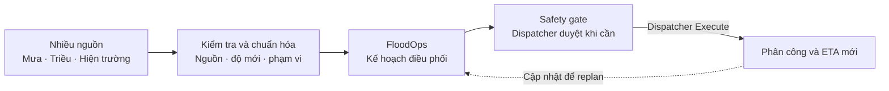
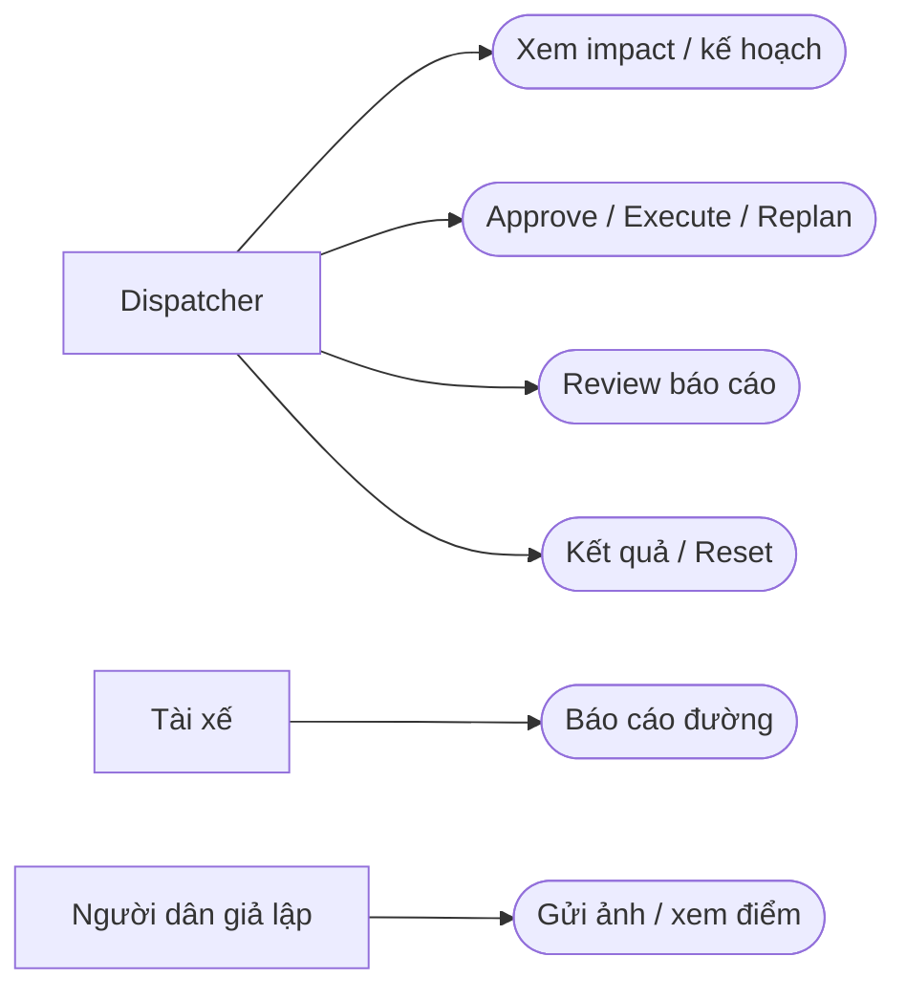
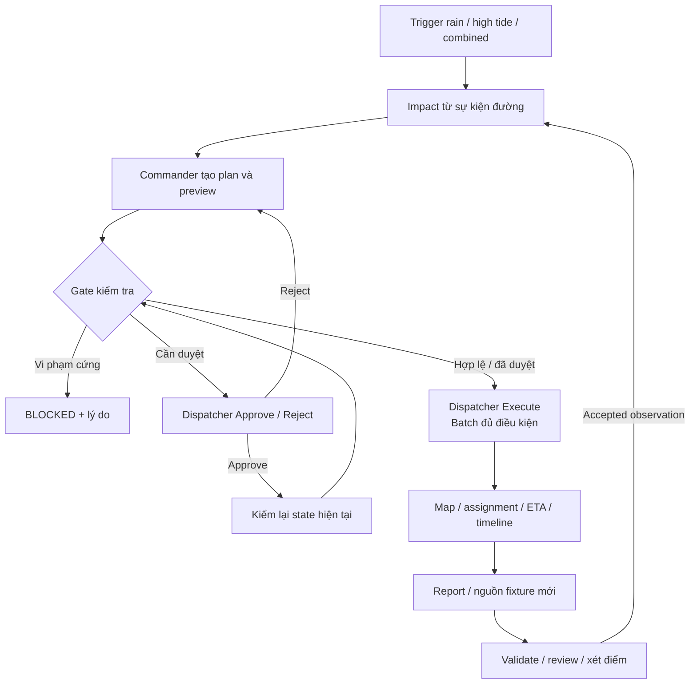
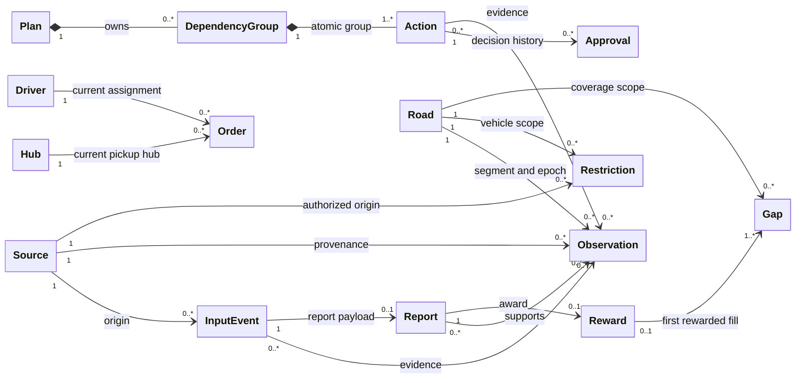
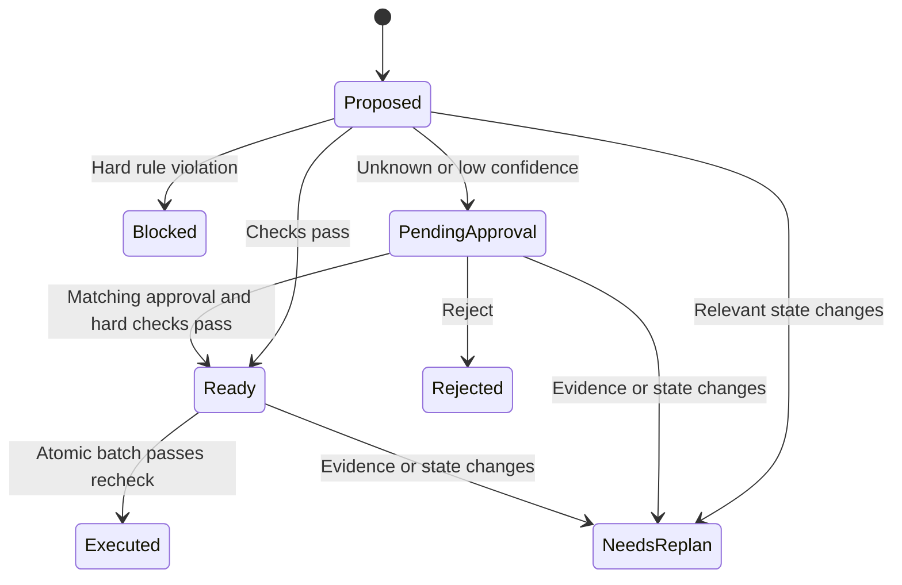
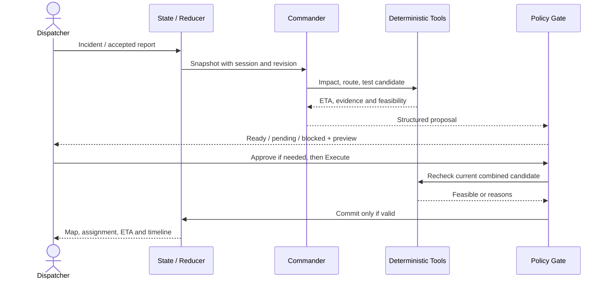
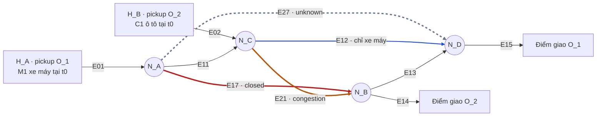
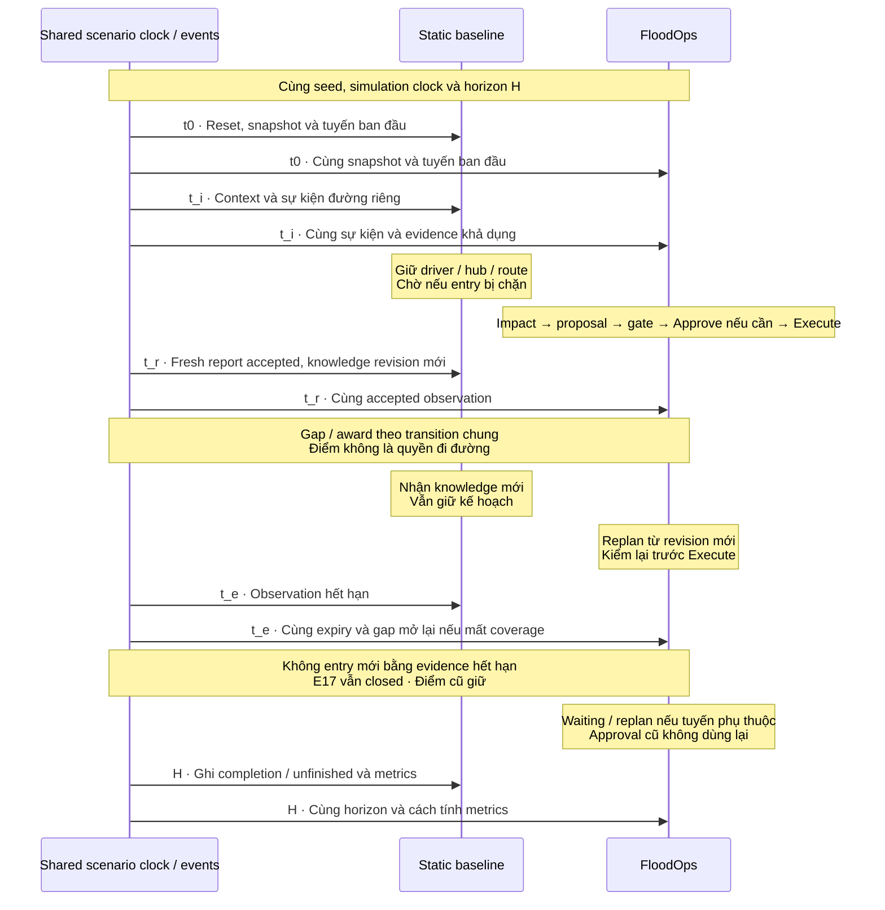
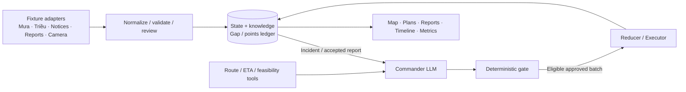

# FloodOps — Product Requirements Document (PRD)

| Thuộc tính | Giá trị |
|---|---|
| Phiên bản | v0.3 — Bản hợp nhất, cập nhật 2026-10-21 |
| Owner | Team Gay Hackers (Hung, Kai, Long, Thiên Ân) |
| Mục tiêu | Bản thử nghiệm tối thiểu (MVP) trong 7 giờ build: 31/10/2026, 10:00–17:00, Shopee VN Office, TP.HCM |
| Tài liệu triển khai | File này chứa phạm vi, dữ liệu, quy tắc, luồng và nghiệm thu. Link ngoài là bằng chứng / tài liệu nguồn, không thay thế yêu cầu sản phẩm. |
| Nguồn hợp nhất | floodops-prd@b30b808 + long-prd@7a9f3b3 + docs/hung-floodops-prd-revision@6b46e40; [đối chiếu ba bản](../plans/reports/review-261021-2211-three-prd-branches.md). |
| Quy ước | **Đã thống nhất** = hướng được xác nhận; **Đề xuất** = cần review; **TBD** = chưa quyết định. Mọi kết quả demo là **Simulation result**. |

**Mức độ hoàn thiện:** đã hợp nhất phạm vi, luồng, hợp đồng triển khai, sơ đồ và cách nghiệm thu trong một file. Vẫn cần chốt khu vực / dữ liệu hiệu chuẩn D04, quyền sử dụng dữ liệu, cấu hình vận hành và lựa chọn kỹ thuật ở mục 10. Chưa có bằng chứng mô phỏng đạt tỉ lệ thực hoặc KPI; các mục Đề xuất / TBD vẫn cần quyết định.

**Cách dùng cho AI triển khai:** đọc phạm vi mục 3, yêu cầu mục 5, hợp đồng dữ liệu / thực thi mục 6–7 và nghiệm thu mục 8. Đối chiếu quyết định mở ở mục 10 trước phần việc phụ thuộc. Không tự coi đề xuất là quyết định đã chốt. Theo D04, thông số vật lý / vận hành phải có căn cứ, đơn vị và kiểm chứng; thiếu thì ghi TBD, không tự đặt số để đạt chỉ số đánh giá (KPI). Cố định bộ thông số trước so sánh kế hoạch gốc (baseline) với FloodOps. Hiện tại chuẩn bị tài liệu; quy định build tại chỗ ở mục 9 vẫn áp dụng.

**Cách đọc cho chủ sản phẩm:** đọc mục 1–4 để hiểu sản phẩm và mục 10 để chốt quyết định; mục 5–9 dành cho yêu cầu triển khai / kiểm chứng chi tiết. Mã, thuật ngữ và ký hiệu có giải thích tiếng Việt tại [chú giải 10.4](#104-chú-giải-mã-ký-hiệu-và-thuật-ngữ).

**Mục lục:** 1. Tổng quan · 2. Khách hàng và bài toán · 3. Phạm vi · 4. UX và luồng · 5. Chức năng · 6. Dữ liệu và nguồn/API · 7. AI và thực thi · 8. Mô phỏng và nghiệm thu · 9. Kỹ thuật, delivery, rủi ro · 10. Quyết định và bằng chứng.

---

## 1. Executive Summary

**Khách hàng và bài toán.** FloodOps phục vụ đơn vị giao hàng nội thành TP.HCM có người điều phối (dispatcher) và đội tài xế riêng. Ngập cục bộ do **mưa lớn, triều cường hoặc cả hai** có thể làm kế hoạch giao hàng mất khả thi. Người điều phối cần biết đơn bị ảnh hưởng, cách phân công lại và giờ đến dự kiến (ETA) mới trong khi dữ liệu từng đoạn đường có thể thiếu hoặc đã cũ.

**Giải pháp.** Một trợ lý AI điều phối sự cố (AI Incident Commander) kết hợp nhiều luồng: báo cáo ngập / giao thông, mực nước và triều, thời tiết, camera, tài xế và cộng đồng. **AI đề xuất, code kiểm tra tính khả thi và luật an toàn, dispatcher duyệt rủi ro khi cần rồi bấm Execute**; thông tin mới kích hoạt lập lại kế hoạch (replan).



**Giá trị kỳ vọng.** Đơn vị giao hàng bảo vệ đơn ưu tiên và hạn chế trễ dây chuyền; dispatcher có kế hoạch phối hợp kèm lý do; tài xế nhận phân công có kiểm tra ràng buộc; người nhận có ETA cập nhật. Người dân được xét điểm giả lập cho quan sát đã kiểm tra lấp khoảng trống dữ liệu.

**Đầu ra MVP.** Console mô phỏng một khu vực nhỏ của TP.HCM, giữ đúng tỉ lệ khoảng cách, thời gian và tải vận hành theo D04; có xử lý sự cố, thực thi có kiểm soát, nhiều nguồn replay / giả lập, báo cáo tài xế, người dân gửi ảnh, review, cộng điểm giả lập và replan. Không tích hợp live hoặc chi trả thật. Dữ liệu hiệu chuẩn, nhu cầu mua và hiệu quả thực tế cần kiểm chứng.

---

## 2. Customer, Context & Problem

### 2.1 Khách hàng, người dùng và bên hưởng lợi

| Vai trò | Đối tượng | Nhu cầu / đầu ra |
|---|---|---|
| Khách hàng chính — giả thuyết B2B | Đơn vị giao hàng nội thành TP.HCM có đội xe, dispatcher và điểm lấy hàng; người mua dự kiến là quản lý vận hành. | Duy trì giao hàng khi gián đoạn, bảo vệ đơn ưu tiên, theo dõi kết quả. |
| Người dùng chính | Dispatcher / trưởng ca. | Xem tác động, so sánh kế hoạch, duyệt và điều phối. |
| Người dùng phụ | Tài xế. | Gửi quan sát; thấy phân công cập nhật trên console. Chỉ giả lập phần báo cáo. |
| Người đóng góp | Người dân có thể quan sát từ vị trí an toàn. | Gửi ảnh / mô tả, xem kết quả review và điểm. |
| Bên hưởng lợi phụ | Người nhận hàng. | Xem trước thông báo ETA mới; không có app khách. |
| Người quan sát demo | Giám khảo. | Kiểm chứng thích nghi, an toàn, nhãn mô phỏng và kết quả. |

Tài xế, người đóng góp và người nhận không được mặc định là phân khúc trả phí riêng. Chọn vai trò trong demo không phải tài khoản production.

### 2.2 Ngữ cảnh Sài Gòn / TP.HCM

Ngập đô thị có thể làm gián đoạn đường chính và đường tiếp cận điểm giao. [HĐND TP.HCM](https://hdnd.hochiminhcity.gov.vn/tin-tuc/tin-tong-hop/tphcm-mua-lon-ket-hop-trieu-cuong-gay-ngap-nhieu-noi) ghi nhận mưa lớn kết hợp triều cường tối 8/10/2025 gây ngập tại Quốc Hương, Xuân Thủy và nhiều tuyến khác; có phương tiện chết máy hoặc quay đầu.

PRD phân biệt ba nguyên nhân kịch bản: **rain**, **high_tide**, **combined**. Có thể có triều cao khi không mưa. Bản tin mưa, dự báo đỉnh triều và đo mực nước là tín hiệu khác nhau; không lấy một giá trị để suy ra độ sâu ngập trên mọi đường.

Bằng chứng xác lập bối cảnh gián đoạn và sự tồn tại của dữ liệu. Quy trình dispatcher, mức thiếu quan sát, ý định mua, hiệu quả FloodOps và lợi thế so với sản phẩm hiện có vẫn là giả thuyết cần phỏng vấn / dữ liệu vận hành; tin về ngập không tự chứng minh nhu cầu mua.

### 2.3 Bài toán và lợi ích

Tình huống mô phỏng: một nhóm tài xế và đơn bị ảnh hưởng khi đường đóng, ùn tắc hoặc chưa rõ khả năng đi; số lượng phải tính từ vị trí, tuyến và thời điểm sự cố. Dispatcher phải quyết định đổi tuyến / tài xế, có đổi hub / hoãn đơn được không, và ETA ai thay đổi. Thông tin xe máy đi được không tự áp dụng cho ô tô.

**Job to be done:** chuyển nhiều thông tin hiện trường thành kế hoạch khả thi cho nhóm đơn bị ảnh hưởng, kèm bằng chứng, ưu tiên, phân công và ETA. Điểm nghẽn cần kiểm chứng là thiếu quan sát đủ mới ở đúng vị trí và thời điểm cần quyết định.

| Nhóm | Lợi ích kỳ vọng | Bằng chứng prototype |
|---|---|---|
| Đơn vị giao hàng | Bảo vệ critical và giảm đơn trễ. | K1–K2 cùng kịch bản. |
| Dispatcher | Có kế hoạch kèm lý do; thấy phần còn thiếu thông tin. | Impact, plan diff, nguồn / độ mới, K4. |
| Tài xế | Phân công có kiểm tra xe, sức chứa, đường đóng. | K3 và kết quả gate. |
| Người đóng góp | Được ghi nhận cho dữ liệu hữu ích. | Report, gap được bổ sung, ledger điểm. |
| Người nhận | Biết ETA thay đổi. | Preview từ state đã thực thi. |

---

## 3. Product Scope & Deliverables

### 3.1 Phạm vi đã thống nhất

- Một đội giao hàng, một khu vực có ranh giới xác định tại TP.HCM và một ca gián đoạn do ngập đô thị. Mạng đường dùng tọa độ / hình học tham chiếu thực, giữ kết nối và hạn chế theo loại xe; phạm vi cụ thể TBD theo dữ liệu đủ để hiệu chuẩn D04.
- Nhiều nguồn qua cùng pipeline. Camera là một nguồn bên cạnh báo cáo ngập / giao thông, mưa, triều / mực nước, tài xế và cộng đồng.
- Luồng cộng đồng tối giản thuộc MVP: ảnh / fixture + vị trí + thời gian → kiểm tra / review → accepted / rejected → xét điểm giả lập → cập nhật hiểu biết → replan.
- Dữ liệu bên ngoài được đóng gói thành snapshot / fixture có nguồn và nhãn; không cần connector live. Snapshot bản đồ / vận hành thực dùng để hiệu chuẩn, còn sự kiện dựng để kiểm luồng phải ghi giả lập. Tiền thật và xây cộng đồng ngoài đời thuộc giai đoạn sau. Danh mục API ở mục 6.6 phục vụ khảo sát.

### 3.2 Đầu ra nhìn thấy

| Khu vực | Nội dung |
|---|---|
| Map | Hub, tài xế, đơn, tuyến; closed / congestion / unknown; phạm vi loại xe; thước tỉ lệ và khoảng cách thực, không kéo giãn từng đoạn để đổi độ dài / ETA. |
| Incident & Plan | Tác động, ưu tiên, kế hoạch, bằng chứng, rủi ro, trước / sau, Approve / Reject / Execute. |
| Data & Reports | Nguồn, mưa / triều / hiện trường, độ mới, review, gap, form tài xế / cộng đồng. |
| Points | Ledger giả lập và lý do đủ / không đủ điều kiện; không có rút tiền. |
| Timeline & Results | Trace sự kiện tới hành động, baseline / FloodOps, clock và Reset. |

Có thể dùng tab / drawer cho khu vực phụ. Banner **Simulation** luôn hiện; trạng thái hiệu chuẩn D04 xem được. Phân biệt **Reference data**, **Replayed** và **Simulated** ở từng nguồn / input; điểm luôn **Simulated**. Dùng bản đồ thật không tự chứng minh toàn bộ mô phỏng đã được hiệu chuẩn.

### 3.3 Ưu tiên và non-goals

**P0:** bắt buộc cho demo. **P1:** mở rộng nếu còn giờ. **P2:** tùy chọn. Cả 5 điều kiện luôn phải đúng (invariants, mục 8.3) áp dụng cho mọi tính năng được bật; cắt tính năng trước khi giảm luật an toàn.

**Ưu tiên bản hợp nhất — D03:** P0 gồm reroute, đổi tài xế, ETA, report → replan, an toàn và luồng dữ liệu / điểm tối giản. Đổi hub và defer standard là P1, chỉ bật khi có cấu hình và bằng chứng nghiệm thu. Giữ đặc tả P1 để không phải tự suy diễn khi mở rộng.

Ngoài phạm vi: mô hình thủy văn riêng; bản đồ phát hiện ngập toàn thành phố; lắp camera; marketplace / OMS / cảm biến live; app cư dân hoặc tài xế production; cứu hộ; auth / multi-tenant; gửi tin thật; thanh toán / crypto; multi-agent chat. “Learn” là cập nhật world state có hạn dùng trong phiên, không huấn luyện mô hình.

---

## 4. UX & End-to-End Flows

### 4.1 Mục tiêu theo actor — sơ đồ khái niệm



Đây là sơ đồ mục tiêu bằng Mermaid, không phải đặc tả ký pháp UML đầy đủ. Tool nội bộ và giám khảo không phải actor vận hành.

### 4.2 Luồng nghiệp vụ



Approve chỉ lưu quyết định cho proposal hiện hành; dispatcher bấm Execute để kiểm lại rồi commit. Replan không tự Execute. Một bản tin mưa / triều chỉ cập nhật context; incident → impact dùng sự kiện đường khai báo riêng trong seed, không suy ra ngập từ thời tiết.

### 4.3 Kịch bản demo mục tiêu ≤ 150 giây

Luồng dưới là **fixture kiểm chức năng**, chưa phải kết quả hiệu chuẩn. **Ba khái niệm thời gian:** ETA là giờ dự kiến giao; SLA là hạn giao theo cam kết dùng để tính trễ; TTL là thời gian quan sát còn được dùng. Ví dụ: hạn giao 15:00, ETA 15:10 thì dự kiến trễ 10 phút, chưa phải kết quả giao thực tế.

1. Reset: xem vùng, kỳ dữ liệu, thông số đã freeze và projected on-time do engine tính, không đặt trước tỉ lệ đúng hạn.
2. Chọn rain / high_tide / combined. E17 closed, E21 congestion, E27 unknown là fixture kiểm luồng, với ID ánh xạ đoạn đường thực. Kịch bản đánh giá dùng sự kiện có căn cứ theo 6.5; số đơn / tài xế ảnh hưởng do engine tính.
3. Engine chỉ ra đơn / tài xế có tuyến bị ảnh hưởng, đề xuất đổi tuyến / đổi tài xế cho đơn còn unpicked, kèm lý do và preview. Approve khi cần; Execute nhóm đủ điều kiện.
4. Replay camera và nguồn ngoài; chỉ ra context mưa / triều khác observation đoạn đường.
5. Gửi ảnh xe máy tại E27 cho gap đang mở; review, xét điểm, replan và thấy ETA thay đổi theo K6. Ô tô vẫn unknown nếu thiếu evidence riêng. Duyệt / Execute kế hoạch mới; tài xế vẫn có form văn bản / nút nhanh.
6. Gửi ảnh trùng / cũ; hiển thị lý do từ chối / 0 điểm. Tua giờ qua expiry.
7. Chạy tới horizon, so baseline / FloodOps, timeline; Reset lặp lại.

Rehearsal không sửa dữ liệu ngoài UI hoặc lược bỏ policy để đạt thời lượng. Tua nhanh chỉ đổi tốc độ phát; khoảng cách, travel / service time, SLA và TTL vẫn giữ cùng tỉ lệ thời gian mô phỏng.

### 4.4 Hành vi UI chung

- Phân biệt proposed, pending approval, blocked, executed, needs replan. Preview chưa commit luôn ghi projected.
- Mỗi action / report có đối tượng, bằng chứng / nguồn và lý do; lỗi có đường thử lại.
- Accepted report, eligible reward và approved route là ba kết quả riêng.
- Chọn vai trò / contributor ID là giả lập. Ảnh synthetic hoặc được phép sử dụng; không yêu cầu ảnh cá nhân thực.

### 4.5 Tra cứu từ luồng tới yêu cầu

| Luồng / thao tác | Yêu cầu mục 5 |
|---|---|
| Tạo sự cố, xem ảnh hưởng và thứ tự ưu tiên | US-01, US-02, US-03, US-10 |
| Xem kế hoạch, bằng chứng, trước / sau và tính khả thi | US-04, US-05, US-06, US-20 |
| Duyệt / từ chối, Execute và chặn đường đóng | US-07, US-08, US-09 |
| Tài xế báo đường, chuẩn hóa theo loại xe, replan; xử lý lỗi AI | US-13, US-14, US-15, US-18, US-24 |
| Người dân gửi ảnh, kiểm tra và review | US-29, US-30 |
| Xác định gap, xét điểm và ghi thưởng một lần | US-31, US-32 |
| Nhiều nguồn, mưa / triều, xung đột và hết hạn | US-16, US-17, US-28, US-34 |
| ETA, so sánh kết quả, timeline / nhãn và bằng chứng demo | US-11, US-21, US-22, US-25, US-26; US-27 nếu bật P2 |
| Tua đồng hồ, Reset toàn phiên | US-19, US-23 |
| Hoãn standard / đổi hub khi bật P1 | US-12, US-33 |

---

## 5. Functional Requirements & Acceptance Criteria

US là mã yêu cầu; mỗi dòng mô tả việc cần làm và cách xác nhận đã làm đúng. LLM là mô hình ngôn ngữ dùng trong AI; API là giao diện phần mềm để gọi mô hình / công cụ / nguồn dữ liệu. Giữ US-01–US-27 để truy vết; US-28 trở đi bổ sung dữ liệu và cộng đồng. Tham chiếu mục trong bảng thuộc file này.

### 5.1 Sự cố và điều phối

| ID | Yêu cầu | Điều kiện nghiệm thu | Ưu tiên |
|---|---|---|---|
| US-01 | Trigger incident. | Có rain / high_tide / combined; fixture kiểm luồng có E17 closed, E21 congestion, E27 unknown, ánh xạ đúng geometry. Map cập nhật ≤ 1 giây, timeline có simulation time và nhãn sự kiện. Tín hiệu mưa / triều riêng không tự đóng đường. | P0 |
| US-02 | Xem impact. | Tính đơn / tài xế, edge gây ảnh hưởng và predicted lateness từ snapshot / tuyến / thời điểm trong scenario; không ấn định 7 đơn / 2 tài xế hoặc hardcode dashboard. | P0 |
| US-03 | Xếp hạng đơn. | Đơn rất khẩn (critical) > đồ ăn (food) > thông thường (standard); cùng mức theo predicted lateness giảm dần, tie-break order ID. | P0 |
| US-04 | Kế hoạch phối hợp. | Reroute, đổi tài xế, ETA; action có targets, reason, evidence, dependency group, risk. Hub / defer chỉ hiện khi P1 bật. | P0 |
| US-05 | Giải thích truy vết. | Mọi entity / evidence ID tồn tại trong snapshot; sai ID / schema → loại proposal, không execute. Không test nguyên văn lời giải thích. | P0 |
| US-06 | Before / after. | Assignment và ETA delta từng đơn; preview chưa execute được ghi projected. | P0 |
| US-07 | Execute nhất quán. | Commit nguyên tử batch gồm dependency groups hoàn chỉnh, đủ điều kiện; kiểm combined candidate state. Nhóm pending và dependent không bị áp dụng. | P0 |
| US-08 | Approve / Reject. | Approval gắn action / plan / revision; cả group chỉ chạy khi đủ điều kiện. Unknown / low-confidence cần duyệt; Reject không execute action / dependent. | P0 |
| US-09 | Chặn đường đóng. | Confirmed closed / impassable theo vehicle → BLOCKED + rule ID; không override. | P0 |
| US-10 | Giữ ưu tiên. | Không đổi tier / defer critical; không hy sinh critical để cải thiện standard, theo POL-05. Không hứa critical luôn đúng hạn trong mọi tình huống. | P0 |
| US-11 | ETA preview. | Tạo từ committed ETA cho đơn thay đổi; nói rõ dự đoán, không gửi thật. Proposal preview có nhãn riêng. | P0 |
| US-12 | Defer standard. | Chỉ standard, cumulative defer ≤ config limit; original SLA không dời. Thiếu limit → disabled / blocked. | P1 |
| US-20 | Feasibility. | Dry-run trả feasible / reasons theo vehicle, capacity, road, pickup progress, hub; kiểm toàn candidate batch. Chỉ unpicked order được đổi driver; picked_up giữ carrying driver và chỉ reroute. | P0 |
| US-24 | Lỗi mô hình. | Timeout / API / schema lỗi không đổi route, assignment, ETA đã commit; giữ observation đã accepted. Có Replan; response cũ bị bỏ. | P0 |
| US-33 | Đổi hub. | Chỉ unpicked order, hub đích có order trong availability fixture và còn cap; không dịch chuyển hàng đã ở trên xe. | P1 |

### 5.2 Dữ liệu, báo cáo và điểm

| ID | Yêu cầu | Điều kiện nghiệm thu | Ưu tiên |
|---|---|---|---|
| US-13 | Driver report. | Văn bản và nút nhanh: xe máy qua được / ngập sâu / đã khô; nút nhanh dùng được khi LLM lỗi. | P0 |
| US-14 | Observation schema. | Segment, vehicle scope, condition, source, validation, confidence, observed_at, expires_at, evidence; thiếu mapping chắc chắn → review / làm rõ. | P0 |
| US-15 | Vehicle scope. | Observation xe máy không áp cho ô tô / xe tải. Xe khác thiếu evidence → unknown. | P0 |
| US-16 | Expiry. | Now ≥ expires_at → không còn current evidence; plan phụ thuộc cần replan; Execute kiểm lại. Điểm đã cấp hợp lệ không bị thu hồi do expiry về sau. | P0 |
| US-17 | Conflict. | Camera / driver / community không gỡ authoritative closure. Source, freshness, trust là trường riêng; conflict chưa giải quyết → unknown / review. | P0 |
| US-18 | Thấy thay đổi sau replan. | Diff action thêm / bỏ / đổi, lý do gắn report / evidence; fixture đạt K6 / T15. Scenario đánh giá báo đúng kể cả không đổi hoặc xấu hơn; proposal cũ không overwrite proposal mới. | P0 |
| US-28 | Nhiều nguồn. | Source registry, camera fixture và context / report ngoài khác, gồm mưa và triều / mực nước. Hiển thị provider, type, simulated flag, time; không API live. | P0 |
| US-29 | Citizen photo. | Contributor giả lập, photo / fixture ID, location / segment, capture time, vehicle scope nếu có, mô tả; pending review trước sử dụng. | P0 |
| US-30 | Validate / review. | Schema, ảnh load được, vị trí, timestamp, duplicate; reason codes rõ. Dùng fixture metadata + dispatcher review, không claim chống giả GPS / ảnh thực. | P0 |
| US-31 | Points. | Accepted, fresh report lấp active gap mới được award một lần theo 6.4; redundant = 0. Retry / ảnh trùng không nhân điểm. | P0 |
| US-32 | Data gaps. | Các cặp segment / vehicle relevant thiếu observation còn hạn / đủ chất lượng; coverage từ state, không số ảnh. Một edge có thể đủ thông tin cho xe máy nhưng còn gap cho ô tô. | P0 |
| US-34 | Mưa và triều. | Chạy được rain-only, tide-only và combined; source context không tự sửa edge condition. Mực nước có unit / datum / location; không so khác datum như cùng chuẩn. | P0 |

### 5.3 Điều khiển và evidence demo

| ID | Yêu cầu | Điều kiện nghiệm thu | Ưu tiên |
|---|---|---|---|
| US-19 | Advance time. | +N phút, N > 0; xử lý expiry, timeline ghi thay đổi. Wall clock không tự làm fixture hết hạn. | P0 |
| US-21 | Baseline. | Cùng seed / events / physics / horizon; 6 chỉ số mục 8.2, nhãn Simulation result. | P0 |
| US-22 | Timeline. | Simulation time + event sequence; actor system / model / dispatcher / driver / community / external; trace report → plan → execution. | P0 |
| US-23 | Reset. | Reset seed, clock, metrics, reports, points; session ID mới; response phiên cũ bị bỏ. | P0 |
| US-25 | Policy / labels. | Banner luôn hiện, rule IDs xem được; nguồn / points fixture có nhãn. | P0 |
| US-26 | Codex prompt log. | K5; repo nộp có prompt, thay đổi, quyết định con người và kết quả kiểm tra. | P0 |
| US-27 | Reroute-only baseline. | Nếu làm cột 3: cùng dữ liệu / policy, tự đổi tuyến từng xe, không đổi driver / hub / ưu tiên. Không gọi là benchmark Google Maps. | P2 |

---

## 6. Data Model, Source Strategy & Rewards

### 6.1 Data contract

| Entity | Trường / quy ước |
|---|---|
| Source | source_id, provider, source_type, role (context / observation / restriction), is_simulated, access_status, policy_profile. |
| Input event | event_id, source_id, issued_at / captured_at, received_at, valid time, location / area, raw text / media ref, external ID. |
| Measurement | measurement_type (rain / tide_height / river_level / discharge / street_depth), value, unit, station / grid, vertical datum nếu là height, observed vs forecast, issued / valid time. |
| Observation | observation_id, source_id, segment_id, knowledge_epoch, vehicle_types, condition (normal / caution / impassable / unknown), validation (pending / accepted / rejected / superseded), confidence_band, observed_at, expires_at, evidence IDs, conflict flag. |
| Restriction | ID, segment, vehicle scope, closure / reopening, authority profile, effective time. Authoritative restriction tách khỏi report thường. |
| Road | ID / source mapping, endpoints, polyline WGS84, length_m, direction / turn restrictions, vehicle compatibility, travel time theo vehicle / time window, nguồn / phương pháp hiệu chuẩn, knowledge_epoch, effective condition theo vehicle và evidence. Congestion factor nếu dùng phải có căn cứ và không tính trùng traffic delay. |
| Driver | ID, vehicle_type, capacity theo từng đại lượng / đơn vị có giới hạn thực, position trên graph, ordered stops, current load cùng đơn vị, status. |
| Hub | ID, tọa độ / điểm nối graph, open / limited, pending pickup capacity với đơn vị / cửa sổ thời gian xác định, available_order_ids. Kiểm tổng demand unpicked orders gán hub theo cùng định nghĩa capacity. Vị trí hub giả định phải có nhãn. |
| Order | ID, tier, demand cùng đơn vị capacity, pickup hub, destination / điểm nối graph, driver, original SLA, ETA, service time, lifecycle (unpicked / picked_up / delivered), cumulative defer; nguồn thực ẩn danh hoặc giả lập có nhãn. |
| Scenario / Parameter provenance | Scenario ID / version, vùng / kỳ dữ liệu, T0 / timezone, replay mapping, calibration_status; mỗi parameter có value, unit, source / reference date, phạm vi vehicle / geography / valid time, measured / derived / assumed, phương pháp và sai số / mức bất định. |
| Plan / Action / Approval | Plan ID, session / input revision; action ID / type / targets, route ID, evidence, reason, dependencies / group, status, projected changes. Approval lưu action ID / plan ID / revision / decision. |
| Report / Gap / Reward | Report ID, contributor, photo_hash, capture metadata / review; gap ID theo segment / vehicle và lần mở; award ID, report ID, filled_gap_ids, points, award_time. |

Simulation time là phút kể từ T0 của ca, cho phép phần lẻ; đổi từ giây / giờ phải tường minh. Một phút mô phỏng biểu diễn một phút vận hành. Playback có thể tăng tốc đồng đều, ví dụ hành trình 15 phút phát ở 30× mất 30 giây wall clock nhưng ETA vẫn là 15 phút. Travel, service, SLA, defer, TTL và incident time cùng đồng hồ đó. Wall clock đo API latency / rehearsal. Replay giữ timestamp gốc và mapping sang T0; không ghép dữ liệu khác ngày thành một sự kiện thực. State có session ID và revision; không dùng thời gian nhận thay thời gian quan sát. Không cộng / so sánh mưa mm, mực nước m theo datum và discharge m³/s như cùng một đại lượng.

#### 6.1.1 Domain model — quan hệ và cardinality



**Cách đọc:** số ở hai đầu dây chỉ số lượng đối tượng được liên kết: `1` = đúng một; `0..1` = không có hoặc một; `0..*` = từ 0 trở lên; `1..*` = từ 1 trở lên. Ví dụ Report–Reward: một báo cáo có thể không nhận thưởng hoặc nhận tối đa một phần thưởng; mỗi phần thưởng thuộc đúng một báo cáo. Hình thoi đen là quan hệ chứa: Plan chứa các nhóm hành động.

Đây là quan hệ khái niệm, không yêu cầu DB hoặc class code tương ứng; bảng 6.1 vẫn là hợp đồng trường dữ liệu. Report là dữ liệu gửi vào / kết quả review, Observation là bằng chứng chuẩn hóa; không phải mọi report đều tạo observation dùng được. Observation chỉ tham gia knowledge khi đúng segment / vehicle / epoch và còn hạn theo 6.3; các reference không tự cấp quyền đi đường.

Hub–Order và Driver–Order biểu diễn phân công hiện tại; hub availability có thể liệt kê order ở nhiều hub, còn picked_up giữ carrying driver. Plan chưa có action có thể có 0 group; mỗi action thuộc một group và dependency phải không có vòng lặp. Approval giữ lịch sử; chỉ quyết định khớp action / plan / revision hiện hành mới có hiệu lực. Mỗi report tối đa một award; một award ghi được nhiều gap, mỗi gap ID tối đa một first-fill award. Camera / report redundant có thể không tạo award; mất coverage mở gap ID mới, không thu hồi điểm cũ hợp lệ.

### 6.2 Nhiều nguồn và vai trò

| Luồng | Dùng cho | Giới hạn |
|---|---|---|
| Mưa / weather forecast | Context, yêu cầu cập nhật hiện trường. | Không xác lập độ sâu hoặc passability. |
| Triều / river-level station / forecast | Context theo vị trí / kỳ triều; observation tại trạm nếu là đo thực. | Dự báo khác quan trắc; cần unit, datum, valid time, vị trí. Không chuyển trực tiếp thành street depth. |
| Báo cáo ngập địa phương | Observation / incident nếu có vị trí, thời gian, phạm vi. | Xác minh quyền, độ phân giải và mapping edge. |
| Traffic / closure notices | Context hoặc restriction từ source được cấu hình có thẩm quyền. | Tên provider không tự tạo quyền đóng / mở đường. |
| Sensor | Observation tại điểm đo. | Mapping từ trạm tới đường cần bằng chứng / model riêng. |
| Camera | Observation trong góc quay. | Mờ, cũ, mất kết nối → không current evidence. |
| Driver | Observation trên tuyến đang phục vụ. | Vehicle scope / thời gian; không tự gỡ closure. |
| Community | Lấp gap về độ phủ / độ mới. | Có người đúng nơi / lúc, kiểm tra và chi phí khuyến khích. |

MVP adapter đọc fixture vào cùng envelope; không xây connector mọi provider. Không có dữ liệu thì hiển thị Unavailable / Unknown. Tín hiệu mưa / triều có thể khởi động đánh giá và yêu cầu report, nhưng không tự đóng đường.

### 6.3 Validation, trust, freshness

1. Raw input không ghi trực tiếp effective road state. Kiểm source ID, schema, geography, timestamp; ảnh phải load được và có fingerprint.
2. Context diện rộng giữ ở context nếu không map segment. Mực nước thiếu datum không được so với nguồn khác để tính chênh / độ sâu; giữ unknown cho phép suy luận đó.
3. Citizen report mới pending_review; dispatcher Accept / Reject sau check. Ảnh thiếu, lỗi, cũ, sai vị trí hoặc duplicate có reason.
4. Chỉ accepted observation với observed_at ≤ now < expires_at tham gia current knowledge. Policy code gán confidence / TTL; LLM không tự sửa.
5. MVP: report driver / community mới mặc định low-confidence dù accepted; fixture high-profile phải khai báo. Accept không tự nâng thành high.
6. Authoritative closure giữ hiệu lực đến authorized reopening. Ngoài closure, các accepted observation còn hạn, đúng vehicle và knowledge_epoch nhưng khác condition tạo **unresolved conflict**, bất kể nguồn. Review phải chọn evidence tiếp tục dùng và đánh dấu evidence bị thay thế là superseded, có lý do. Timestamp mới hơn không tự xóa mâu thuẫn. Khi không conflict, chọn confidence high trước low rồi observed_at mới nhất; tie-break observation ID. Không lấy số đông làm chứng nhận an toàn.
7. Expiry / conflict ảnh hưởng route → plan needs replan; không lấy report đã hết hạn để lấp gap.

Reason codes: INVALID_SCHEMA, INVALID_IMAGE, UNKNOWN_SEGMENT, LOCATION_MISMATCH, FUTURE_CAPTURE, EXPIRED, DUPLICATE_IMAGE, CONFLICT, ACCEPTED, VALID_BUT_REDUNDANT, UNKNOWN_DATUM.

**Effective knowledge và coverage:** seed khai báo initial condition / vehicle scope và evidence cho mọi edge relevant. Source profile high / low có trong config; thiếu profile mặc định low, không tự thành high vì là camera. Bản đồ / thời gian đi tham chiếu không phải evidence đường đang khô hoặc đi được. Kịch bản đánh giá dùng validity có căn cứ; thiếu thì unknown. Fixture kiểm luồng được khai báo initial normal giả lập, nhưng không dùng để tuyên bố trạng thái thực. Khi incident thay đổi edge, tăng knowledge_epoch và loại evidence epoch cũ khỏi current knowledge. E27 unknown sau incident không quay về normal từ seed khi report mới hết hạn.

Không evidence đủ điều kiện → **ordinary unknown**, có thể xét duyệt theo POL-02. **Unresolved conflict** là trạng thái riêng, chặn route mới qua edge tới khi review giải quyết; replan đơn thuần không xóa conflict. Authoritative closure không được supersede bằng review report.

Đối với useful coverage / gap, evidence đủ chất lượng là accepted, còn hạn, đúng segment / vehicle / epoch, condition khác unknown và không conflict. **Low-confidence được tính coverage**, nhưng route dùng nó vẫn cần approval. Nhận điểm không tự cấp quyền đi đường.

### 6.4 Community Reporting & Rewards

Game tối giản gồm gap cần cập nhật, tiến độ, review result và điểm. Chỉ quan sát từ vị trí đang an toàn; không nhiệm vụ đi vào vùng ngập hoặc thưởng theo mức nguy hiểm. Báo cáo nước rút cũng có giá trị.

- **Gap:** relevant segment / vehicle scope không có observation đủ chất lượng và còn hạn. Mỗi lần mất coverage mở một gap ID mới.
- **Điều kiện:** report accepted và dùng được lấp gap đang open ngay trước transition làm report dùng được: acceptance hoặc review resolution. Tại transition đó kiểm lại freshness, vehicle scope, duplicate và report chưa có award; ghi gap IDs thực sự được lấp. Camera / system events không nhận điểm; số ảnh không phải thước đo thưởng.
- **Exactly once:** acceptance / review resolution làm dữ liệu dùng được, gap fill và award commit một transition. Report nhiều vehicle chỉ lấp gap đúng scope, lưu toàn bộ filled_gap_ids nhưng tối đa một award / report. Gap chỉ thưởng lần lấp đầu tiên. Retry / cùng ảnh qua contributor khác trong phiên không nhân điểm. Report còn conflict chưa lấp gap hoặc nhận thưởng.
- **Redundant / expiry:** valid redundant có thể lưu lịch sử, 0 điểm. Ảnh cũ / trùng có reason. Expiry về sau không thu hồi điểm đã cấp hợp lệ; Reset xóa ledger.
- **Ba kết quả riêng:** accepted report ≠ eligible reward ≠ approved route.
- Fixture metadata + review không chứng minh chống gian lận thực tế. Tiền / voucher, tài trợ và production payout là TBD; demo chỉ points.

### 6.5 Tỉ lệ thực và hiệu chuẩn mô phỏng — D04

**Đã thống nhất:** mô phỏng phải giữ đúng tỉ lệ ngoài đời về địa lý, thời gian và tải vận hành trong khu vực được chọn. Có thể thu nhỏ **phạm vi khảo sát**, nhưng không tùy ý rút ngắn quãng đường, tăng tốc xe, giảm thời gian giao hay tăng sức chứa để làm đẹp kết quả. Nguồn / số liệu cụ thể và ngưỡng sai số còn **TBD**; đây là yêu cầu cần đáp ứng, chưa phải tuyên bố đã hiệu chuẩn xong.

| Nhóm thông số | Căn cứ / quy tắc bắt buộc |
|---|---|
| Vùng và cỡ mẫu | Chọn ranh giới thực tại TP.HCM, ngày / khung giờ và thời lượng ca. 2 hub / 5 tài xế / 30 đơn chỉ còn là đề xuất cỡ mẫu; chốt sau khi đối chiếu mật độ đơn, phân bố điểm giao, số đơn / giờ / xe và cơ cấu phương tiện. Không coi tỉ lệ xe máy / ô tô đặt sẵn là đại diện TP.HCM. |
| Hình học / mạng đường | Dùng snapshot bản đồ có nguồn / phiên bản / quyền sử dụng; length_m theo polyline thực, không dùng khoảng cách đường chim bay thay đường đi. Giữ một chiều, kết nối, hạn chế rẽ / loại xe liên quan. Map có thước tỉ lệ; phép chiếu phải giữ tỉ lệ trong sai số chấp nhận của vùng. |
| Travel / service | Thời gian đi dựa trên quan sát hoặc snapshot routing / traffic đã đối chiếu đúng vehicle, đoạn đường và khung giờ; service time dựa trên mẫu vận hành. Có thể dùng mô hình length / speed khi nêu rõ cách hiệu chuẩn và phần trễ đã tính. Không mặc định 1 phút / stop, congestion ×3 hay caution ×1.5; không cộng trùng traffic delay. Thiếu dữ liệu thì TBD / assumed, chưa đạt hiệu chuẩn. |
| Xe / hàng / hub | Capacity và demand dùng kg, thể tích / kích thước hoặc đơn vị nghiệp vụ có định nghĩa, nguồn và giới hạn áp dụng. Nếu dùng equivalent units, phải có quy đổi từ mẫu kiện thực và kiểm mọi giới hạn liên quan; không mặc định mọi đơn = 1 unit. Giới hạn hub phải có đơn vị / thời gian và căn cứ vận hành, không mặc định 20 đơn. |
| Ngập / ùn tắc | Kịch bản replay thực cần nguồn, vị trí, thời gian và phạm vi phương tiện của sự kiện / tác động. Sự kiện dựng để kiểm gate có nhãn Simulated. Không đổi mực triều / lượng mưa thành street depth hoặc tốc độ đi qua nước khi chưa có model được kiểm chứng; thiếu passability thì unknown / restriction theo evidence. |
| TTL / vị trí ảnh | TTL là policy cần căn cứ nhịp cập nhật, độ biến động hiện trường và loại nguồn; tolerance vị trí dựa trên độ chính xác vị trí / hình học. Không mặc định 2 / 5 phút hoặc 50 m cho mọi nguồn; mapping nhiều đường còn mơ hồ thì review. Không claim chống GPS spoofing thực. |
| SLA / defer / horizon | SLA và giới hạn defer lấy từ quy trình vận hành / dữ liệu có nguồn hoặc giả định được công bố; không dời SLA để đạt KPI. P1 thiếu defer limit → disabled. H sau mọi SLA của tập đánh giá, cùng H cho mọi nhánh. |
| Điểm thưởng | Đề xuất 10 points / eligible report, chỉ là cấu hình UX giả lập; không quy thành tiền / thu nhập thực hay dùng để tuyên bố đã mô phỏng đúng kinh tế khuyến khích. |

**Hồ sơ hiệu chuẩn trong seed / kết quả:** mỗi thông số ảnh hưởng route, ETA, feasibility hoặc freshness phải có provenance theo 6.1. Ghi mẫu / cỡ mẫu, thời gian / địa bàn, cách tính, phạm vi áp dụng, sai số chấp nhận và kết quả đối chiếu. Ngưỡng sai số phải chốt **trước** khi kiểm chứng; dùng mẫu đối chiếu độc lập với mẫu đã dùng để fit. Cùng đơn vị chưa đủ chứng minh đúng thực tế. Hiện chưa có bộ dữ liệu / kết quả đối chiếu trong repo chứng minh D04 đã đạt.

Tách **fixture kiểm chức năng** (có thể dựng E17 / E21 / E27, ảnh cũ / trùng, conflict) khỏi **scenario đánh giá đã hiệu chuẩn**. Fixture kiểm chức năng không được dùng để công bố mức giảm trễ thực tế. Scenario còn assumed / TBD ở thông số thiết yếu phải hiện **Calibration incomplete**, công bố phạm vi chưa kiểm chứng; không tự thay bằng số tùy ý hoặc gọi là đã đúng tỉ lệ thực. Freeze dữ liệu, config và phiên bản trước so baseline / FloodOps; chỉnh sau đó phải tạo phiên bản mới và chạy lại cả hai, không chỉnh để ép K1/K2.

### 6.6 Danh mục nguồn / API ứng viên

Tài liệu nguồn ngập / mưa / triều đối chiếu ngày **2026-10-15**; bổ sung nguồn bản đồ / routing ngày **2026-10-19**. Chưa triển khai hoặc kiểm tra endpoint live. Các nguồn này không mặc định có passability cho mọi đường TP.HCM. API / key / licence, coverage và quyền lưu snapshot để replay cần kiểm tra trước sử dụng; MVP dùng dữ liệu đóng gói có nhãn.

| Nguồn / docs | Dữ liệu và giới hạn | Truy cập / vai trò |
|---|---|---|
| [OpenStreetMap](https://www.openstreetmap.org/copyright) | Ứng viên hình học / mạng đường tham chiếu; cần kiểm độ đầy đủ của kết nối, một chiều và hạn chế theo loại xe tại vùng chọn. Không cung cấp bằng chứng đường đang ngập / đi được hoặc travel time đã hiệu chuẩn. | Snapshot có phiên bản / attribution; tuân thủ ODbL và điều kiện dịch vụ dùng để lấy dữ liệu. Phục vụ D04; chưa chọn / kiểm tra extract cụ thể. |
| [TomTom Calculate Route](https://docs.tomtom.com/routing-api/documentation/tomtom-maps/v1/calculate-route) / [Flow Segment Data](https://docs.tomtom.com/traffic-api/documentation/tomtom-maps/v1/traffic-flow/flow-segment-data) | Ứng viên route geometry / distance / estimated time và traffic speed / travel time; Flow trả travel time theo giây. Confidence traffic không phải confidence passability ngập. | Cần key, kiểm coverage TP.HCM, vehicle profile nhất là xe máy, licence / quyền lưu replay và map matching trước hiệu chuẩn. Không dùng bicycle profile thay xe máy. Chưa có response thực cho vùng chọn; không bắt buộc chọn provider này. |
| [Open-Meteo Weather](https://open-meteo.com/en/docs) | JSON mưa, precipitation probability / weather code theo tọa độ; model resolution tùy vùng, không phải trạm đo từng đường. | /v1/forecast; evaluation non-commercial có public API không key, [commercial terms](https://open-meteo.com/en/pricing) riêng. Context mưa. |
| [Open-Meteo Flood / GloFAS](https://open-meteo.com/en/docs/flood-api) | Daily river discharge mô phỏng / dự báo, lưới khoảng 5 km, m³/s; nearest river có thể không đại diện vị trí cần. | /v1/flood; context sông / lưu vực, không urban street depth. |
| [Open-Meteo Marine](https://open-meteo.com/en/docs/marine-weather-api) | Sea level including tides, sea_level_height_msl theo global mean sea level; model khoảng 8 km, độ chính xác ven bờ hạn chế / sâu trong đất liền có thể không tin cậy. | /v1/marine; context ven biển; không thay trạm Phú An / Nhà Bè hay mặc định đại diện sông Sài Gòn. |
| [WorldTides](https://www.worldtides.info/apidocs) | Tide heights, extremes, datum / station metadata; prediction point / datum có thể khác request. Không phải đo street water. | /api/v3; cần API key và credits, [licence / usage](https://www.worldtides.info/developer) cần kiểm tra cho dashboard nhiều người. Kiểm coverage / datum tại khu vực trước dùng. |
| [GDACS](https://www.gdacs.org/Documents/2025/GDACS_API_quickstart_v1.pdf) | Flood/disaster event GeoJSON / XML, phạm vi sự kiện; không bảo đảm có mọi ngập nhỏ. | SEARCH eventlist=FL; [feeds](https://www.gdacs.org/feed_reference.aspx), attribution GDACS. Incident context, không edge condition. |
| [NASA GPM IMERG](https://gpm.nasa.gov/data/imerg) | Mưa vệ tinh: lưới 0.1°, sản phẩm half-hourly; độ trễ theo Early / Late / Final. Không phải ngập quan trắc hoặc triều. | [Product directory](https://gpm.nasa.gov/data/directory), GES DISC cần [Earthdata Login](https://urs.earthdata.nasa.gov/documentation/for_users/data_access/curl_and_wget); PPS đăng ký riêng. Context / lịch sử mưa, không thời gian thực cho hẻm. |
| [NCHMF](https://nchmf.gov.vn/kttv/) | Bản tin chính thức về mưa, thủy văn, triều; issued / valid time và phạm vi theo bản tin. | Public web / attachments; chưa xác minh documented public developer API hay quyền bulk reuse. Context; không đoán endpoint. |
| [FEDS / thông tin thoát nước TP.HCM](https://thongtinthoatnuoc.tphcm.gov.vn/) | Báo cáo vị trí / mức ngập, thời gian và lớp liên quan theo [World Bank case study](https://documents1.worldbank.org/curated/en/099052625225018333/pdf/P176260-dffa6f4e-18b1-412f-ab75-4e4dfe34167d.pdf). | Portal có đăng nhập; chưa có public API / quyền reuse được xác minh cho FloodOps. Nguồn địa phương cần trao đổi. |
| [Giao thông / camera TP.HCM](https://dieuhanhgiaothong-sxd.hochiminhcity.gov.vn/chuc-nang-nhiem-vu-98.html) | Tài liệu mô tả khai thác / chia sẻ hình ảnh và dữ liệu giao thông. | Quyền stream / API bên thứ ba chưa xác minh. Observation / notice khi có quyền và dữ liệu phù hợp. |

Ví dụ request theo docs, **chưa gọi kiểm tra**; tọa độ chỉ là điểm tham khảo TP.HCM, không xác nhận coverage:

```text
GET https://api.open-meteo.com/v1/forecast?latitude=10.7769&longitude=106.7009&hourly=precipitation,rain,precipitation_probability&timezone=Asia%2FHo_Chi_Minh
GET https://flood-api.open-meteo.com/v1/flood?latitude=10.7769&longitude=106.7009&daily=river_discharge
GET https://www.gdacs.org/gdacsapi/api/events/geteventlist/SEARCH?eventlist=FL&fromdate=2026-10-01&todate=2026-10-15
```

Sau MVP, connector lưu provider / version, measurement type / units / datum, issued / observed / valid / received time, geography / resolution, licence, access mode, stale / error status. Không scrape trang hạn chế hoặc suy đoán endpoint. Key ở server-side env; lỗi nguồn không tạo road fact.

---

## 7. AI, Policy Gate & Execution

### 7.1 Phân vai và tool contract

Incident / accepted report kích hoạt Commander nhận snapshot và đề xuất qua tools; dispatcher không phải gõ prompt cho từng bước. **Codex hỗ trợ xây sản phẩm trong giờ thi; runtime LLM là mô hình ứng dụng gọi khi demo.** External text / caption là dữ liệu không tin cậy, không có quyền sửa luật.

| Vai trò | Trách nhiệm |
|---|---|
| LLM | Hiểu văn bản, tóm tắt impact, chọn tools, đề xuất kế hoạch và giải thích. |
| Code tất định | Tính route / ETA / feasibility, chuẩn hóa dữ liệu, gán policy / TTL, xét điểm, kiểm ID và commit. |
| Dispatcher | Review report, duyệt / từ chối rủi ro được phép và Execute. |

| Tool | Input → output | Side effect |
|---|---|---|
| get_incident_state | Session / revision → incident, sources, roads, drivers, hubs, orders, config. | Read-only. |
| get_affected_orders | Snapshot / event IDs → affected orders, causes, projected delay. | Read-only. |
| compute_route | Vehicle, origin, stops, snapshot → route ID / edges / ETA / evidence / unknown / no-route. | Read-only, không cấp quyền execute. |
| test_reassignment | Candidate batch → feasible / reasons, resulting loads / ETA. | Dry-run toàn candidate state. |
| propose_assignment_change | Order / driver / optional hub / route → action proposal. | Không ghi operational state. |
| propose_order_deferral | Standard order / minutes → proposal hoặc error. | P1, không ghi state. |
| draft_customer_notification | Committed ETA → notification preview; proposal ETA có nhãn projected riêng. | Không gửi thật. |
| record_road_observation | Structured report → checks / review / transition đề nghị. | Reducer commit sau validation; không gỡ closure. |

Reroute action tham chiếu route ID từ compute_route. Unknown IDs, stale revision, no-route và thiếu config trả structured error; không bịa giá trị.

### 7.2 Policy matrix

| Rule | Điều kiện | Kết quả |
|---|---|---|
| POL-01 | Confirmed closed hoặc effective impassable cho vehicle. | Block, không override. |
| POL-02 | Ordinary unknown hoặc low-confidence, không unresolved conflict / hard violation. | Pending nếu chưa có approval đúng action / revision; matching approval đáp ứng soft gate, cho Ready sau hard checks. UI giữ uncertainty. |
| POL-03 | Evidence expired hoặc proposal stale; unresolved conflict. | Expired / stale → Needs replan. Conflict → Blocked pending evidence review; replan không tự giải quyết conflict. Approval cũ không dùng lại. |
| POL-04 | Vehicle, capacity, pickup progress, hub availability / cap sai. | Block action và dependent group. |
| POL-05 | Đổi tier / defer critical hoặc hy sinh critical cho standard. | Block. Objective projected so lexicographic: critical unreachable → critical late count → critical delay tới H → food late count → total late count → total delay tới H → total unreachable. Candidate không làm objective xấu hơn current plan projected từ cùng snapshot / H. |
| POL-06 | Defer không standard, quá cumulative limit hoặc thiếu limit. | Block / disabled. |
| POL-07 | ETA / notification. | Tính từ committed state; pending proposal không thành thông báo đã cập nhật. |
| POL-08 | Không soft risk, fresh evidence, batch feasible. | Ready; apply trong lần Execute. |

Approve không bỏ qua hard rules. **Auto** nghĩa không cần Approve riêng; action vẫn thuộc batch dispatcher Execute, không có background execution chưa yêu cầu.

Đọc POL-05 từ trái sang phải: ưu tiên tiêu chí đứng trước; chỉ xét tiêu chí sau khi mọi tiêu chí trước bằng nhau. Đây là cách so sánh theo thứ tự ưu tiên (lexicographic), không cộng tất cả chỉ số thành một điểm chung.

### 7.3 Atomicity, dependencies, stale responses

- Proposal lưu session, input revision, evidence, dependency groups không vòng lặp.
- Preview rõ eligible / excluded. Group cần reroute + reassignment không được execute riêng một nửa.
- Execute kiểm snapshot mới, evidence / approval, áp eligible groups vào candidate rồi tính lại toàn route / load / ETA / objective. Candidate fail → không commit batch, nêu lý do và cần replan.
- Combined feasibility cho phép order ngoài eligible groups tiếp tục **waiting**, ETA = null, không có executable route hoặc movement chưa được phép. Route cũ có thể lưu để so sánh nhưng không dùng để di chuyển qua edge không hợp lệ. Không từ chối mọi eligible group chỉ vì order khác chưa có route; vẫn kiểm consistency, capacity và POL-05 cho cả candidate, gồm waiting outcomes.
- Commit nguyên tử assignment, route, ETA, notification preview, success timeline. Pending / blocked groups không chạy; proposal còn lại phụ thuộc state thay đổi phải replan.
- Road / accepted observation / clock / operation changes tăng revision; **mọi revision change làm proposal chưa execute và approval của nó hết hiệu lực**. Approval / audit không đổi operational state không tăng revision; review acceptance đổi knowledge thì tăng. MVP không ngầm phân loại material / immaterial.
- LLM request lưu session / revision. Response cũ sau update / Reset bị bỏ; không overwrite state / proposal mới.
- LLM failure không rollback observation đã accepted hoặc operations trước đó; không commit action mới. Failure audit được phép, không đổi route / assignment / ETA.



Replan tạo proposal snapshot mới; old blocked / rejected / needs-replan lưu lịch sử.

**Objective không bịa ETA:** project current / candidate bằng cùng runner và snapshot. Với no-route / waiting chưa giải quyết, giữ ETA = null và đánh dấu unreachable; score delay tạm dùng max(0, H − SLA), late khi H > SLA. Với route có predicted completion, dùng min(predicted completion, H) để score delay tới H, late khi predicted completion > SLA. Đây là projected score cho gate, không phải completion metrics quan sát ở mục 8.2.

### 7.4 Sequence bên trong hệ thống



### 7.5 Di chuyển và thay đổi sau Execute

- Simulator di chuyển theo node / edge và event time; baseline / FloodOps cùng travel / service model. Trước mỗi edge entry, kiểm closure / impassable và evidence / authorization còn dùng được. Không thể đi thì waiting, không teleport hoặc ETA bịa.
- Expiry / conflict / điều kiện mới ảnh hưởng route đã commit: dừng trước edge tiếp theo cần evidence đó, replan / duyệt lại. Revision không liên quan không tự xóa route đã commit, nhưng check entry vẫn áp dụng.
- MVP seed phát closure khi xe liên quan ở node. Nếu event đến lúc xe đã vào edge hợp lệ, hoàn tất edge theo travel time đã chốt, ghi in_progress_at_change; không vào thêm edge nay bị chặn. Đây là đơn giản hóa mô phỏng, không phải hướng dẫn xử lý xe trong nước ngập.
- Invariant đường đóng đo tại **edge entry**: không bắt đầu vào edge đang confirmed closed. Log lưu entry time / restriction revision. Baseline cũng chờ khi ordinary unknown cần approval mà chưa được duyệt.
- Reassignment chỉ unpicked; picked_up giữ carrying driver, chỉ reroute. Delivered order không sửa assignment / completion để cải thiện KPI.

---

## 8. Simulation, Metrics & Acceptance

### 8.1 Seed và baseline

- Seed khai báo vùng / khung giờ, snapshot geometry thực, fleet / workload, travel / service times, stops, SLA, compatibility, availability, policy config và hồ sơ hiệu chuẩn 6.5. Số edges theo mạng đường đủ phục vụ vùng / tuyến, không ép còn 25 nếu làm mất kết nối hoặc đường vòng hợp lệ. Cỡ mẫu hub / xe / đơn chưa chốt trước đối chiếu tải vận hành.
- Fixture kiểm chức năng gồm rain-only, tide-only, combined; E17 closed, E21 congestion, E27 unknown là alias map tới đoạn đường thực, không khẳng định đó là mã / sự cố lịch sử. Có camera, context mưa / triều, driver report, citizen report mới, ảnh trùng / cũ và report mâu thuẫn closure.
- Fixture kiểm chức năng có accepted citizen report làm đổi plan / ETA. Scenario đánh giá lấy ảnh hưởng từ dữ liệu / mô hình đã hiệu chuẩn; số đơn / tài xế ảnh hưởng, projected on-time và cải thiện sau report đều là kết quả tính, không target 7 / 2 hoặc 28 / 30 để chỉnh đầu vào.
- Baseline / FloodOps cùng seed, event stream / time, thông tin khả dụng, travel model, physical restrictions và horizon H. Latency planning không tạo hai đồng hồ khác nhau.
- **Static baseline:** giữ driver, hub, visit order và route ban đầu; không coordinated replan. Closed / impassable thì chờ, không xuyên đường. Công bố đây là baseline giữ kế hoạch, không đại diện sản phẩm thương mại tốt nhất.
- No-route → infeasible / waiting, không ETA bịa. H sau mọi SLA tập đánh giá; ghi rõ unfinished.
- Scenario runner tính kết quả từ event / completion log, không gõ số dashboard. Baseline và runner với stub phải tái lập được; LLM thật có thể cho plan khác. Báo scenario version / calibration_status; fixture dựng không được trình bày thành bằng chứng hiệu quả thực. Đổi playback speed không đổi kết quả deterministic theo simulation time.

#### 8.1.1 Mạng đường — topology minh họa cho fixture

**Đề xuất cấu trúc kiểm chức năng; không đúng tỉ lệ địa lý.** Chưa chốt khu vực / snapshot thực, nên hình dưới chỉ minh họa kết nối, chiều đi và cách gắn trạng thái. H_A / H_B là điểm lấy hàng; N_* là nút giao; E* là đoạn đường; M1 / C1 là tài xế xe máy / ô tô; O_1 / O_2 là đơn. Các ID không phải tọa độ, quy mô đội xe hoặc địa danh đã xác minh. Không lấy độ dài nét vẽ để tính mét hoặc ETA; trạng thái D04 vẫn **Calibration incomplete** (chưa đủ dữ liệu kiểm chứng tỉ lệ thực).



| Thành phần | Cách đọc / kiểm |
|---|---|
| Node / cạnh / điểm phục vụ | Node tròn là nút kết nối; mũi tên là chiều đi. Hub / điểm giao phải nối graph bằng đoạn tiếp cận có thời gian; không teleport giữa tọa độ và tuyến. |
| E17 đỏ — closure | Fixture khai báo closed cho cả hai loại xe; vẫn giữ geometry để thấy tuyến cũ bị ảnh hưởng. Mọi route mới phải tránh; report không gỡ closure. |
| E21 nâu — congestion | Traffic delay theo nguồn / config đã hiệu chuẩn; không tự đồng nghĩa impassable và không mặc định multiplier. |
| E27 nét đứt — unknown | Fresh accepted motorbike report có thể bổ sung knowledge cho xe máy; low-confidence vẫn cần approval. Ô tô không thừa kế observation đó. |
| E12 xanh — vehicle restriction | Ví dụ hạn chế cố định chỉ xe máy; approval không cho ô tô vượt compatibility. Các cạnh còn lại cũng cần evidence / authorization đúng scope, không mặc định đi được chỉ vì không tô màu. |
| Tuyến ứng viên | M1 có đường vòng H_A → N_A → N_C → N_D → O_1; C1 có H_B → N_C → N_B → O_2. Engine còn phải kiểm evidence, tải, pickup và thời gian; hình không khẳng định tuyến tối ưu hoặc giao đúng hạn. |

**Hợp đồng bản đồ có tỉ lệ để đạt D04:** sau khi chọn vùng, thay topology minh họa bằng geometry snapshot thực; lưu mapping từng alias sang segment / hướng / vehicle, polyline WGS84, length_m, travel time / service time và provenance. Hình bản đồ phải giữ ranh giới, tọa độ, đường vòng / hạn chế rẽ liên quan, thước tỉ lệ và nguồn / phiên bản. Geometry là lớp nền; closure / congestion / observation / gap là lớp trạng thái theo simulation time. Cho xem tuyến trước / sau từ state, cùng thời điểm; mọi giá trị chưa có căn cứ vẫn TBD. Kiểm tỉ lệ và sai số bằng T14, không dùng flowchart này thay bản đồ đã hiệu chuẩn.

#### 8.1.2 Timeline sự kiện — một lượt replay

Sơ đồ dưới minh họa một fixture, với **t0 < t_i < t_r < t_e < H**: bắt đầu ca → sự cố → báo cáo được chấp nhận sau kiểm tra → quan sát hết hạn → dừng đo kết quả. H là mốc kết thúc đánh giá, khác H_A / H_B là tên điểm lấy hàng. Khoảng cách giữa các dòng không biểu diễn số phút; mốc, TTL và thời lượng phải lấy từ seed có provenance theo 6.5. Accepted report là sự kiện chung sau cùng một lần review; baseline được nhận cùng thông tin, dù giữ nguyên kế hoạch.

Hai nhánh có operational state độc lập: driver position / load, order lifecycle, assignment, route, ETA, proposal / approval, revision và completion log. Execute / movement của một nhánh không sửa nhánh kia. Dữ liệu đầu vào / kết quả review được chia sẻ; evidence / gap / award của luồng demo chung xử lý một lần, không cộng điểm lần nữa khi phát cùng event cho nhánh thứ hai.



Tại mỗi mốc, áp các thay đổi context / restriction / accepted evidence có hiệu lực và xét expiry **trước khi** kiểm Execute hoặc edge entry ở mốc đó. Cùng timestamp nhưng có quan hệ nhân quả phải giữ event sequence trong log; current evidence luôn thỏa observed_at ≤ now < expires_at. Recheck dùng toàn bộ state hiện hành; closure không bị bỏ qua do thứ tự xử lý. Xe đã ở trên edge xử lý theo 7.5, không dịch chuyển ngược hoặc thêm entry trái phép.

Wall-clock LLM latency và thời gian review được ghi riêng theo K4 / 8.4; playback chỉ đổi tốc độ xem. Nếu advance simulation time trong lúc chờ proposal / approval thì revision đổi, kết quả / approval cũ phải được loại hoặc replan theo 7.3. Đổi playback speed không đổi event time, travel / service duration, SLA, TTL hoặc kết quả deterministic. Timeline này đặc tả hành vi, chưa phải log chạy hoặc bằng chứng đạt K1/K2 / D04.

### 8.2 Sáu chỉ số hiển thị

Cùng H: finish(o) = delivered_at nếu đã giao; nếu chưa giao dùng H để tính delay quan sát tới mốc đó, vẫn ghi **unfinished**. Defer không dời original SLA; không đổi hạn giao để làm giảm số đơn trễ.

Đọc công thức: `o` là một đơn; `finish(o)` là mốc dùng để tính trễ của đơn đó; `max(0, x)` giữ x nếu x dương, còn lại lấy 0. Ví dụ hạn giao 15:00: giao lúc 15:07 → trễ 7 phút; giao lúc 14:55 → trễ 0 phút; đến H = 15:10 vẫn chưa giao → ghi chưa hoàn tất và đã trễ 10 phút tính tới H.

| Chỉ số | Định nghĩa |
|---|---|
| Critical late | Số critical giao sau SLA hoặc unfinished khi H > SLA. |
| Total late | Tất cả orders giao sau SLA hoặc unfinished khi H > SLA. |
| Total delay minutes | Tổng max(0, finish(o) − original SLA); unfinished là delay ghi nhận tới H. |
| Blocked-route attempts | Số distinct attempt_id bị gate / engine từ chối vì blocked road; tách breakdown proposal / movement, không tăng do re-render hoặc retry cùng attempt. Tách khỏi executed violation, vốn phải = 0. |
| Orders reassigned — đơn đổi tài xế | Số order ID duy nhất thực sự đổi driver sau incident. Thay đổi hub được ghi riêng khi P1 bật; proposal chưa Execute không làm tăng số đếm. |
| Updated ETA previews — đơn có ETA cập nhật | Số order ID duy nhất có preview ETA mới từ committed state; đếm theo đơn, chưa có tin gửi thật. |

Hiện Simulation result, H, unfinished count và mô tả baseline. Projected ETA trước Execute khác completion metrics tại H.

### 8.3 KPI và invariants

| ID | Mục tiêu | Đo |
|---|---|---|
| K1 | Mục tiêu bảo vệ critical: FloodOps critical late = 0; chưa được kiểm chứng. | Cùng scenario tới H, báo raw counts cả hai nhánh. Baseline có thể không trễ critical; không dựng đầu vào bắt baseline ≥ 1 hoặc khái quát từ một scenario. |
| K2 | FloodOps total late ≤ 50% baseline — **đề xuất**, chưa kiểm chứng. | Cùng H; baseline = 0 thì tỷ lệ N/A, vẫn so raw counts. Báo đúng kể cả không đạt mục tiêu. |
| K3 | 0 edge entries bắt đầu khi edge confirmed closed; 5/5 invariants có kiểm và pass. | Gate suite và scenario runner; semantics ở mục 7.5. |
| K4 | Accepted report → plan hiển thị ≤ 10 giây p95 trong 10 rehearsal; demo lõi ≤ 150 giây, ≥ 9/10 lượt không sửa data / code ngoài UI. | Wall clock, p95 nearest-rank: 10 lượt phải đều ≤ 10 giây. Timeout / lượt không hoàn tất tính failure và giữ trong log; duyệt theo kịch bản được phép. |
| K5 | Prompt log ≥ 10 dòng — **đề xuất** — phủ modules chính. | Prompt → thay đổi → quyết định → kết quả kiểm tra, lưu repo nộp. |
| K6 | **Thích nghi với quan sát mới.** Fixture US-18 có report được chấp nhận, còn hạn, đúng loại xe làm replan tạo ít nhất một ETA thay đổi. | Đối chiếu snapshot / diff trước–sau và lý do truy tới report; Execute kế hoạch mới qua cùng gate / approval (T15). Chỉ kiểm chức năng fixture, không buộc mọi report hoặc scenario hiệu chuẩn phải đổi hay cải thiện ETA. |

K4 không gồm thời gian chờ người dùng Accept; review delay phải ghi riêng. K1/K2 là mục tiêu đánh giá, không phải điều kiện để điều chỉnh bản đồ / thời gian / sức chứa / demand. Không hardcode KPI hoặc chỉ chọn lần chạy có lợi rồi công bố là đại diện. Không dùng stub để claim model thật hoạt động.

KPI là chỉ số để đánh giá sản phẩm, ví dụ số đơn trễ hoặc thời gian lập lại kế hoạch; mục tiêu KPI chưa phải kết quả đã đạt. `p95` không phải trung bình: sắp thời gian từ nhỏ tới lớn và lấy vị trí làm tròn lên của 95% số lần đo; với 10 lần đo, đó là giá trị lớn nhất.

**Năm invariant K3:** I1 giữ tier / không defer critical và POL-05; I2 không enter edge đang confirmed closed; I3 expired không là current evidence; I4 đúng vehicle scope; I5 action cần approval không tự chạy.

**Đánh giá mô hình thật:** 10 lượt độc lập, Reset về cùng seed / config / model và cùng event sequence; chấm proposal đầu tiên của mỗi lượt, lưu request / response và gate result. Mục tiêu ≥ 8/10 proposal hợp lệ là **đề xuất**; pending approval do soft risk vẫn hợp lệ nếu schema, IDs, hard rules và feasibility đều đạt. Blocked, sai ID, lỗi hoặc không có response tính fail; mọi lượt ở trong mẫu số 10, không retry để thay kết quả đầu.

Mục tiêu 100% IDs hợp lệ; gate phải từ chối mọi ID sai. Đưa proposal nguy hiểm trực tiếp vào gate để kiểm chặn, không chờ LLM tình cờ sinh lỗi. Stub kiểm logic tất định; kết quả stub không chứng minh chất lượng runtime LLM.

### 8.4 Đánh giá dữ liệu

- Freeze **relevant_scope_pairs = (segment_id, vehicle_type)** trong seed cho cùng bài toán / thời điểm. Useful coverage = số cặp có accepted observation đủ chất lượng và còn hạn / toàn cặp relevant. Gap closure, progress và dashboard cùng dùng định nghĩa này. Báo cáo xe máy không làm cặp ô tô thành covered; một edge có thể hiện partial coverage.
- Update latency: captured → received / accepted; ghi riêng review delay. Replay dùng simulation clock, không gán nhầm thành wall-clock API latency.
- Cost of useful coverage: cùng vùng / thời gian; gồm access / điện-mạng / bảo trì nếu có, xử lý nguồn, thu hút, thưởng, review. Demo không chứng minh ROI hoặc chi phí thực tế.
- Mục tiêu dữ liệu thực: TBD. Không dùng số ảnh thay coverage hoặc giả định crowdsourcing luôn rẻ hơn camera.

### 8.5 Acceptance scenarios

| ID | Thao tác / input | Expected |
|---|---|---|
| T01 | Reset → main combined → plan → approved Execute → H. | K1/K2 tính từ runner; UI / state nhất quán. |
| T02 | Proposal E17 và citizen report nói E17 đi được. | Block; report không gỡ closure, không override. |
| T03 | E27 chỉ có motorbike observation; route ô tô. | Không thừa kế quyền đi; unknown cần approval / impassable thì block. |
| T04 | Accept, Approve, advance qua expiry, Execute. | Needs replan; approval / evidence cũ không chạy; không partial commit. |
| T05 | Batch swap vượt cap hoặc đổi hub cho picked_up order. | Combined candidate fail, không commit nửa chừng. |
| T06 | Action bắt buộc còn pending / rejected, nhưng có eligible group độc lập. | Nhóm phụ thuộc chưa chạy; eligible group có thể commit khi candidate hợp lệ, nhóm còn lại waiting / ETA null; không công bố proposal ETA như đã thực thi. |
| T07 | Fresh photo lấp gap; retry / cùng ảnh qua ID khác; redundant / expired report. | Một award đúng mức; các lần sau 0, reason rõ. |
| T08 | Chỉ có rain / tide context, chưa có edge observation. | Context hiển thị, không tự đóng / mở đường; unit / datum / forecast vs observed rõ. |
| T09 | LLM timeout / invalid IDs; report có lệnh bỏ luật; response sau Reset. | Giữ observations / committed operations, không execute lỗi / injection / phiên cũ. |
| T10 | Reset hai lần, cùng stub / events / H. | Cùng baseline / initial state; ledger không lẫn phiên. |
| T11 | Tide-only không mưa; source thiếu datum hoặc datum khác. | Vẫn tạo được incident fixture; không trừ mực triều thành street depth hoặc so khác datum như cùng chuẩn. |
| T12 | Hai accepted observations trái nhau; review supersede một report; report còn low-confidence. | Conflict chặn route mới; sau review có thể lấp gap / xét điểm một lần, route vẫn cần approval. |
| T13 | Xe đã Execute, evidence expires hoặc closure trước edge tiếp theo. | Chờ trước entry không hợp lệ; không thêm entry qua closure; log phân biệt edge đang đi lúc event. |
| T14 | Đối chiếu seed với nguồn / mẫu độc lập theo 6.5; chạy lại cùng stub / event time với playback speed khác. | Khoảng cách, travel / service time, tải / capacity đạt ngưỡng sai số đã chốt, ghi cỡ mẫu / phạm vi / sai số; kết quả deterministic không đổi khi tua nhanh. Thiếu căn cứ hoặc chưa đạt → Calibration incomplete; không công bố đã đúng tỉ lệ thực. |
| T15 | Reset fixture US-18 → Execute plan đầu → accepted fresh motorbike report tại gap E27 → replan → Approve nếu cần → Execute. | K6: diff có ETA đổi và lý do đúng report; ô tô không thừa kế observation. Không áp dụng thay đổi từ proposal mới vào operational state trước Execute; proposal / approval cũ hết hiệu lực theo revision. |

Test hành vi bên ngoài: seam chính scenario runner với Commander stub cho logic deterministic; seam phụ gate nhận arbitrary proposal. Rehearsal LLM thật riêng cho latency / chất lượng; không test câu chữ prompt.

---

## 9. Technical Constraints, Delivery & Risks

### 9.1 Kiến trúc



Validator, reward service và tools trả result / transition; reducer là điểm commit duy nhất. Acceptance có thể commit observation / award trước Commander; plan execution là transaction riêng theo 7.3.

- State và ảnh fixture trong phiên, không DB / auth / multi-tenant. Reset tái lập được.
- Route / ETA / simulator chạy code thật trên graph từ geometry tham chiếu thực và config có provenance theo D04; không chỉ đổi số theo nút.
- Map có thể tự vẽ geometry snapshot và thước tỉ lệ, không phụ thuộc tile server live; chọn phép chiếu phù hợp vùng để không méo tỉ lệ. Key LLM / provider ở backend / env, không browser bundle / repo public.
- Stack / model / test runner chốt đầu build. AI được đề xuất phù hợp môi trường, giữ hợp đồng PRD; không tự thêm DB, auth hoặc live adapters.
- Model cần structured output / tool calling, schema / timeout rõ. API lỗi phải hiện; replay / video dự phòng có nhãn, không giả live model.
- Trace event / report / proposal / action; external text không thực thi lệnh. Phân biệt dữ liệu tham chiếu có nguồn, replay và synthetic; ảnh được phép, dữ liệu vận hành thật phải ẩn danh trước sử dụng.

### 9.2 Kế hoạch 7 giờ và cut-line

| Giờ 31/10/2026 | Đầu ra |
|---|---|
| 10:00–10:30 | Kiểm dữ liệu / quyền / D04, chốt vùng, config có căn cứ, stack / model access và chia việc. |
| 10:30–12:00 | Graph / runner, baseline, revision / Reset; tools, gate và atomic executor với stub, UI luồng lõi. |
| 12:00–13:00 | Commander, impact / plan, Approve / Execute, metrics; 12:30 ăn trưa làm việc theo briefing. |
| 13:00–14:15 | Pipeline sources, driver / citizen photo, review / gap / points, expiry và replan diff. |
| 14:15–14:30 | Chạy bản có thể demo, ghi phần đã làm / còn thiếu và nộp tiến độ (Work-in-Progress) lúc 14:30. |
| 14:30–15:30 | Nghiệm thu P0 / 5 invariants / D04, stale / error paths; ghi KPI và prompt log. |
| 15:30–16:30 | Hosting, rehearsal model thật, polish và write-up / declarations / bằng chứng. |
| 16:30–17:00 | Kiểm repo public mới, demo URL / cách chạy, bộ nộp; gửi form trước 17:00. |

Bảo vệ P0: incident → impact → plan → gate / approval / Execute → nhiều nguồn / citizen photo → validation / points → replan → expiry / Reset → metrics. Tài liệu chuẩn bị cần xác định vùng và nguồn có thể sử dụng cho D04; code / seed vẫn chỉ tạo trong giờ build. Kế hoạch 7 giờ không tự bảo đảm đủ dữ liệu hiệu chuẩn. Thiếu giờ cắt P2 rồi P1; thiếu D04 hoặc P0 phải báo rõ và thống nhất thu hẹp phạm vi, không âm thầm giảm tỉ lệ thực hoặc claim hoàn tất.

### 9.3 Risks

| Rủi ro | Giảm thiểu |
|---|---|
| P0 lớn trong 7 giờ | Pipeline chung, form tối giản; gate / Execute hoạt động sớm, bản chạy được để nộp tiến độ 14:30. Cắt P2 rồi P1; giữ 5 invariants cho mọi tính năng bật. |
| Thiếu dữ liệu / thời gian hiệu chuẩn D04 | Chọn vùng nhỏ có căn cứ, kiểm nguồn / đơn vị / vehicle profile và sai số; công bố Calibration incomplete nếu chưa đủ. Không tự đặt speed / capacity hoặc chỉ dùng bản đồ thật để claim toàn bộ mô phỏng đúng thực tế. |
| Coarse / stale source thành street truth | Tách context / observation / restriction, unit / datum / geography / time; thiếu thì unknown. |
| Community cold start / gian lận | Fixture và đội tài xế trước; reward gap / exactly-once, pilot thật trước scale. |
| Camera / source không access | Không phụ thuộc live; public web không đồng nghĩa public API; xin quyền trước connector. |
| LLM chậm / sai / injection | Schema / ID validation, gate, revisions, fail-closed, rehearsal. |
| Baseline gây hiểu nhầm | Cùng physics / H, công bố static / unfinished; không benchmark Google Maps. |
| Nhầm mô phỏng thành hiệu quả thật | Labels, projected vs executed / measured; không claim ROI / an toàn ngoài đời. |
| Key / ảnh riêng tư | Server-side env, ảnh synthetic / được phép, kiểm trước public repo. |

### 9.4 Bộ nộp và Definition of Done

Theo [briefing lưu trong repo](../%5BVN%5D%202026%20Sea%20x%20OpenAI%20Codex%20Hackathon%20-%20Participants%20briefing.pdf), tr. 3–7, 10, 12: build **10:00–17:00 ngày 31/10/2026**, nộp tiến độ **14:30**; mỗi vòng trình bày **6 phút demo / pitch + 2 phút Q&A**. Demo lõi 150 giây nằm trong bài 6 phút. Toàn đội check-in 08:30–09:15; tối thiểu 3 người, mọi thành viên đăng ký phải có mặt đủ ngày. Xác nhận phân vai theo briefing cuối.

**Điều kiện chuẩn bị:** briefing tr. 4 cho phép bắt đầu từ đầu hoặc mở rộng đáng kể dự án cá nhân / mã nguồn mở, chỉ chấm phần xây tại chỗ và yêu cầu khai báo repo gốc. [FAQ chính thức](https://codexhackathon.sea.com/#faq) còn ghi không nộp dự án / code làm sẵn (đối chiếu 21/10/2026). Chưa có xác nhận giải quyết khác biệt: giữ phương án **bắt đầu từ đầu**, trước D-Day chỉ chuẩn bị tài liệu; không tạo code ứng dụng / seed trước để nộp như viết tại chỗ. D09 cần đối chiếu hướng build với **bản đăng ký thực nộp**, không chỉ bản nháp trong repo.

**Nộp trước 17:00:** một form gồm **repo GitHub public mới, Project Write-up PDF, link demo / prototype, Declarations PDF**. README có cách chạy / dùng, tên biến môi trường, nguồn / giới hạn dữ liệu, phần xây tại chỗ; repo có prompt log và kết quả kiểm tra. Kiểm demo URL truy cập được và backend có key server-side; chuẩn bị cách chạy tại máy / replay hoặc video dự phòng có nhãn. Model / credits / hosting access phải chốt theo D05; không công bố key.

**Definition of Done:** P0 có evidence nghiệm thu, gồm K6 / T15; 5 invariants pass; D04 có hồ sơ nguồn / sai số và T14 đạt trong phạm vi chốt; báo K1/K2 thực từ runner kể cả không đạt target; rehearsal K4; log K5; mọi input có nhãn provenance, points ghi simulated; Reset lặp lại; không secret. Thiếu hiệu chuẩn, P0 hoặc bằng chứng phải ghi rõ, chưa đánh dấu complete.

### 9.5 Bằng chứng theo sáu tiêu chí chấm

| Tiêu chí briefing | Giám khảo kiểm gì | Truy vết |
|---|---|---|
| Phù hợp bài toán / giải pháp (Problem & Solution Fit) | Khách hàng, ngập TP.HCM và nhóm đơn bị ảnh hưởng nối tới quyết định điều phối. | Mục 2; US-01–US-03 |
| Chất lượng xây dựng (Build Quality) | Runner / tools thật, Execute nguyên tử, 5 invariants, lỗi / Reset; UI khớp state. | US-07–US-10, US-20, US-23–US-24; K3 |
| Hiểu biết / tính mới (Insight & Originality) | Kế hoạch phối hợp và report hữu ích tạo thay đổi có giải thích. | US-04, US-18, US-28–US-34; K6 |
| Giá trị thực tế (Real World Value) | So cùng scenario / H, raw counts, phạm vi hiệu chuẩn và giới hạn; chưa suy ROI. | K1–K2; T14; mục 6.5 / 8.4 |
| Đúng hướng build (Alignment with Build Direction) | Commander nhận sự kiện, gọi tools và đề xuất; demo đúng hướng đã đăng ký. | Mục 7.1; D09 |
| Sử dụng Codex (Use of Codex) | Prompt → thay đổi → quyết định con người → kết quả kiểm tra, có dấu vết trong repo. | US-26; K5 |

---

## 10. Decision Register, Roadmap & Evidence

### 10.1 Quyết định

| ID | Trạng thái / nội dung | Hệ quả |
|---|---|---|
| D01 | **Đã thống nhất:** B2B dự kiến, dispatcher chính, TP.HCM, ngập do mưa / triều / kết hợp; nhiều nguồn, camera là một nguồn. | Không chuyển thành camera-only hoặc dự báo ngập toàn thành phố. |
| D02 | **Đã thống nhất:** MVP source fixtures, citizen photo, checks / review / points; không live / tiền thật. | US-28–US-32 P0 trong seed / demo / acceptance; US-34 ghi nhận mưa / triều. |
| D03 | **Đã thống nhất cho bản hợp nhất:** hub / defer P1; before-after, clock / expiry demo, Reset / labels P0. | Cắt P2 rồi P1 nếu thiếu giờ, giữ 5 invariants cho chức năng bật. Thay đổi phạm vi phải cập nhật US / DoD đồng bộ. |
| D04 | **Đã thống nhất:** mô phỏng phải đúng tỉ lệ ngoài đời về hình học / khoảng cách, thời gian và tải vận hành trong khu vực TP.HCM được chọn; chỉ playback được tăng tốc đồng đều. Số liệu / nguồn cụ thể và ngưỡng sai số **TBD**, theo 6.5. | Hiệu chuẩn / đối chiếu T14 trước tuyên bố đạt. Bỏ config vật lý tùy ý; thiếu dữ liệu hiện Calibration incomplete. Freeze config trước so baseline; KPI là kết quả tính, không chỉnh thông số để ép đạt. |
| D05 | **TBD đầu build:** stack, runtime model / credits / key, test runner, hosting và người phụ trách demo access. | Kiểm API / structured output / latency và server-side env; chưa access thì chưa chứng minh demo LLM thật, vẫn có thể kiểm simulator với stub có nhãn. |
| D06 | **Đề xuất:** UI English, report tiếng Việt; critical seed có đơn thuốc ưu tiên. | Xác nhận trước polish; không quy tất cả thuốc ngoài đời thành critical. |
| D07 | **TBD trước sử dụng:** nguồn / quyền lưu snapshot bản đồ, vận hành và sự kiện để đáp ứng D04. Connector live / mapping thủy văn station / tide / street thuộc sau MVP. | Catalog không phải tuyên bố đã kết nối hoặc có dữ liệu hiệu chuẩn. Không suy street depth từ tide; thiếu quyền / dữ liệu thì chưa đáp ứng D04. |
| D08 | **TBD sau MVP:** tiền / voucher, người tài trợ, ngân sách, adoption / anti-fraud thực. | Demo points, không hứa tiền thật. |
| D09 | **TBD trước D-Day:** phân vai / người phụ trách từng đầu ra, bản đăng ký thực nộp, chi tiết nộp tiến độ 14:30 và xác nhận BTC về khác biệt FAQ / PDF. | Khung mốc / bộ nộp theo mục 9; mặc định bắt đầu từ đầu tới khi điều kiện khác được xác nhận. Chốt tham dự, trình bày và Q&A. |

**Checklist còn mở:** vùng / kỳ / cỡ mẫu; travel / service / capacity / demand; profile confidence / TTL / tolerance vị trí; H / cumulative defer limit; quyền dữ liệu; model / hosting; ngôn ngữ UI và phân vai. D04 / 6.5 quy định căn cứ và sai số cần có; thiếu defer limit thì tắt P1 đó. Người triển khai phải nêu lựa chọn / giả định, không tự coi các mục Đề xuất / TBD là đã duyệt.

### 10.2 Sau hackathon — giả thuyết

- v1.1: phỏng vấn dispatcher, khảo sát dữ liệu / quyền / tide mapping, pilot một khu vực; đo coverage, latency, chi phí, nhu cầu mua.
- v2.0: sau bằng chứng mới mở nhiều đội / hub, OMS, app production và thưởng thật.

### 10.3 Nguồn tham khảo

- [Ngập do mưa và triều — HĐND TP.HCM](https://hdnd.hochiminhcity.gov.vn/tin-tuc/tin-tong-hop/tphcm-mua-lon-ket-hop-trieu-cuong-gay-ngap-nhieu-noi): bối cảnh, không chứng minh product-market fit.
- [FEDS — World Bank](https://documents1.worldbank.org/curated/en/099052625225018333/pdf/P176260-dffa6f4e-18b1-412f-ab75-4e4dfe34167d.pdf): reporting / decision support, không chứng minh API mở cho FloodOps.
- [TEKKON — WEF](https://prtimes.jp/main/html/rd/p/000000022.000079512.html) và [PicTrée — TEPCO](https://www4.tepco.co.jp/en/pg/about/newsroom/press/archives/2024/20240304_01.html): gamification hỗ trợ thu thập / review hạ tầng; không chứng minh hiệu quả cho ngập TP.HCM hoặc thay toàn bộ kỹ sư.
- API docs ở 6.6; briefing / FAQ và mốc đối chiếu ở 9.4. [Thể lệ nghiên cứu trong repo](../hackathon-research/judging-and-rules.md) là nguồn nền; file PRD này chứa các ràng buộc sản phẩm / delivery cần để triển khai.

### 10.4 Chú giải mã, ký hiệu và thuật ngữ

Các mã giúp tra cứu một yêu cầu / quyết định chính xác; không cần học thuộc để hiểu ý tưởng sản phẩm. Tên tiếng Anh được giữ để đối chiếu với trường dữ liệu và công cụ triển khai.

**Mã tra cứu và mức ưu tiên**

| Mã | Cách hiểu |
|---|---|
| US-01…US-34 | Yêu cầu chức năng: người dùng / hệ thống cần làm được gì, kèm điều kiện nghiệm thu. |
| POL-01…POL-08 / I1…I5 | POL là quy tắc kiểm tra hành động; I là điều kiện bắt buộc luôn đúng. |
| K1…K6 / T01…T15 / D01…D09 | K: chỉ số / mục tiêu đo; T: tình huống nghiệm thu; D: quyết định và trạng thái đã chốt / còn mở. |
| P0 / P1 / P2 | Bắt buộc cho demo / mở rộng nếu còn giờ / tùy chọn; khác mức khẩn critical / food / standard của đơn hàng. |
| E17 / N_A / H_A / O_1 / M1 / C1 | Đoạn đường / nút giao / điểm lấy hàng / đơn / tài xế xe máy / tài xế ô tô trong hình minh họa. |

**Thuật ngữ dùng trong sản phẩm**

| Thuật ngữ | Nghĩa trong PRD này / ví dụ |
|---|---|
| PRD / MVP | PRD: tài liệu yêu cầu sản phẩm này. MVP: bản thử nghiệm tối thiểu có đủ luồng đã chốt để trình diễn / kiểm chứng. |
| B2B / dispatcher / hub | Phục vụ khách hàng doanh nghiệp / người điều phối giao hàng / điểm tập kết và lấy hàng. |
| KPI — Key Performance Indicator | Chỉ số đánh giá kết quả: ví dụ số đơn trễ. Mục tiêu giảm số đơn trễ 50% khác kết quả thực tế engine tính được. |
| SLA — Service Level Agreement | Trong mô phỏng: hạn giao theo cam kết, ví dụ giao chậm nhất 15:00. Đây là mốc để tính trễ; đổi ETA không dời hạn này. |
| ETA — Estimated Time of Arrival | Giờ dự kiến tới / giao, ví dụ hiện dự đoán 15:10; có thể đổi khi đổi tuyến hoặc có thông tin mới. |
| TTL — Time to Live | Khoảng thời gian một quan sát còn được dùng; đến expires_at thì hết hạn. Thời lượng cụ thể phải có căn cứ theo 6.5. |
| LLM / API | LLM: mô hình ngôn ngữ dùng để hiểu / đề xuất. API: giao diện để phần mềm gọi mô hình, công cụ hoặc nguồn dữ liệu. |
| Seed / fixture | Seed: bộ dữ liệu và cấu hình khởi đầu một lượt chạy. Fixture: mẫu đầu vào / sự kiện chuẩn bị sẵn để replay hoặc kiểm một trường hợp. |
| Snapshot / replay | Snapshot: bản chụp dữ liệu / trạng thái tại một thời điểm. Replay: phát lại dữ liệu theo các mốc đã khai báo. |
| State / revision / knowledge_epoch | State: trạng thái hiện tại. Revision: số phiên bản state, giúp phát hiện đề xuất cũ. Knowledge_epoch: đợt thông tin của một đoạn đường; evidence thuộc đợt cũ có thể mất hiệu lực sau incident. |
| Report / observation / evidence | Báo cáo gửi vào / quan sát đã chuẩn hóa / bằng chứng làm căn cứ. Nhận báo cáo không đồng nghĩa cho phép đi đường. |
| Gap / coverage / vehicle scope | Khoảng trống thông tin / phần đoạn đường–loại xe đã có thông tin đủ dùng / loại xe mà thông tin áp dụng. Biết xe máy đi được chưa đủ để kết luận ô tô đi được. |
| Gate / Approve / Execute | Kiểm luật / người điều phối duyệt rủi ro được phép duyệt / áp dụng nhóm hành động đã qua kiểm tra. Duyệt không bỏ qua đường đóng hoặc sức chứa. |
| Projected / committed / reducer | Dự kiến nếu áp dụng / đã ghi nhận vào state / nơi duy nhất ghi thay đổi chính thức. Kế hoạch đang xem trước chưa làm xe đổi tuyến. |
| Baseline / reroute / replan / defer | Kế hoạch gốc để so sánh / đổi đường đi / lập lại kế hoạch phối hợp / hoãn xử lý đơn trong giới hạn, vẫn giữ hạn giao gốc. |
| Capacity / demand | Sức chứa / lượng hàng cần phục vụ; phải dùng cùng đơn vị và căn cứ vận hành, không mặc định mọi đơn bằng nhau. |
| p95 / DoD | p95: ngưỡng thời gian theo cách tính ở 8.3, khác trung bình. DoD: các điều kiện phải đạt để gọi sản phẩm hoàn tất, ở 9.4. |
| Provenance / calibration | Nguồn gốc, thời điểm, cách có số liệu / đối chiếu và hiệu chỉnh mô hình bằng dữ liệu thực, với sai số chấp nhận đã chốt. |
| WGS84 / datum | Hệ tọa độ địa lý của vị trí / mốc chuẩn đo cao độ hoặc mực nước. Hai giá trị cùng đơn vị mét nhưng khác mốc chuẩn chưa chắc so trực tiếp được. |
| TBD / Calibration incomplete | Chưa quyết định / chưa đủ bằng chứng mô phỏng đạt tỉ lệ thực. Người triển khai cần nêu phần còn thiếu. |

**Ký hiệu trong sơ đồ và công thức**

| Ký hiệu | Cách đọc |
|---|---|
| 1 / 0..1 / 0..* / 1..* | Đúng một / không có hoặc một / từ 0 trở lên / từ 1 trở lên đối tượng liên kết; ví dụ cụ thể ở 6.1.1. |
| Mũi tên trong flowchart / state diagram | Luồng xử lý, dữ liệu hoặc chuyển trạng thái; chữ trên mũi tên nêu điều kiện / sự kiện. `[*]` là điểm bắt đầu hoặc kết thúc. |
| Mũi tên trong mạng đường | Chiều kết nối của đường; vẫn phải kiểm trạng thái đường, loại xe và bằng chứng trước khi đi. |
| ->> / -->> trong sequence diagram | Gửi sự kiện / yêu cầu và trả kết quả; đọc từ trên xuống theo thứ tự, không đo thời lượng bằng độ dài nét. |
| --> / *-- trong class diagram | Quan hệ tham chiếu / quan hệ chứa với hình thoi đen; `*--` không phải phép nhân. |
| ≤ / ≥ / ≠ / × | Nhỏ hơn hoặc bằng / lớn hơn hoặc bằng / khác / nhân; ví dụ 30× là phát nhanh gấp 30 lần. |
| T0 hoặc t0 / t_i / t_r / t_e / H | Bắt đầu ca / lúc sự cố / báo cáo được chấp nhận sau kiểm tra / quan sát hết hạn / kết thúc đo kết quả; H không phải tên hub H_A / H_B. |
| null / N/A | Chưa có giá trị / không áp dụng cách tính. ETA null không có nghĩa giao ngay; baseline không trễ thì tỷ lệ giảm trễ có thể là N/A. |
