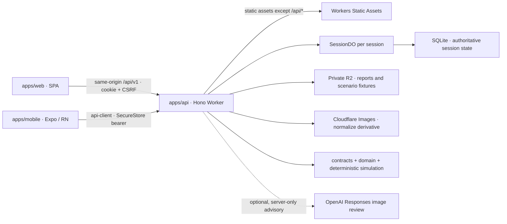

# System architecture

## Components and authority

- **Web:** `apps/web` is a React Router Data Mode SPA. Production static assets are served by the same Worker as `/api/*`; the API path runs worker-first and unknown API routes remain API responses rather than SPA HTML.
- **Native:** `apps/mobile` is one Expo Router / React Native app with capability-filtered role workspaces. It calls the same API through the portable API client; device builds are a separate M2 evidence gate.
- **API Worker:** `apps/api` composes Hono routers for scenario, source/media, review, planning, simulation, results and evaluation features. `apps/api/src/index.ts` loads the immutable functional scenario, builds feature runtimes and exports `SessionDO`.
- **Session authority:** one SQLite-backed `SessionDO` owns authoritative state for one session, including generation/revision, idempotency, events and feature data. Reducers commit through the session transaction boundary; UI caches and R2 are not authorities.
- **Private object storage:** `REPORT_MEDIA` stores session-owned media derivatives; `SCENARIO_ASSETS` supplies approved immutable scenario fixtures. R2 does not authorize access. `IMAGES` performs image normalization; raw staging is not served as a safe image.
- **Pure shared packages:** `packages/contracts` defines validated wire schemas/operations; `packages/api-client` handles typed HTTP, credential adapters, idempotent commands and event streaming; `packages/domain` and `packages/simulation` provide portable domain transitions and deterministic simulation/planning seams. UI tokens/components are shared without importing web UI into native.
- **AI boundary:** planning is the bounded deterministic runtime, not a runtime AI Commander. Optional OpenAI Responses image advice is server-only and disabled unless its Worker bindings are complete; it is advisory and cannot approve a report, award points, alter road state or Execute.



## Main workflow and data flow

1. A participant creates or joins a scenario session. Hono issues scoped capabilities; role selection in either client changes presentation only.
2. Clients use shared contracts/API client to read role-authorized projections and submit commands with the required idempotency, revision/ETag, and authentication headers.
3. A report upload reserves a session-owned media ID, sends bytes to the Worker, normalizes through Images, and writes a private derivative to R2. The report stores a server-issued media reference, not a public URL.
4. The Worker validates the request and asks the session runtime to commit a domain transition atomically. Manual review and any resulting knowledge/reward effects are distinct from optional image advice.
5. The deterministic planner derives a bounded proposal from the current committed session state. Approval is a separate decision; Execute rechecks current evidence, vehicle scope, hard safety rules and atomic dependency groups before committing.
6. Explicit simulation-clock advance processes expiry/events. Results use actual simulation branches/completion logs; SSE/event sequence and authorized reads update the clients. Reset creates a replacement session generation and invalidates old capabilities/state.

```mermaid
sequenceDiagram
  participant C as Web or native client
  participant W as Hono Worker
  participant D as SessionDO / SQLite
  participant O as Private R2 + Images
  C->>W: capability-authenticated command / upload
  W->>W: schema, scope, CSRF/Origin or bearer, CAS/idempotency checks
  W->>O: normalize and store private media derivative (upload path only)
  W->>D: deterministic domain transition
  D-->>W: committed snapshot/revision/event sequence
  W-->>C: typed result + ETag
  C->>W: request deterministic plan; later Approve, then separate Execute
  W->>D: current-state gate and atomic execution
  D-->>C: committed outcome and events
```

## Security boundaries

| Boundary | Enforcement and limit |
| --- | --- |
| Participant authority | Server-issued session capabilities are scoped by participant and session. Web uses HttpOnly/Secure cookies plus CSRF token and Origin checks; native stores bearer capability in SecureStore. Session ID, UI role choice and CORS are not authorization. |
| State mutation | Strict schemas, server-side identity/resource checks, idempotency keys and If-Match/ETag protect mutations. The session reducer/executor is authoritative; Approve does not Execute and stale plans/jobs are fenced. |
| Media | R2 is private; clients cannot choose R2 keys or fetch arbitrary URLs. Only validated/normalized derivatives are served after ownership checks; raw upload/staging is not a safe-media fallback. |
| Model and external data | Report text, captions, image metadata and model output are untrusted data. Image advice is a proposal only; typed schema, session binding and deterministic policy gates retain authority. Missing provider configuration produces unavailable behavior, not a fabricated result. |
| Prompt injection | Repository INJ rules separate actual trusted user/runtime instructions from files, tool output and teammate/model content. Runtime model tools are constrained; hard policy is enforced outside the model. Injection fixture checks do not establish jailbreak resistance. |
| Secrets | Provider keys and capability/signing material remain server-side; they do not belong in web/native bundles, URLs, logs or source control. |

## Deployment topology and current limit

`apps/api/wrangler.jsonc` configures one Cloudflare Worker with `apps/web/dist/live` as SPA assets, worker-first `/api/*`, a SQLite-backed `SessionDO`, private R2 bindings and an Images binding. The deployed demo is on [`floodops-api.vominhlongbentre.workers.dev`](https://floodops-api.vominhlongbentre.workers.dev); web and API share that origin. Expo is a client of the same API and is not hosted as an iOS/Android binary by Workers.

The account is on Workers Free (10 ms CPU per request). The [deployment record](../README.md) states that deterministic planning and evaluation exceed this production CPU limit; session/catalog/upload/report/review/knowledge paths are available there. This deployment is not evidence of full production readiness, M2 native release, D04 calibration, or real-model quality. Local Workerd evidence is recorded separately in the [implementation roadmap](development-roadmap.md) and linked reports.

## Source map

- [PRD v0.5](../FloodOps/prd.md) — milestones and product decisions.
- [Architecture specification](../plans/20261030-2249-floodops-web-mobile-implementation/specs/architecture.md) and [API security conventions](../plans/20261030-2249-floodops-web-mobile-implementation/specs/api-conventions-security.md).
- [Cloudflare deployment specification](../plans/20261030-2249-floodops-web-mobile-implementation/specs/cloudflare-deployment.md), [API Worker config](../apps/api/wrangler.jsonc), [web README](../apps/web/README.md), [native README](../apps/mobile/README.md).
