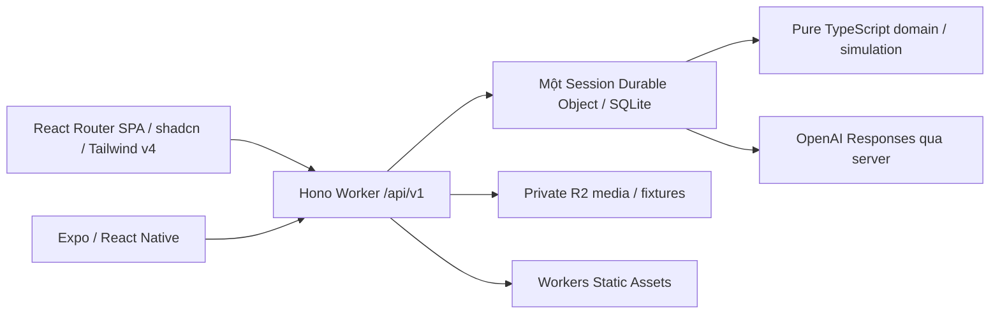

# Kiến trúc ứng dụng và ranh giới feature

## Chuẩn và phạm vi
- Nguồn: [PRD v0.3](../../../FloodOps/prd.md); thay thế mọi suy luận từ PRD v0.1/v0.2.
- User đã chọn React, React Router, Tailwind CSS v4, Hono, shadcn, isometric icons, Expo và Cloudflare Workers. Không có phân bổ thời gian.
- Toàn bộ US-01–US-34 được lập kế hoạch, gồm P1 đổi hub/defer và P2 reroute-only baseline; feature flags không phải lý do bỏ triển khai.
- Hai client của cùng sản phẩm: web app bàn dispatcher và một app native iOS/Android cho driver/contributor cùng đầy đủ dispatcher, theo [PRD mục 3.4](../../../FloodOps/prd.md). Driver xem own committed assignment/route/ETA và report, không có accept/reject cuốc hoặc turn-by-turn navigation. Không làm app khách nhận hàng, payout thật, SaaS multi-tenant, live data connectors hoặc background GPS.
- Tiếp tục là simulator. Chọn phương tiện/vai trò trong UI không phải quyền production và không cấp quyền API.

## Kiến trúc chốt cho plan

- Một Worker phục vụ Hono API và static web assets cùng origin; `/api/*` không fallback HTML. React Router **data mode SPA**, không ghép thêm SSR framework/server thứ hai.
- Durable Object (DO) là authority duy nhất mỗi phiên: snapshot, revision, approvals, idempotency, event log, reports/gaps/awards. Model gọi ngoài transaction; response áp dụng bằng compare-and-set.
- SQLite-backed DO và R2 là thiết kế session persistence đã ghi trong plan, thay cho prototype in-process/no-DB: web/mobile dùng cùng authority, reconnect và atomicity theo PRD §3.4/9.1. Không thêm D1, Redis, KV, microservices hoặc event bus.
- DO storage không biến demo thành logistics production. Dữ liệu phiên có expiry; Reset không giữ ledger cũ trong phiên mới.
- Native binaries phát hành EAS; Cloudflare chỉ host web/API/assets, không host executable iOS/Android.
- US-30 vision advisory chạy riêng trong feature reports/review: một ảnh normalized + context tối thiểu → typed rubric/match/reasons → server derive score/recommendation. Không cấp8 Commander tools hoặc commit permission cho vision call; [image review spec](ai-assisted-image-review.md) chốt durable metadata-only job và late-result guards.

## Workspace và luật import
- Toolchain dùng Bun 1.4.0, root `package.json.workspaces` và `bun.lock`; ngoại lệ Wrangler/Expo theo [Bun decision](../../../docs/architecture/bun-toolchain.md). Domain/simulation không import Bun API chỉ vì tooling dùng Bun.
```text
apps/
  web/src/{app,features,shared}
  mobile/{app,src/features,src/shared}
  api/src/{app,features,session-runtime,shared}
packages/
  contracts/src/{common,sessions,scenarios,operations,evidence,planning,simulation}
  domain/src/{operations,knowledge,reporting,rewards,planning}
  simulation/src/{graph,clock,movement,projection,metrics,calibration}
  api-client/src/{http,commands,events,features}
  design-tokens/src/{primitive,semantic,component}
  icons/{src/web,src/native,assets/isometric,asset-manifest.json}
  ui-web/src/{primitives,patterns,icons}
  ui-native/src/{primitives,patterns,icons}
  test-fixtures/src/{functional,adversarial,calibration}
```
- Feature folder: `api/`, `model/`, `components/` hoặc `screens/`, `tests/`, `index.ts` hẹp. Không tạo `services/` hoặc `utils/` toàn cục chứa nghiệp vụ lẫn lộn.
- Các feature: `session`, `scenario`, `operations-map`, `incidents`, `planning`, `reports`, `knowledge`, `sources`, `rewards`, `simulation`, `results`, `evidence-log`.
- UI → feature facade → api-client/contracts. API route → feature service → pure domain reducer + injected ports. Domain không import Hono, React, Cloudflare SDK hoặc OpenAI.
- `packages/contracts` chỉ wire validation/types, không runtime I/O; `domain` không đọc env/time/random. Inject clock/ID/random seed.
- Không import deep private path feature khác; dùng public entrypoint. Cấm app-to-app imports, circular feature imports, ui-web trong mobile, `window` trong shared packages.
- Nghiệp vụ dùng camelCase nội bộ nếu cần; serialize snake_case tại boundary bằng converter duy nhất. Không hai nguồn schema độc lập.
- Mỗi code file <200 dòng; tách theo trách nhiệm thật, không barrel re-export mọi thứ. Test file dài chỉ khi nhiều boundary behavior liên quan.

## Luồng authority
1. Hono parse/auth/rate-limit/validate → DO session + generation.
2. DO kiểm idempotency/If-Match → pure transition → atomic write snapshot+outbox+ledger.
3. Commit xong mới publish stream và trigger planning. Outbox replay được sau crash.
4. UI chỉ render committed snapshot; preview có model riêng và nhãn Projected.
5. Mọi quyết định safety nằm backend; mobile/web không sửa source confidence, points, tier hoặc revision.

## Tính sẵn sàng
- API snapshot dùng một consistent revision, không join nhiều nguồn eventually consistent.
- Session hỏng/mất mạng: đọc cache có nhãn stale; cấm mutation an toàn bằng stale state. No-route là waiting/ETA null, không fallback tuyến tưởng tượng.
- Chỉ những prerequisite D04 có dữ liệu mới được gắn calibrated; functional fixture vẫn dùng được với nhãn Calibration incomplete.

## Quyết định chưa phải fact
- Numeric quota, retention, ảnh và timeout trong plan là operational security limits, không physical/calibration constants.
- Exact dependency patch được freeze lúc implementation sau compatibility/supply-chain check; không tự nhận package “latest” đã xác minh.
- [Decision register](decisions-prerequisites.md) ghi lựa chọn kỹ thuật và prerequisite chưa kiểm chứng. PRD §3.4 nay làm rõ hai nền tảng và người dùng; không đổi US/API/safety rules hoặc dùng tài liệu thay runtime evidence.
