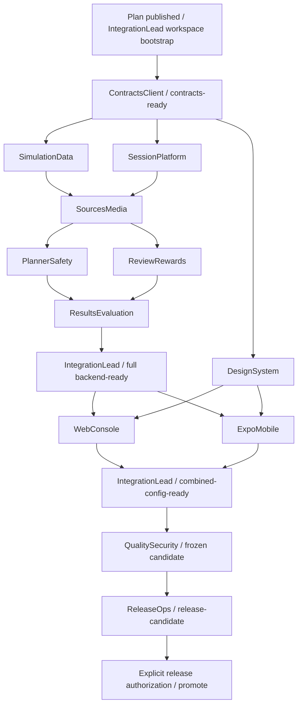

# Dependency waves và gates

Wave là thứ tự prerequisite, **không phải phân thời gian**. Chỉ mở worker khi dependencies đã **merge vào integration** và launch receipt có exact SHA. “Agent nói xong” hoặc branch tồn tại chưa đủ.

## Waves được phép
- **W0:** IntegrationLead publish plan, tạo integration worktree, seed central workspace manifests/toolchain/lock. Không generator creates empty fake features.
- **W1:** ContractsClient implement phase01; Lead merge và seal contracts-ready public interfaces.
- **W2:** DesignSystem, SimulationData và SessionPlatform làm3 worktrees độc lập. Lead merge theo prerequisites; design có thể xong sau backend nếu không block consumer UI.
- **W3:** SourcesMedia sau simulation-ready + platform-ready. Không đọc dependency branch chưa merge như authoritative base.
- **W4:** PlannerSafety và ReviewRewards song song trên sources-ready; subtree review partition giữ không overlap.
- **W5:** ResultsEvaluation sau planner/review ready. Lead compose actual API index + API-local config và smoke Hono→DO **trước** Web/Mobile.
- **W6:** WebConsole và ExpoMobile song song khi backend-ready+ui-libraries-ready. Mỗi role dùng API state/client đúng contract, không mock implementation để gọi complete.
- **W7:** Lead merge cả2 client, commit static/env combined config rồi QualitySecurity chạy combined gates trên **frozen exact candidate**.
- **W8:** ReleaseOps soạn/kiểm workflow/runbooks và final preview/rollback. Preview/development actions cần scoped **preview-authorized** (không cần đã pass QA); production/store/main-promotion mới cần **release-authorized** sau required evidence.

## Readiness vs hoàn tất sản phẩm
- Integration gate như simulation-ready có thể chứng minh pure runner/functional fixtures usable trong khi D04 data release prerequisite còn blocked; ghi đúng qualification, không đánh dấu calibration complete.
- ui-libraries-ready cần public primitives/token contract và scoped checks, native full-device acceptance bổ sung ở QA.
- Phase complete/product DoD vẫn theo plan/PRD; source owner có code-ready delivery không tự xóa missing external data/model/device gates.
- QA có thể đọc/review test design trước W7 nhưng không gửi final “all pass” trên candidate chưa có cả2 client.
- Merge/fix/contract change sau qa-ready làm affected evidence stale; freeze lại và rerun affected/full release gate trước promote.
- Gate preview-authorized là explicit permission độc lập evidence: Lead có thể cấp sau bootstrap/before QA cho own isolated preview/model/native dev-build scope khi code cần đã ready. Lead vận hành preview sớm; không đợi ReleaseOps để có môi trường tạo QA evidence. Không cấp production permissions hay claim D04 từ quyền preview.

## Merge rule
- IntegrationLead là merger duy nhất; cùng lúc chỉ1 merge/central-file change trong integration worktree.
- Design/simulation/platform deliveries không có shared write overlap có thể merge lần lượt theo bất kỳ thứ tự thỏa gates.
- Source/planner/review/results/UI branches luôn từ **new integration launch SHA**; không squash hoặc rewrite worker history khi đang dùng ancestor receipts.
- Không rebase/force-push branch agent khác. Existing in-flight work cần baseline mới: stop, checkpoint bàn giao, Lead quyết định cập nhật; không git reset/clean tự động.
